# Chapter 45 — Subscriptions and Onboarding

This chapter describes how a new clinic joins the Platform and how its right to keep using the Platform is tracked. It covers self-signup, email verification, the one-time setup wizard, the 14-day trial, plan limits, the read-only mode that starts after a subscription runs out, and the super admin screens that record manual payments. It is written for the product owner, who needs to know what a clinic sees, what the backend enforces and where the gaps are.

## 45.1 What this module is for

A **subscription** is the clinic's permission to use the Platform for a period of time under a plan. Plans are defined in code, not in a table. Nothing charges the clinic automatically: the clinic pays by bank transfer, JazzCash or similar, and a **super admin** records the payment by hand, which extends the period.

**Onboarding** is the path from "I found the Platform" to "my clinic is set up". A visitor creates an account and a clinic in one step, starts a 14-day trial on the Professional plan, and then completes a three-step setup wizard.

Who uses it:

- **Visitor, then owner**: registers, verifies the email address, completes the wizard and watches the trial.
- **Owner**: opens "Plan & billing" to see the plan, usage and payment history. Only the owner (or a super admin) can use the setup and plan screens. Other staff see only the warning banners.
- **Super admin**: lists every clinic's subscription, changes plan, dates and limits, records payments and edits the payment instructions text.

Where it appears: the super admin sidebar item **Subscriptions** (key `nav.subscriptions`, route `/subscriptions`, super admin only). Owners reach **Plan & billing** from Settings (route `/settings/subscription`), where the link is shown to owners only. `/register`, `/verify-email` and `/setup` have no sidebar entry.

Permissions and feature keys: none. These endpoints are `@AnyMember()` with an owner check in code, `@Public()`, or `@RequireSuperAdmin()`. There is no feature key.

## 45.2 Screens

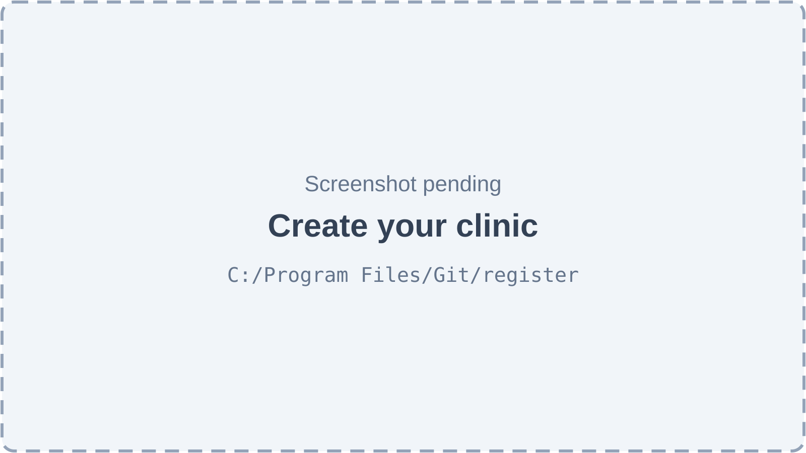

*Figure 45.1 — Create your clinic (screenshot pending).*

The registration page (`/register`) is headed "Create your clinic" with the line "Start your 14-day free trial. No card needed." Its fields are the clinic name (placeholder "City Care Clinic"), the owner's full name, an email address, a phone number and a password with a show or hide toggle. Messages say "Enter your clinic name", "Please enter a valid email", "Password must be at least 6 characters" and "At most 20 characters" for the phone. On success a toast says "Your clinic is ready" and "Your 14-day free trial has started.", and the app moves to the setup wizard. A failure shows "Registration failed. Please try again."

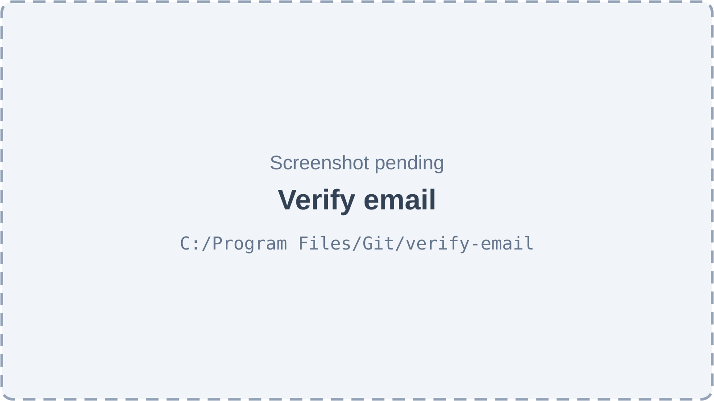

*Figure 45.2 — Verify email (screenshot pending).*

The page `/verify-email?token=…` is the landing page of the link in the verification email. It confirms the address and offers "Continue to the app" or "Go to sign in". If the link has no token it says "This link is missing its token." If the token is wrong or expired it says "This verification link is invalid or has expired." and "Use "Resend link" in the app to get a new one."

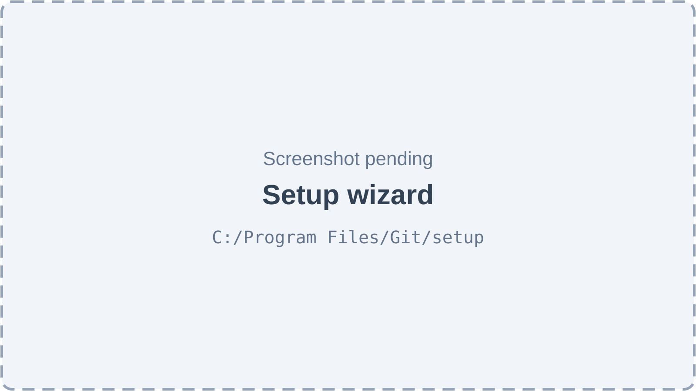

*Figure 45.3 — Setup wizard (screenshot pending).*

The wizard (`/setup`) shows three steps in a progress strip: **Clinic**, **Location & tax** and **Your team**. The Clinic step asks for the clinic name, "What kind of clinic is it?" (pick every type that applies, because it decides which tools the user sees), phone, clinic email, timezone (a list including Asia/Karachi, Asia/Dubai, Asia/Riyadh, Asia/Qatar, Asia/Kolkata, Asia/Dhaka, Europe/London and America/New_York) and currency. The Location & tax step asks for the location name ("Your first branch. You can add more under Locations later."), address, city, phone, email and "Sales tax on invoices (%)" with the hint "Added on top of each patient invoice. Leave 0 for no tax." The Your team step explains that doctors and front-desk staff can be added later, each with a role, and links to Employees, User Admin and Patients → Import. Its final button finishes setup, and a toast says "Your clinic is ready". Once setup is done, the page shows a **Back to the app** button.

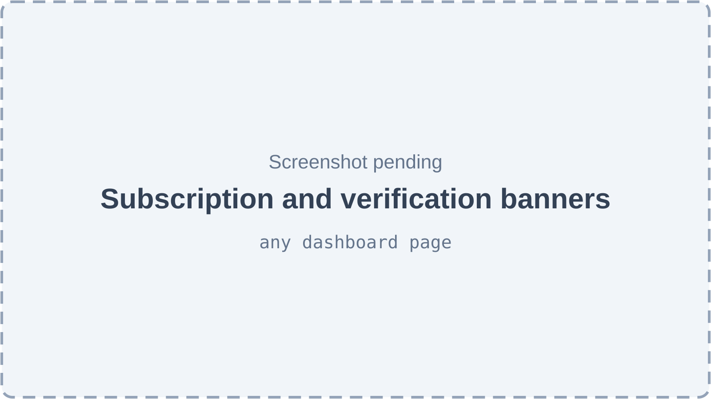

*Figure 45.4 — Subscription and verification banners (screenshot pending).*

A banner appears at the top of every dashboard page when something needs attention. For an unverified email: "Please verify your email — we sent a link to …" with a **Resend link** button. For a trial, owners see "Free trial — N days left." with a **See plans** link. For an active plan close to its end, owners see "Your plan renews in N days — send the payment to keep the clinic running without interruption." During the grace period everyone sees a warning that the clinic turns read-only in N days. After expiry: "Subscription expired. The clinic is read-only — renew your plan to make changes again." (owners) or "The clinic is read-only until the owner renews the plan." (others). An owner whose setup is pending is redirected to `/setup` from any other page.

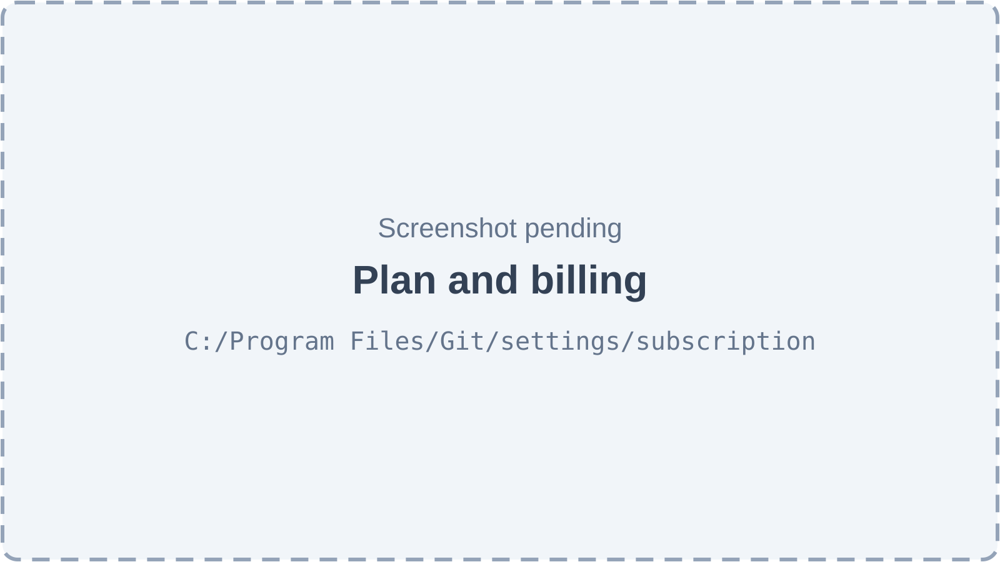

*Figure 45.5 — Plan and billing (screenshot pending).*

"Plan & billing" has the subtitle "Your subscription, usage and payments." It shows the current plan and status with "Trial ends", "Paid until" or "Ended on", usage bars for Locations and Logins against the limits, a "Plans" section with Free, Starter, Professional and Enterprise (price as "PKR n / month" or "Custom pricing", "Unlimited" limits), a "How to pay" box with the instructions text, and a "Payment history" table (Paid on, Plan, Period, Method, Amount) with the empty state "No payments yet". Non-owners see "Only the clinic owner can see this".

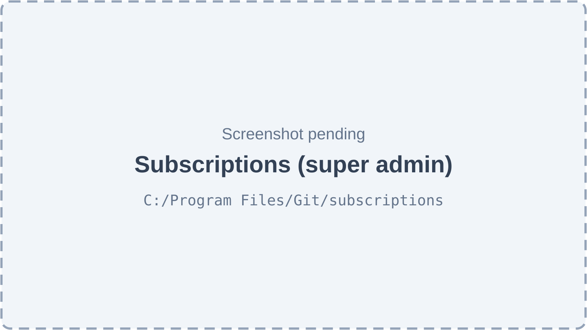

*Figure 45.6 — Subscriptions (super admin) (screenshot pending).*

The super admin page has the subtitle "Every clinic's plan and status. Record payments clinics send you." A "Payment instructions" card holds a text field (at most 2000 characters, shown to every owner) with "Unsaved changes" tracking. Below it, a table lists clinics with columns Clinic, Plan, Status, Period ends and Days left, a search box ("Search clinics…"), a status filter ("All statuses") and a row action with the tooltip "Manage subscription". The empty state is "No clinics yet".

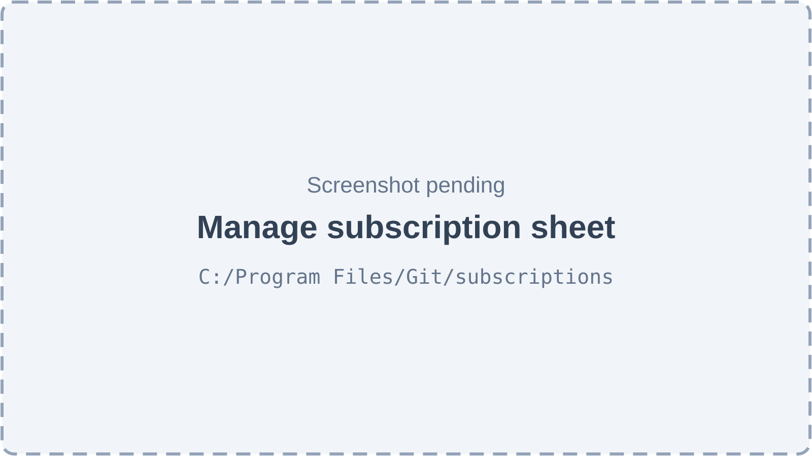

*Figure 45.7 — Manage subscription sheet (screenshot pending).*

The sheet has three tabs. **Record payment**: Plan, "Months paid", "Amount received (PKR)", Method, "Paid on", "Reference / transaction ID" and Notes. **Plan & limits**: Plan, "Trial ends" ("Extend a trial by moving this date."), "Paid until" ("Normally set by recording a payment."), "Location limit" and "Login limit". **History**: the clinic's payments, or "No payments recorded yet". Both forms warn about unsaved changes.

## 45.3 Features

### 45.3.1 Sign up and create a clinic

**Status:** [Implemented]

**What it does.** Creates the owner's login, the clinic (organization), its first location and the ownership link in one step, starts a 14-day trial and signs the owner in.

**How the user does it.**
1. Open `/register`.
2. Fill in clinic name, full name, email, phone (optional) and password.
3. Submit. The app signs the owner in and opens the setup wizard.

**Behind the scenes — in simple terms.** The clinic is ready to use at once. It starts on the Professional plan for 14 days, with PKR and the Asia/Karachi timezone as starting values, and is marked "onboarding pending" until the wizard is finished. If clinic creation fails, the new login is removed so no orphan account is left behind.

**Behind the scenes — technically.** `POST /auth/register` (`@Public`, rate limit 5 per hour) runs `AuthService.register`: `UserService.createLocalUser`, then `ClinicSetupService.createClinicForOwner` in one transaction. The transaction creates the organization (slug from the clinic name, with a random suffix on collision; plan `TRIAL_PLAN` = professional; `trial_ends_at` = now + `TRIAL_DAYS` (14); `onboarding_pending` = true), a location with code `MAIN` and `is_main_branch`, its settings row and the primary ownership row. After the commit, `FeatureFlagsService.seedFlagsForOrg` and `AccessTemplatesService.seedForOrg` seed feature switches and the five system roles; a failure there is only logged. A verification email is then sent and the user is signed in through `login()` with a 30-day session.

**Rules and validations.** Email must be valid; name and clinic name are required (at most 255); password at least 6 characters; phone at most 20.

**Who can do it.** Anyone, no account needed (a public route, also listed in `PUBLIC_ROUTES`).

**Data read and written.** Writes `users`, `organizations`, `locations`, `location_settings`, `organization_ownership`, and, after commit, feature-flag and role tables.

**Effects on other modules.** The new clinic gets the default features and roles (Chapters 10 and 11).

**Error cases.** A duplicate email is rejected by user creation; more than 5 attempts per hour is rate limited; any clinic-creation error returns the error and deletes the new user.

**Technical references:** `backend/src/auth/auth.service.ts` · `AuthService.register` · `backend/src/subscriptions/clinic-setup.service.ts` · `ClinicSetupService.createClinicForOwner` · `web-app/src/routes/register.tsx`, `web-app/src/features/auth/components/RegisterForm.tsx`

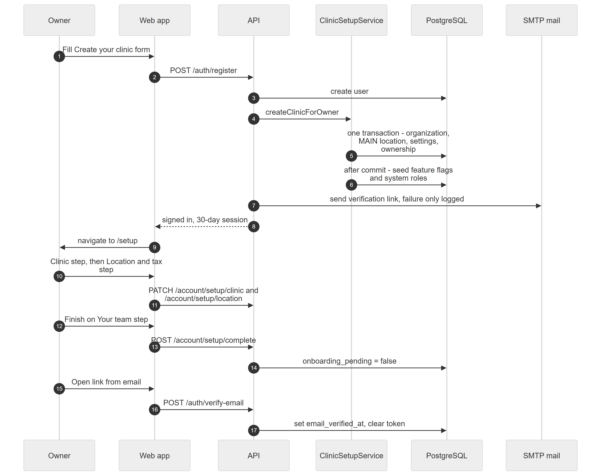

*Figure 45.8 — From sign-up to a verified, set-up clinic.*

The diagram has six participants: Owner, Web app, API, ClinicSetupService, PostgreSQL and SMTP mail. The Owner fills the "Create your clinic" form and the Web app posts to the API. The API creates the user, then asks ClinicSetupService to create the clinic, which writes the organization, the MAIN location, its settings and the ownership in one transaction and, after the commit, seeds feature flags and system roles. The API sends the verification link by email (a failure is only logged) and returns a signed-in 30-day session. The Web app moves the Owner to `/setup`. The Owner completes the Clinic step and the Location and tax step, which the Web app saves with two PATCH calls, then finishes on the Your team step, which posts to `/account/setup/complete` and clears the pending flag. Separately, the Owner opens the link from the email; the Web app posts the token to the API, which stores the verification time and clears the token.

### 45.3.2 Verify the email address and resend the link

**Status:** [Partial]

**What it does.** Sends a link to the new owner's email and confirms the address when the link is opened. Verification is informational: nothing is blocked while the email is unverified.

**How the user does it.**
1. After signing up, read the banner "Please verify your email".
2. Open the link in the email, which lands on `/verify-email`.
3. If the link is lost or expired, click **Resend link** in the banner.

**Behind the scenes — in simple terms.** The email contains a one-time random token. The server stores only a fingerprint of it, valid for 48 hours. A new link replaces the old one. The banner shows while a token is still waiting.

**Behind the scenes — technically.** `sendVerificationEmail` creates 32 random bytes, stores the SHA-256 hash in `users.email_verification_token` with `email_verification_expires` = now + 48 h, and calls `MailService.sendEmailVerification`, which builds `<frontend URL>/verify-email?token=…` and sends through SMTP (environment variables `SMTP_USER`, `SMTP_PASS` and `FRONTEND_URL`). `POST /auth/verify-email` (`@Public`, 10 per 15 minutes) hashes the token, finds an unexpired match, sets `email_verified_at` and clears the token. `POST /auth/resend-verification` (signed in, `@ContextFree`, 3 per hour) sends a fresh link, or answers "Email already verified" when no token is pending. The user DTO exposes `emailVerificationPending` (token present), which drives the banner.

**Rules and validations.** Token valid for 48 hours; single use. Partial because no feature or screen is gated by `email_verified_at`, and a failed email send is only logged, so the user sees success.

**Who can do it.** Anyone with the link (verify); any signed-in user (resend).

**Data read and written.** `users` (`email_verification_token`, `email_verification_expires`, `email_verified_at`).

**Effects on other modules.** None; sign-in does not require verification.

**Error cases.** "This verification link is invalid or has expired" (validation error) when the token is unknown or expired; 429 when rate limited; toast "Could not send the email. Try again." when resend fails.

**Technical references:** `backend/src/auth/auth.service.ts` · `verifyEmail`, `resendVerification` · `backend/src/common/services/mail.service.ts` · `MailService` · `web-app/src/routes/verify-email.tsx`, `web-app/src/features/account/pages/VerifyEmailPage.tsx`, `components/AccountBanner.tsx`

### 45.3.3 Complete the setup wizard

**Status:** [Implemented]

**What it does.** Collects the clinic's real details in three steps and then clears the "onboarding pending" flag.

**How the user does it.**
1. After signing up, the app opens `/setup`. Until it is finished, an owner who opens any other page is sent back to `/setup`.
2. Step **Clinic**: name, clinic types, phone, email, timezone, currency. Save and continue.
3. Step **Location & tax**: location name, address, city, phone, email and the sales tax percentage. Save and continue.
4. Step **Your team**: read the hints, then finish. The app refreshes the session and opens the home page.

**Behind the scenes — in simple terms.** The first two steps save immediately. The finish button only flips the flag; it does not check the earlier steps were saved. Saving the clinic step copies the timezone and currency to every location of the clinic, because a new clinic's branches follow the clinic.

**Behind the scenes — technically.** `GET /account/setup` returns the main location (first active by `is_main_branch DESC, created_at ASC`). `PATCH /account/setup/clinic` (`SetupClinicDto`: name, phone, email, website, `specialtyTags` from `CLINIC_SPECIALTIES`, timezone, currency upper-cased) runs `saveClinic` in a transaction, updating the organization and every location. `PATCH /account/setup/location` runs `saveLocation` in a transaction, updating the main location and its settings, with `taxRate` 0–100. `POST /account/setup/complete` sets `onboarding_pending` to false. All four are `@AnyMember()` and call `assertOwner`. Setup writes are on the always-writable path list, so an expired clinic can still finish setup.

**Rules and validations.**
- Owner or super admin only.
- Email must be valid; tax 0–100; clinic types must come from the fixed list; timezone is free text and is not checked against the IANA list.
- Currency is upper-cased.

**Who can do it.** The owner or a super admin; no permission key, no feature key.

**Data read and written.** Reads and writes `organizations`, `locations`, `location_settings`; reads `organization_ownership`.

**Effects on other modules.** Timezone and currency drive clinic times and money display everywhere (Chapter 62). Tax rate is added to patient invoices (Chapter 34). Clinic types decide which tools show.

**Error cases.** 403 "Only the clinic owner can do this"; validation errors per field; toast "Could not save. Try again."

**Technical references:** `backend/src/subscriptions/account.controller.ts` · `AccountController` · `clinic-setup.service.ts` · `ClinicSetupService.saveClinic`, `saveLocation`, `complete` · `web-app/src/routes/setup.tsx`, `web-app/src/features/account/pages/SetupWizardPage.tsx`, `hooks/useSetupForms.ts`

### 45.3.4 Trial, plans and plan limits

**Status:** [Implemented]

**What it does.** Gives each managed clinic a plan with limits on locations and logins, and refuses to exceed them.

**How the user does it.** The owner opens **Settings → Plan & billing** to see the plan, the usage bars and the plan catalog. Reaching a limit shows the error when adding a location or a login.

**Behind the scenes — in simple terms.** Four plans exist. A clinic with no trial date and no paid date is called unmanaged: it has no limits and never expires (older clinics and clinics created by a super admin). A limit set on the clinic itself wins over the plan's limit.

| Plan | Price per month (PKR) | Locations | Logins |
|---|---|---|---|
| Free | 0 | 1 | 2 |
| Starter | 4 999 | 1 | 5 |
| Professional | 9 999 | 3 | 15 |
| Enterprise | custom | unlimited | unlimited |

The table lists the plan catalog from code. Prices are only what the clinic sees; nothing bills them. A "login" is an owner plus any employee with portal access.

**Behind the scenes — technically.** `PLANS` in `plans.ts`. `effectiveLimits(org)` returns `org.maxLocations ?? plan.maxLocations` and likewise for users, and none for unmanaged clinics. `assertCanAddLocation` and `assertCanAddUser` compare against `usage()` (active locations; owners plus active staff with a `user_id`) and throw `PlanLimitException` (code `PLAN_LIMIT`). `GET /account` returns the summary, usage and, for owners, the plans, payment instructions and payments. Location creation calls the check for non-super-admins; login creation calls it from the user service.

**Rules and validations.** Limits are skipped for super admins and unmanaged clinics.

**Who can do it.** Any member reads the summary; owners also get plans and payments. Writes happen when locations or logins are added.

**Data read and written.** Reads `organizations`, `locations`, `employee_org_location_assignments`, `organization_ownership`, `subscription_payments`, `config_values`.

**Effects on other modules.** Locations (Chapter 9) and Employees (Chapter 37) are blocked at the limit.

**Error cases.** `PLAN_LIMIT` (HTTP 403): "Your Professional plan allows 3 locations. Upgrade your plan to add more." or "… allows 15 logins. …".

**Technical references:** `backend/src/subscriptions/plans.ts` · `PLANS`, `TRIAL_PLAN`, `TRIAL_DAYS` · `subscription-state.ts` · `effectiveLimits` · `subscriptions.service.ts` · `SubscriptionsService.usage`, `assertCanAddLocation`, `assertCanAddUser` · `web-app/src/routes/settings_.subscription.tsx`, `web-app/src/features/account/pages/SubscriptionPage.tsx`

### 45.3.5 Read-only mode after expiry

**Status:** [Implemented]

**What it does.** When a clinic's period and its grace days have passed, every write is refused until a payment is recorded. Reading still works, so the clinic keeps its data.

**How the user does it.** Staff see the red banner and a rejected save. The owner pays and the super admin records it (45.3.7).

**Behind the scenes — in simple terms.** The period end is the later of the trial end and the paid-until date. After that there are 3 grace days with a warning, then the clinic becomes read-only. The decision is cached for 30 seconds per server process, so a renewal can take up to 30 seconds to be seen.

**Behind the scenes — technically.** `SubscriptionGuard` is the last global guard. It lets GET, HEAD and OPTIONS pass; skips `@Public` routes and super admins; lets paths starting with `/auth/`, `/account`, `/me/` and `/admin/subscriptions` through; resolves the organization from the access context or the `x-organization-id` header; and calls `SubscriptionsService.isReadOnly`, a 30 s cache over `subscriptionState()`. When read-only it throws HTTP 402 with code `SUBSCRIPTION_EXPIRED`. Requests with no organization pass.

**Rules and validations.** `GRACE_DAYS` = 3. Unmanaged clinics are never read-only.

**Who can do it.** Applies to every user except super admins.

**Data read and written.** Reads `organizations` (`trial_ends_at`, `paid_until`).

**Effects on other modules.** Every module's write endpoints are blocked, including the queue and billing. Realtime reads are unaffected.

**Error cases.** HTTP 402 `SUBSCRIPTION_EXPIRED`: "Your subscription has expired — the clinic is read-only until it is renewed."

**Technical references:** `backend/src/subscriptions/subscription.guard.ts` · `SubscriptionGuard` · `subscriptions.service.ts` · `isReadOnly` · `web-app/src/features/account/components/AccountBanner.tsx`

### 45.3.6 See subscription status and warnings

**Status:** [Implemented]

**What it does.** Shows owners and staff where the subscription stands and warns before it runs out.

**How the user does it.** The banner appears automatically. Owners open Plan & billing for detail.

**Behind the scenes — in simple terms.** The status is never stored. It is worked out every time from the two dates and the current time.

**Behind the scenes — technically.** `subscriptionState(org, now)` returns `status`, `periodEndsAt`, `readOnlyFrom`, `daysLeft` and `readOnly`. Rules: no dates means `unmanaged`; `paid_until` in the future means `active`; else `trial_ends_at` in the future means `trialing`; else before period end plus 3 days means `grace`; else `expired`. `AccountBanner` reads `GET /account` and shows the matching message; owners see trial and renewal messages, everyone sees grace and expiry.

**Rules and validations.** The status rules are the ones in the technical paragraph.

**Who can do it.** Any signed-in member sees the banner for their clinic.

**Data read and written.** Reads `organizations`.

**Effects on other modules.** None.

**Error cases.** The banner is simply absent if the account request fails.

**Technical references:** `backend/src/subscriptions/subscription-state.ts` · `subscriptionState` · `web-app/src/features/account/components/AccountBanner.tsx`, `hooks/useAccount.ts`

### 45.3.7 Record a manual payment (super admin)

**Status:** [Implemented]

**What it does.** Records a payment the clinic made outside the Platform and extends the paid period.

**How the user does it.**
1. As a super admin, open **Subscriptions** in the sidebar.
2. Click **Manage subscription** on the clinic's row.
3. On the **Record payment** tab, pick the plan, months paid, amount, method, date, reference and notes.
4. Save. A toast says "Payment recorded — the plan is extended".

**Behind the scenes — in simple terms.** The new period starts where the current trial or paid period ends, so paying early loses no days. Recording a payment also sets the clinic's plan to the plan paid for, so paying for Starter during a Professional trial lowers the limits at once.

**Behind the scenes — technically.** `POST /admin/subscriptions/:orgId/payments` (`RecordSubscriptionPaymentDto`) runs `SubscriptionsService.recordPayment` in a transaction: locks the organization row, computes `nextPaidPeriod(org, months, now)`, inserts a `subscription_payments` row with `period_start` and `period_end`, sets `paid_until` to the period end and `subscription_plan` to the payment's plan, writes audit entries and clears the read-only cache.

**Rules and validations.** Plan in the enum; months 1–36; amount at least 0 with 2 decimals; method one of bank_transfer, jazzcash, easypaisa, cash, cheque, other; reference at most 120; notes at most 1 000; date optional.

**Who can do it.** Super admin only (`@RequireSuperAdmin()` on the controller). No feature key.

**Data read and written.** Writes `subscription_payments`, `organizations`, `audit_logs`.

**Effects on other modules.** Lifts read-only mode; changes the plan limits.

**Error cases.** 404 "Organization not found"; 400 validation errors; 403 for non-super-admins.

**Technical references:** `backend/src/subscriptions/admin-subscriptions.controller.ts` · `AdminSubscriptionsController.recordPayment` · `subscriptions.service.ts` · `recordPayment` · `entities/subscription-payment.entity.ts` · `web-app/src/routes/subscriptions.tsx`, `web-app/src/features/account/components/ManageSubscriptionSheet.tsx`

### 45.3.8 Change a clinic's plan, dates or limits (super admin)

**Status:** [Implemented]

**What it does.** Lets a super admin set the plan, trial end, paid-until date and per-clinic location and login limits directly.

**How the user does it.**
1. Open **Subscriptions**, click **Manage subscription** on a row, choose the **Plan & limits** tab.
2. Change fields and save. A toast says "Subscription updated".

**Behind the scenes — in simple terms.** Moving the trial date extends a trial. Clearing both dates makes the clinic unmanaged (no limits, no expiry).

**Behind the scenes — technically.** `PATCH /admin/subscriptions/:orgId` (`UpdateSubscriptionDto`) runs `update` under a `pessimistic_write` lock, records an audit entry with before and after values (`organization_subscription`) and clears the cache. `GET /admin/subscriptions` lists clinics (including inactive ones) with derived state, and `GET /admin/subscriptions/:orgId` returns one clinic with its payments.

**Rules and validations.** Dates are ISO strings or null; limits are integers of at least 1 or null.

**Who can do it.** Super admin only.

**Data read and written.** `organizations`, `audit_logs`; reads `subscription_payments`.

**Effects on other modules.** Same as 45.3.4 and 45.3.5.

**Error cases.** 404 for an unknown clinic; 400 on invalid values.

**Technical references:** `AdminSubscriptionsController.list`, `get`, `update` · `SubscriptionsService.update` · `web-app/src/features/account/pages/AdminSubscriptionsPage.tsx`, `hooks/useAdminSubscriptionForms.ts`

### 45.3.9 Edit the payment instructions (super admin)

**Status:** [Implemented]

**What it does.** Sets the text every clinic owner sees under "How to pay".

**How the user does it.** On the Subscriptions page, edit the "Payment instructions" card and save ("Payment instructions saved").

**Behind the scenes — in simple terms.** One text for the whole Platform, with a built-in default asking the clinic to pay by bank transfer or JazzCash and share the receipt with support.

**Behind the scenes — technically.** `GET` and `PUT /admin/subscriptions/payment-instructions` (`PaymentInstructionsDto`, at most 2 000 characters) through the settings registry key `subscription.payment_instructions` at platform scope. The route is declared before `:orgId`.

**Rules and validations.** At most 2 000 characters; platform scope only; not lockable.

**Who can do it.** Super admin only.

**Data read and written.** `config_values`.

**Effects on other modules.** None.

**Error cases.** Toast "Could not save. Try again."

**Technical references:** `backend/src/subscriptions/subscription.settings.ts` · `SUBSCRIPTION_SETTINGS` · `SubscriptionsService.setPaymentInstructions`

### 45.3.10 Create a clinic from the Organizations screen (older path)

**Status:** [Partial]

**What it does.** A super admin can create or edit an organization on the Organizations screen. The result is an unmanaged clinic with no owner, no location and no trial. The plan selector on that screen is broken: it sends uppercase values the API rejects.

**How the user does it.** Super admin, Organizations screen, create or edit dialog.

**Behind the scenes — technically.** The form offers FREE, BASIC, PREMIUM and ENTERPRISE and sends them as the `subscriptionPlan`. The DTO validates against the `SubscriptionPlan` enum, whose values are lowercase `free`, `starter`, `professional` and `enterprise`. So every uppercase value fails validation, and BASIC and PREMIUM are not plans at all. This was verified by reading both files; the app was not run. The plan is optional in the DTO, so a request that omits it would pass. Plan changes made here are not audited, unlike changes through the Subscriptions screen.

**Rules and validations.** `@IsEnum(SubscriptionPlan)` on create and update.

**Who can do it.** Super admin.

**Data read and written.** `organizations`.

**Effects on other modules.** None.

**Error cases.** HTTP 400 with a message that `subscriptionPlan` must be one of the enum values.

**Technical references:** `backend/src/organizations/dto/organization.dto.ts` · `subscriptionPlan` · `web-app/src/features/organizations/OrganizationManagementView.tsx` · `backend/docs/modules/01-organizations-locations.md`

## 45.4 Entities and data model

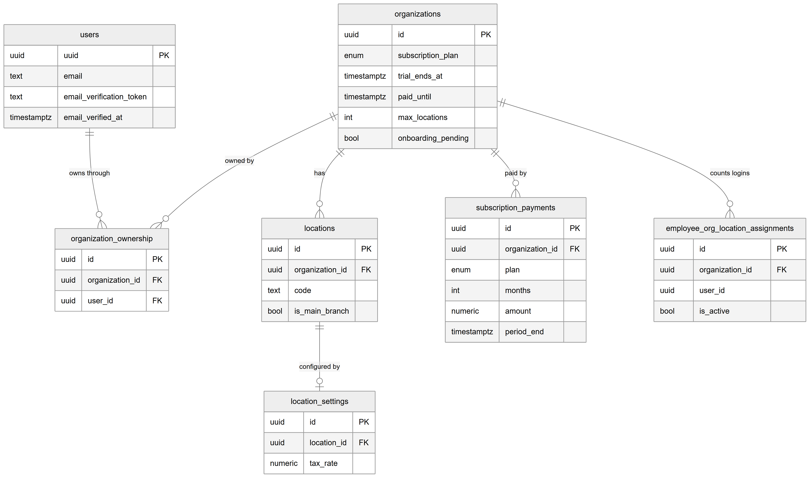

*Figure 45.9 — The tables behind subscriptions and sign-up.*

The diagram shows seven tables. `users` carries the email verification columns (`email_verification_token`, `email_verified_at`). `organizations` carries the subscription columns: `subscription_plan`, `trial_ends_at`, `paid_until`, `max_locations` (and a login limit) and `onboarding_pending`. `organization_ownership` links a user to an organization. `locations` has a code and an `is_main_branch` flag. `location_settings` holds the tax rate. `subscription_payments` records each manual payment. `employee_org_location_assignments` is read to count logins.

The relationships in words:

- Each ownership row links one user to one organization; deleting either deletes the row (ON DELETE CASCADE). A clinic created through signup has one primary owner.
- Each location belongs to one organization (CASCADE). Signup creates the first one with code `MAIN`.
- Each location has at most one settings row.
- Each payment belongs to one organization; deleting the organization deletes its payments (CASCADE). The organization has many payments over time.
- Login usage is counted from owners plus active assignments that have a user; this is a read, not a link.

Key `subscription_payments` columns: `plan`, `months`, `amount` (numeric, 2 decimals), `method`, `reference`, `paid_at`, `period_start`, `period_end`, `notes` and `recorded_by`. Plan definitions are not stored; they live in `plans.ts`. The subscription status is not stored either.

## 45.5 Status lifecycles

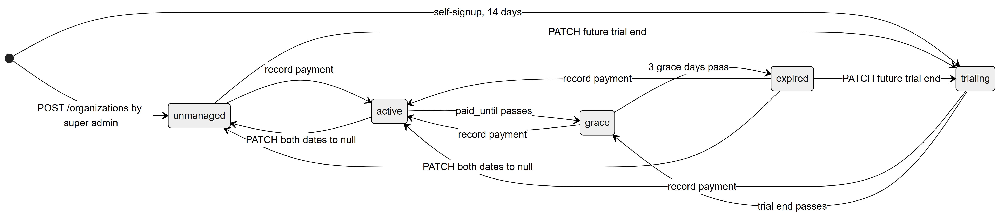

*Figure 45.10 — Derived subscription status.*

A clinic is **unmanaged** when created by a super admin (no dates), and **trialing** when created by signup. **Trialing** becomes **active** when a payment is recorded, or **grace** when the trial end passes. **Active** becomes **grace** when `paid_until` passes. **Grace** lasts 3 days and then becomes **expired**; a recorded payment returns it to active. **Expired** is read-only, and a recorded payment returns it to active. A super admin can move an unmanaged clinic to active (payment) or trialing (set a future trial end), and can send an active or expired clinic back to unmanaged by clearing both dates. A future trial end also moves an expired clinic back to trialing. Status is computed on read, so these changes happen as time passes, not through a job.

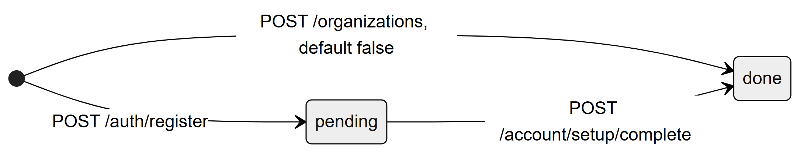

*Figure 45.11 — The `onboarding_pending` flag.*

A signup creates the organization as pending. `POST /account/setup/complete` sets it to done. An organization created by a super admin starts as done. There is no way back to pending.

## 45.6 Connections to other modules

- **Authentication (Chapter 56)** owns register, verify and resend, and the 30-day session after signup.
- **Organizations and locations (Chapter 9)** and **Features (Chapter 10)**: signup seeds feature switches and the five system roles (Chapter 11). Plan limits block adding locations and logins.
- **Employees (Chapter 37)**: adding a login counts against the login limit.
- **Billing (Chapter 34)**: the tax rate saved in the wizard applies to patient invoices.
- **Request lifecycle (Chapter 5)** lists the five global guards; the subscription guard is the last.
- **Audit logging (Chapter 60)**: plan changes and payments are audited.
- **Time, money and numbering (Chapter 62)**: timezone and currency from the wizard.

## 45.7 Limitations and known gaps

- Nothing charges clinics. Payments are recorded by hand, and there is no reminder email for renewals.
- Email verification is not required for anything; a failed send is only logged.
- A free-text timezone is accepted in the wizard without checking it against the IANA list.
- The wizard's finish button does not check the earlier steps were saved.
- Saving the clinic step overwrites timezone and currency on every location.
- Recording a payment overwrites the plan, which can lower the limits.
- The location limit is skipped when a super admin acts; unmanaged clinics have no limits.
- Read-only state is cached for 30 seconds per server process.
- The Organizations screen sends plan values the API rejects (45.3.10), and changes through it are not audited.

## 45.8 Owner's FAQ

**What does a new clinic get?** A 14-day trial on Professional (3 locations, 15 logins), one location called `MAIN`, default features and the five system roles.

**What happens when the trial ends?** The clinic has 3 grace days with a warning banner, then becomes read-only. Reads work, all saves are refused with `SUBSCRIPTION_EXPIRED`.

**How does a clinic pay?** Outside the Platform, by the method in the instructions text. A super admin then records the payment, which extends the period and lifts read-only mode.

**Can an expired clinic still finish setup?** Yes. Sign-in, `/account` (including setup), `/me/` and `/admin/subscriptions` paths stay writable.

**Can a clinic add a fourth branch on Professional?** No. It gets `PLAN_LIMIT` unless a super admin raises its location limit.

**Do users have to verify their email?** No. The banner nags, but nothing is blocked.

**Where is the status stored?** Nowhere. It is derived from `trial_ends_at` and `paid_until`.

**Can a super admin give a clinic unlimited access?** Yes, by clearing both dates (unmanaged) or by setting Enterprise limits.

**What if the verification email never arrives?** The owner clicks Resend link (3 per hour). If SMTP is not configured, sending fails silently on the server and only a log line records it.
