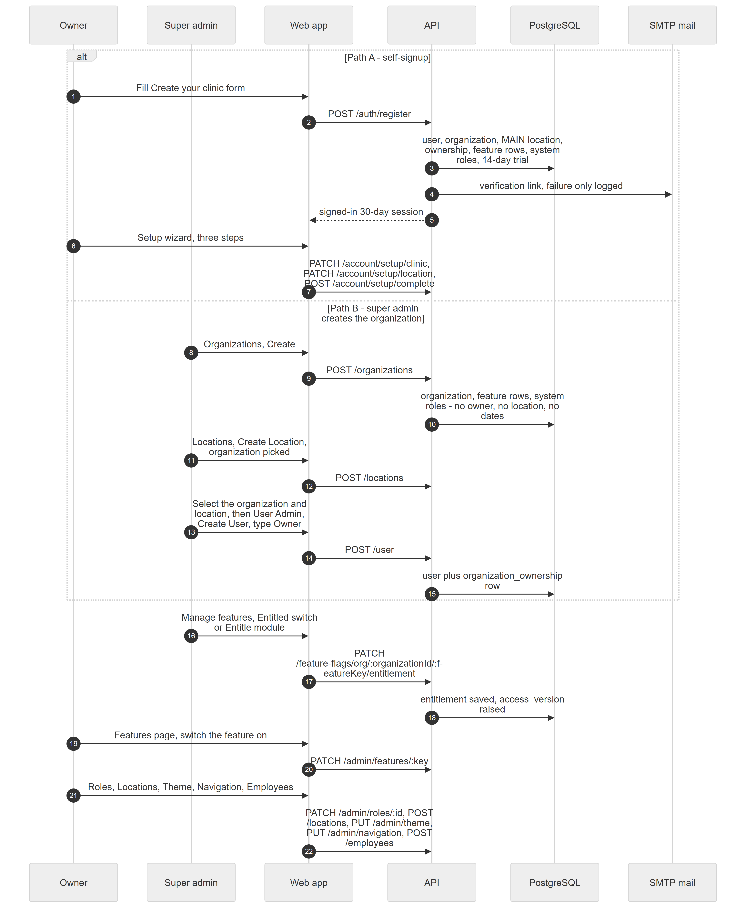

# Chapter 46 — Workflow: Onboarding a New Clinic

This chapter follows one new clinic from nothing to a clinic that is ready to receive patients. There are two ways in: the owner signs up alone, or a super admin creates the organization by hand. It is written for the product owner, who needs to know which steps are automatic, which need a super admin, and where the two paths differ. Each step names the module, its status and the chapter that explains it in full.

## 46.1 Who is involved

- **Owner**: the person who runs the clinic business. On the self-signup path this person creates the clinic. On the other path an owner login is created for them.
- **Super admin**: the Platform operator. Creates organizations by hand, entitles features, records payments and can act inside any clinic.
- **Example Clinic**: the fictional organization used in this chapter, with a Main location.
- **Sample staff**: employees added at the end (Chapter 47 covers staff onboarding).

## 46.2 The steps

Figure 46.1 shows both paths and the shared steps that follow them.

*Figure 46.1 — Two ways to create a clinic, then the shared set-up steps.*

The diagram has six participants from left to right: Owner, Super admin, Web app, API, PostgreSQL and SMTP mail. It has 22 numbered messages. A box labelled "alt" holds the two paths. In Path A (messages 1 to 7) the Owner fills the "Create your clinic" form, the Web app posts to `POST /auth/register`, and the API writes the user, the organization, the MAIN location, the ownership row, the feature rows, the system roles and a 14-day trial to PostgreSQL. The API sends a verification link through SMTP mail (a failure is only logged) and returns a signed-in 30-day session. The Owner then goes through the three-step setup wizard, and the Web app saves it with two PATCH calls and one POST that completes setup. In Path B (messages 8 to 15) the Super admin creates the organization from the Organizations screen; the API stores the organization, its feature rows and system roles but no owner, no location and no dates. The Super admin then creates a location, selects the organization and location, and creates a user of type Owner in User Admin, which writes the user and an ownership row. After the box, both paths continue: the Super admin entitles features (messages 16 to 18), the Owner switches features on (19 and 20), and the Owner sets up roles, locations, theme, navigation and employees (21 and 22).

### Step 1a — Self-signup (Path A)

**Module:** Subscriptions and Onboarding. **Status:** [Implemented]. The visitor opens `/register`, enters clinic name, full name, email, an optional phone and a password. The Platform creates the owner login, the organization, one location with code `MAIN`, the ownership link, a 14-day trial on the Professional plan, the feature rows and the five system roles, then signs the owner in. Chapter 45 describes this in full: a visitor registers, and a trial starts at once.

### Step 1b — Verify the email address

**Module:** Subscriptions and Onboarding. **Status:** [Partial]. The owner receives a link that is valid for 48 hours and opens `/verify-email`. Verification is informational: nothing is blocked while the address is unverified, and a failed email send is only logged. Chapter 45 and the Authentication chapter (Chapter 56) cover it.

### Step 1c — Setup wizard

**Module:** Subscriptions and Onboarding. **Status:** [Implemented]. An owner whose setup is pending is sent to `/setup` from any other page. Step "Clinic" collects name, clinic types, phone, email, timezone and currency. Step "Location & tax" collects the main location's details and the sales tax percentage. Step "Your team" only explains that staff are added later; its finish button clears the pending flag without checking that the first two steps were saved. Saving the clinic step copies timezone and currency to every location of the clinic (Chapter 45).

### Step 2 — Super admin creates the organization (Path B)

**Module:** Organizations and locations. **Status:** [Partial]. `POST /organizations` works, and it seeds the feature rows and the five system roles. The Organizations screen's form offers plan, clinic type, timezone and currency values that the API rejects, so a form filled with those fields fails with HTTP 400 (found by reading both files, not by running the app). The result is an unmanaged clinic: no owner, no location, no trial and no plan limits (Chapter 9 and Chapter 45).

### Step 3 — Give the clinic a location and an owner (Path B)

**Module:** Organizations and locations, and User Admin. **Status:** [Partial]. A super admin adds a location from the Locations screen by choosing the organization. There is no field on the organization screen to name an owner. The code creates an owner login through User Admin with the account type "Owner", which uses the active organization from the request header. A super admin therefore has to select that organization and a location before creating the owner. This sequence is deduced from the code and was not run. Chapter 8 explains ownership; Chapter 56 explains User Admin.

### Step 4 — Entitle features

**Module:** Features. **Status:** [Implemented]. A super admin opens "Manage features" for the clinic. Every feature has an **Entitled** switch, an optional trial end date and an **Enabled** switch; "Entitle module" acts on a whole module. The seeding at clinic creation sets entitled and enabled equal to each feature's default. Several features that clinics rely on are off by default and need this step: among them `billing.invoices`, `billing.commissions`, `inventory.core`, `dental.lab_orders`, `reports.financial` and `reports.clinical`. Without `billing.invoices`, completing a consultation creates no charges (Chapter 31). Chapter 10 covers the three switches.

### Step 5 — Owner enables features

**Module:** Features. **Status:** [Implemented]. The owner opens **Features** (`/admin/features`) and switches on the features in the plan. A locked feature, which is not entitled or whose trial ended, cannot be switched on. Turning a feature off shows an impact list of the permissions and roles affected, and a location can switch a feature off for itself only (Chapter 10).

### Step 6 — Roles

**Module:** Roles and permissions. **Status:** [Implemented]. The five system roles (Admin, Doctor, Receptionist, Assistant, Accountant) already exist. The owner may clone one or build a custom role at **Roles & permissions** (`/admin/roles`) with None, Basic or Full per module. System roles are read-only (Chapter 11).

### Step 7 — Locations

**Module:** Organizations and locations. **Status:** [Implemented]. The owner adds further branches from Locations. The plan's location limit applies (Professional allows 3) and an expired subscription refuses the write. The edit screen for locations sends fields the API refuses, so changing a location afterwards may fail [Partial] (Chapter 9).

### Step 8 — Theme and navigation

**Module:** Customization. **Status:** [Implemented]. At `/admin/theme` the owner sets the display name (default "Clinic Portal"), logos, favicon, brand colour (default a blue), sidebar style and default light, dark or system mode. A location may override the name and logos. At `/admin/navigation` the owner arranges the sidebar for the whole clinic. Both need their own permission (`admin.theme.manage`, `admin.nav.manage`). Changing the sidebar layout raises the access version; the theme save does not appear to (Chapter 58 covers customization; Chapter 54 describes how access changes spread).

### Step 9 — Staff

**Module:** Employees. **Status:** [Implemented]. The owner or an Admin adds employees with roles and logins. Chapter 47 follows that workflow.

## 46.3 What can go wrong

- **Duplicate email at sign-up.** User creation rejects it. If clinic creation fails after the user is created, the new user is deleted so no orphan account remains.
- **Rate limit.** Registration is limited to 5 per hour, verification to 10 per 15 minutes and resend to 3 per hour.
- **Feature set after signup is smaller than expected.** Features that are off by default must be entitled by a super admin. Clinics that have not been entitled for billing see no automatic charges.
- **Seeding failure.** After the clinic is committed, seeding the feature rows and roles can fail; the failure is only logged, so a clinic can exist with no roles (Chapter 45).
- **Plan limit.** Adding a fourth location on Professional gives `PLAN_LIMIT`.
- **Super admin path cannot be finished in one screen.** Owner creation needs an organization context, which needs a location first.
- **Expired trial.** After the trial and 3 grace days the clinic is read-only; setup and account paths stay writable (Chapter 53).

## 46.4 Data left behind

- `users`: the owner login, with the email verification columns.
- `organizations`: plan, `trial_ends_at`, `onboarding_pending`, `access_version`.
- `organization_ownership`: one primary owner on Path A; one non-primary owner on Path B.
- `locations` and `location_settings`: at least one location with the tax rate.
- `org_feature_flags` (entitled and enabled per feature) and `employment_roles` (the five system roles).
- `config_values`: theme settings. `nav_layouts`: the sidebar layout, if the owner saved one.
- `audit_logs`: feature entitlement changes and nav layout changes.
- Employees and assignments after Step 9.
