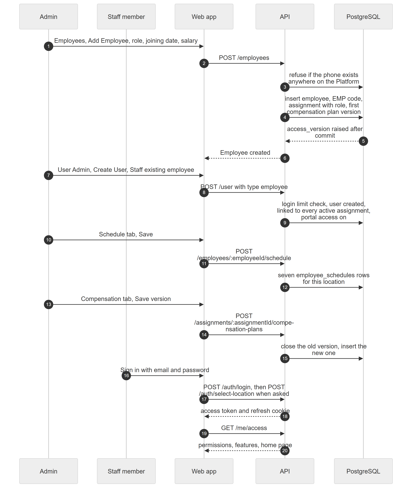

# Chapter 47 — Workflow: Onboarding a Staff Member

This chapter follows one new staff member, Dr. Example One, from the first employee record to the first sign-in. It is written for the product owner, who needs to know how a person, a role, a login, working hours and pay terms fit together, and what the Platform cannot do. The workflow touches Employees, Roles, User Admin, Authentication and Commissions.

## 47.1 Who is involved

- **Admin** (or the owner): holds `employees.manage`, `admin.users.manage` and `compensation.manage`. Only the Admin system role holds them by default.
- **Dr. Example One**: the new employee. Becomes a **staff login** once a user account is linked.
- **Example Clinic**, Main location.

## 47.2 The steps

Figure 47.1 shows the whole flow.

*Figure 47.1 — From the Add Employee form to the first sign-in.*

The diagram has five participants: Admin, Staff member, Web app, API and PostgreSQL, and 20 messages. The Admin fills the Add Employee form and the Web app calls `POST /employees`. The API first refuses the request if the phone number exists anywhere on the Platform, then inserts the employee, an `EMP-` code, the assignment with its role and the first compensation plan version. PostgreSQL raises the organization's access version after the commit, and the API answers "Employee created". Next the Admin opens User Admin and creates a staff login (`POST /user` with type employee); the API checks the login limit, creates the user and links it to every active assignment with portal access on. The Admin saves the weekly schedule (`POST /employees/:employeeId/schedule`, seven rows for this location) and, if needed, a new compensation plan version (`POST /assignments/:assignmentId/compensation-plans`). Finally the Staff member signs in, the Web app calls `POST /auth/login` and, when asked, `POST /auth/select-location`, and then `GET /me/access`, which returns permissions, features and the home page.

### Step 1 — Employee record, assignment and role

**Module:** Employees. **Status:** [Implemented]. On **Employees**, **Add Employee** asks for Full Name, Phone, Designation, Role, Employment Type and Joining Date. The server rejects a phone that already exists on the Platform (the employee record is shared across clinics). It generates the employee code (`EMP-001` style, counting the organization's assignments), inserts the assignment at the active location with the chosen role, and adds the first compensation plan version starting on the joining date: salaried with the entered salary, unless a commission plan was chosen (Chapter 37, Chapter 35). The role decides what the person may do at that location; a login alone grants nothing.

### Step 2 — Staff login

**Module:** Employees and User Admin. **Status:** [Implemented]. There are two routes. The **Portal Access** switch on the employee form creates a login with an email and a password of at least 6 characters, linked only to the active location's assignment. **User Admin → Create User → Staff (existing employee)** needs a password of at least 8 characters, checks the plan's login limit and links the login to all the person's active assignments in the organization. Only the second route checks the limit (Chapter 37). The user receives no verification email when created by an administrator (Chapter 56).

### Step 3 — Weekly schedule

**Module:** Employees. **Status:** [Implemented]. On the **Schedule** tab the Admin switches days on or off, sets start and end times and a slot length of 15, 30, 45 or 60 minutes, and saves seven rows. Booking checks these hours: a doctor with no working block that day cannot be booked (Chapter 29). The Save button is visible to people without `employees.manage`, but the server refuses them. Availability overrides and approved leave are stored but do not affect booking [Partial] (Chapter 37).

### Step 4 — Compensation plan

**Module:** Commissions. **Status:** [Implemented]. On the **Compensation** tab the Admin picks Salaried, Commission or Both and an effective date. A new version closes the old one on the previous day. Commission is allowed only for roles that can conduct consultations, and the feature `billing.commissions` must be on. A second change on the same day replaces the first only if no charge used it (Chapter 35).

### Step 5 — First sign-in

**Module:** Authentication and Access control. **Status:** [Implemented]. The staff member signs in with the email and password. If they have one location, it becomes active at once; otherwise the app shows the location picker. `GET /me/access` returns what they can do and the role's home page, for example `/queue/doctor` for a Doctor (Chapter 8, Chapter 11, Chapter 56).

### What is not possible: a second location

**Module:** Employees. **Status:** [Not implemented]. There is no endpoint that assigns an existing employee to another location or organization. `CreateAssignmentDto` exists but nothing uses it. Add Employee at a second location fails because the phone number is already taken. A doctor who works at two locations therefore cannot be set up through the Platform (Chapter 37).

## 47.3 What can go wrong

- **Duplicate phone** gives 409 "An employee with this phone number already exists". A duplicate CNIC is caught only by a database index and returns a generic 500 error.
- **Duplicate login email** gives 409.
- **Commission plan refused**: 403 `COMMISSIONS_DISABLED` when the feature is off, 422 `COMMISSION_ROLE_CANNOT_CONSULT` for a non-consulting role.
- **Login limit** reached gives `PLAN_LIMIT` on the User Admin route.
- **Wrong or missing role**: the person signs in but sees a restricted sidebar or the no-access page.
- **Read-only mode**: every step is refused with 402.
- The person is saved before the login and the assignment, outside the final transaction, so a failure part-way can leave a person record with no assignment.

## 47.4 Data left behind

- `employees` (person), `employee_org_location_assignments` (role, location, `user_id`, `has_portal_access`).
- `users` (login), `employee_schedules` (seven rows per location).
- `compensation_plans` and `commission_rules`.
- `organizations.access_version` raised by the assignment save.
