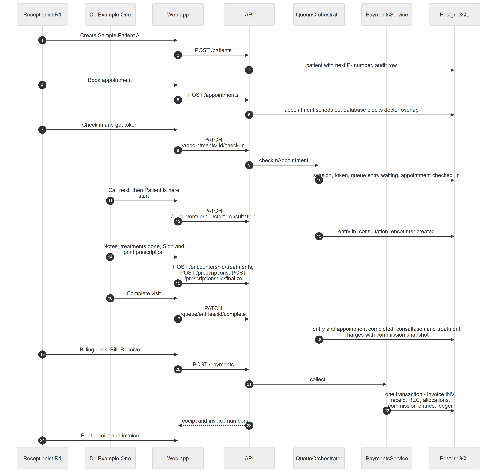

# Chapter 48 — Workflow: The Patient Journey

This chapter follows Sample Patient A through one visit at Example Clinic, from registration to a printed receipt. It is written for the product owner. It follows the order the code really uses, which differs from a naive reading in two places: the invoice is created when payment is collected, and a lab case is a separate flow that is billed separately.

## 48.1 Who is involved

- **Receptionist R1**: registers, books, checks in and collects payment.
- **Dr. Example One**: calls the patient, consults, prescribes, completes the visit.
- **Sample Patient A**: the patient.
- **Accountant** and **Admin**: may also collect payments and correct invoices.

## 48.2 The steps

*Figure 48.1 — One visit from registration to receipt.*

The diagram has seven participants: Receptionist R1, Dr. Example One, Web app, API, QueueOrchestrator, PaymentsService and PostgreSQL, and 24 messages. R1 creates the patient (`POST /patients`) and the API stores the patient with the next `P-` number and an audit row. R1 books an appointment (`POST /appointments`); it is saved as scheduled and the database blocks a doctor overlap. On arrival R1 clicks "Check in and get token" (`PATCH /appointments/:id/check-in`), the API hands over to QueueOrchestrator, which writes the session, the token, a queue entry in state waiting and sets the appointment to checked in. Dr. Example One calls the next patient and presses "Patient is here, start" (`PATCH /queue/entries/:id/start-consultation`); the entry becomes in consultation and the encounter is created. The doctor records notes and treatments, signs the prescription (`POST /encounters/:id/treatments`, `POST /prescriptions`, `POST /prescriptions/:id/finalize`) and presses "Complete visit" (`PATCH /queue/entries/:id/complete`); in one transaction the entry and appointment become completed and the consultation and treatment charges are created with the commission snapshot. R1 then opens the billing desk, presses Bill and Receive (`POST /payments`); PaymentsService runs one transaction that issues the invoice, records the receipt, allocates the money, writes commission entries and the ledger row. The API returns the receipt and invoice numbers and R1 prints them.

### Step 1 — Registration

**Module:** Patients. **Status:** [Implemented]. **Create** on `/patients` takes Full Name and Phone. The phone must be unique inside the organization. The server assigns `P-` plus a five-digit number and writes an audit row. The check-before-save endpoint exists, but no screen calls it [Partial] (Chapter 28).

### Step 2 — Appointment

**Module:** Appointments. **Status:** [Implemented]. The booking checks the doctor works at that location, that the slot fits a working block, that the doctor has no overlapping booking and the daily limit. A booking has no token yet. A walk-in skips this step (Chapter 29).

### Step 3 — Check-in

**Module:** Appointments and Queue. **Status:** [Implemented]. Check-in is allowed only on the booking's own day and up to the location's maximum lateness (45 minutes by default). It opens the doctor's queue session if needed and issues a token such as A-007. A patient who is too late is offered "Convert to walk-in" (Chapter 29, Chapter 30).

### Step 4 — Queue

**Module:** Queue. **Status:** [Implemented]. The doctor starts the queue, then **Call next** picks the next patient by the smart or first-come rules. Reception and the TV display update live (Chapter 30).

### Step 5 — Consultation

**Module:** Consultation. **Status:** [Implemented]. Starting the consultation creates the encounter, the clinical record of this visit, in the same transaction. The workspace shows the patient summary and allergy strip, and auto-saves notes (Chapter 31).

### Step 6 — Treatment

**Module:** Consultation. **Status:** [Implemented]. The doctor taps procedure chips from the service catalog. Each becomes a treatment. The doctor never sees prices. A treatment typed by name has no price and is later priced by reception (Chapter 31).

### Step 7 — Prescription

**Module:** Prescriptions. **Status:** [Implemented]. In the workspace panel the doctor adds medicines and presses "Sign & print". The prescription is optional and has no effect on billing (Chapter 32).

### Step 8 — Lab case (separate flow)

**Module:** Dental Lab. **Status:** [Not implemented] from the consultation workspace. The workspace has no lab-order button, and a lab order has no link to an encounter in the data model (Chapter 31). A lab order is actually created from the sidebar: **Lab orders → New lab order**, where the user picks the patient, the lab, the ordering doctor and the items, then presses **Submit to lab**. The API accepts an optional appointment and treatment on the order, but the order form in the web app does not appear to send them [Unverified]. Chapter 49 follows the lab case. Lab work is billed by its own invoice, not by the clinic's charges.

### Step 9 — Automatic charges

**Module:** Billing. **Status:** [Implemented] with a condition. When the doctor completes the visit, the Platform creates one consultation charge and one charge per treatment, priced from the service catalog with any doctor-specific price. This runs only when the feature `billing.invoices` is enabled; that feature is off by default (Chapter 31, Chapter 34). A charge with no price is marked "needs pricing" and blocks invoicing until someone sets a price. Each charge stores a snapshot of the doctor's commission terms (Chapter 35).

### Step 10 — Payment and invoice

**Module:** Billing. **Status:** [Implemented]. On the **Billing desk**, "ready to bill" lists patients with unbilled charges. **Collect payment** previews the split and then saves. The invoice is issued at this moment, taking the next `INV` number, with the location's sales tax added on top. Surplus money becomes the patient's advance. A patient who leaves without paying can still be invoiced with **Issue invoice** from the patient's Billing tab (Chapter 34).

### Step 11 — Receipt

**Module:** Billing. **Status:** [Implemented]. The payment takes the next `REC` number. The result screen prints the receipt and the invoice in A4 or 80 mm thermal layout. There is no server-generated PDF receipt [Not implemented] (Chapter 34).

## 48.3 What can go wrong

- Duplicate phone on registration gives 409.
- Booking conflicts: `DOCTOR_DOUBLE_BOOKED`, `DAILY_LIMIT_REACHED`, outside working hours.
- Check-in too late (`LATE_LIMIT_EXCEEDED`), wrong day (`NOT_TODAY`), queue closed (`SESSION_NOT_OPEN`).
- A stale queue screen gives 409 `VERSION_CONFLICT`.
- With `billing.invoices` off, completion succeeds and no charge appears.
- A charge needing a price blocks the invoice ("Set a price for ...").
- Payment errors: missing reference for an account that requires one, allocation above balance.
- In read-only mode every write gives 402.

## 48.4 Data left behind

`patients`, `audit_logs`, `appointments`, `queue_sessions`, `queue_entries`, `queue_events`, `outbox`, `idempotency_keys`, `patient_encounters`, `treatments`, `prescriptions` and children, `charges`, `billing_audit_logs`, `invoices`, `payments`, `payment_allocations`, `document_sequences`, `ledger_entries`, `commission_entries`.
