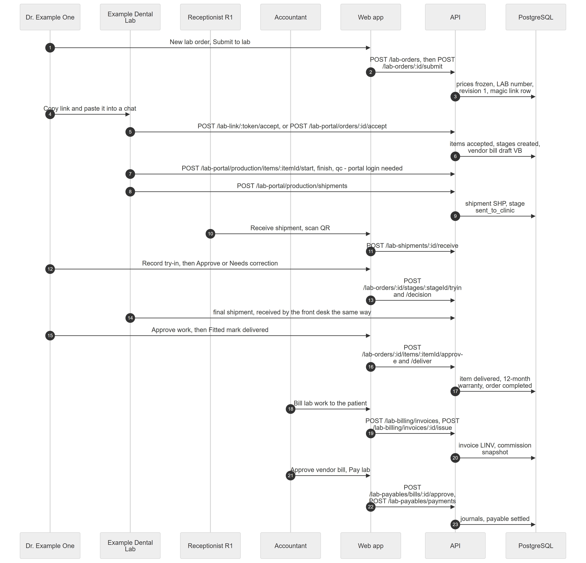

# Chapter 49 — Workflow: A Dental Lab Case

This chapter follows one lab case, a zirconia crown for Sample Patient A, from the order to the delivered work, and then follows the money: what the patient is billed, what the clinic owes the lab and what the doctor earns. It is written for the product owner. The case involves three modules (Dental Lab, Lab Finance, Commissions) and two sides: the clinic and the lab, which is not a tenant of the Platform. The lab feature `dental.lab_orders` is off by default; a super admin entitles it and the owner switches it on.

## 49.1 Who is involved

- **Dr. Example One**: creates and submits the order, decides try-ins, approves and delivers.
- **Receptionist R1**: receives shipments at the front desk.
- **Accountant**: bills the patient for lab work, approves vendor bills, pays the lab.
- **Example Dental Lab**: the **lab**. Its people are **lab members** (lab admin, lab technician) who use the **lab portal**, or a contact who acts through a **magic link**.
- **Admin**: may act on behalf of a lab that does not answer.

## 49.2 The steps

*Figure 49.1 — Order to delivery, then the money.*

The diagram has seven participants: Dr. Example One, Example Dental Lab, Receptionist R1, Accountant, Web app, API and PostgreSQL, and 23 messages. The doctor submits the order (`POST /lab-orders`, then `POST /lab-orders/:id/submit`); the API freezes the prices, assigns a LAB number, stores revision 1 and a magic link row. The doctor copies the link and pastes it into a chat. The lab accepts, through the link (`POST /lab-link/:token/accept`) or the portal (`POST /lab-portal/orders/:id/accept`), and the API marks the items accepted, creates the stages and drafts a vendor bill. The lab then works through the portal: start, finish and QC (`POST /lab-portal/production/items/:itemId/start` and the following actions) and dispatches a shipment (`POST /lab-portal/production/shipments`). The front desk receives it by scanning the QR code (`POST /lab-shipments/:id/receive`). The doctor records the try-in and approves or asks for correction (`.../stages/:stageId/tryin` and `/decision`). After the final shipment is received, the doctor approves and marks the work delivered (`.../items/:itemId/approve` and `/deliver`), which starts a 12-month warranty and completes the order. The Accountant bills the patient (`POST /lab-billing/invoices` and `/issue`), approves the vendor bill and pays the lab (`POST /lab-payables/bills/:id/approve`, `POST /lab-payables/payments`).

### Step 1 — Create and submit the order

**Module:** Dental Lab. **Status:** [Implemented]. **Lab orders → New lab order**: choose patient, lab, ordering doctor, priority and date needed; add items (service, options, quantity, teeth, form answers); **Submit to lab**. The lab must be an active **lab link** of the clinic. At submit the Platform checks the forms, freezes the lab and patient prices of every line, assigns a number such as LAB-0001 and queues a message for the lab members. Every line needs a lab price and a mapped clinic treatment on the submit day (Chapter 40).

### Step 2 — Reach the lab

**Module:** Dental Lab. **Status:** [Partial]. Three routes exist. The lab portal gives members the order in their own inbox [Implemented] (Chapter 41 covers the portal). A **magic link** opens one order without a login and allows view, accept, reject and ask a question only. **Send link to lab** queues a message, but the only registered provider for WhatsApp, SMS and email writes the message to the server log, so nothing reaches the lab; **Copy link** returns the link once and the doctor pastes it into a chat by hand (Chapter 40, Chapter 44). A coordinator holding both `lab.orders.create` and `lab.links.manage` can record the lab's answer on its behalf [Implemented].

### Step 3 — Lab accepts

**Module:** Dental Lab and Lab Finance. **Status:** [Implemented]. Accept needs an expected date. Items move to accepted, the stage rows are copied from the item's stage template, and a draft **vendor bill** is created or updated at the frozen lab cost (Chapter 42).

### Step 4 — Production stages

**Module:** Lab Portal. **Status:** [Implemented]. Production actions (start, assign a technician, finish, QC, dispatch a shipment) are lab portal endpoints for members. A lab that has only a magic link and no portal login cannot perform them, and the clinic's proxy actions cover only accept, reject, clarification and expected date. The clinic follows progress on the order's Production panel (Chapter 40).

### Step 5 — Try-in

**Module:** Dental Lab. **Status:** [Implemented]. For items with try-in stages the doctor presses **Record try-in** after the patient visit, then **Approve** or **Needs correction** with notes. A correction closes the round and opens the same stage as the next round. No appointment is created or reminded automatically; the event for a due try-in is never emitted (Chapter 40).

### Step 6 — Shipment and receive

**Module:** Dental Lab. **Status:** [Implemented]. The front desk opens the incoming shipment or scans its QR code, sets condition and quantity per line and presses **Receive**. A parcel that never arrives can be marked lost with a reason.

### Step 7 — Approve and deliver

**Module:** Dental Lab. **Status:** [Implemented]. The doctor presses **Approve work**, then **Fitted, mark delivered**, which starts a 12-month warranty. Rejecting received work opens a remake request that the lab may dispute. When all items are approved or delivered the order is completed.

### Step 8 — Money: patient lab invoice

**Module:** Lab Finance. **Status:** [Implemented]. This is not the clinic's normal invoice: lab work is billed through its own tables and numbers (`LINV`). The Accountant opens the submitted order and presses **Bill N item(s)**, which starts an **estimate**; **Issue invoice** gives it a number and due date. The lines copy the patient prices frozen at submit. This can be done any time after the order is submitted, not only after delivery. Payments, advances and credit notes follow (Chapter 42).

### Step 9 — Money: vendor bill and payment to the lab

**Module:** Lab Finance. **Status:** [Partial]. The draft vendor bill appears under **Lab payables → Bills**. The Accountant presses **Approve**, setting the lab's invoice number, due date and tax, which books the debt. **Pay lab** records a payment and splits it over approved bills. Editing the bill header and adding manual lines exist only in the API (Chapter 42).

### Step 10 — Money: lab-line commission

**Module:** Commissions. **Status:** [Implemented] (backend only by design). When the lab invoice is issued, each line stores the doctor's plan and rate. As the patient pays, the doctor earns commission on the money collected minus the lab's cost, so the doctor is paid on the clinic's margin. Reversals and credit notes give it back. It needs `billing.commissions` on and feeds My earnings and payroll like any other commission (Chapter 35).

## 49.3 What can go wrong

- Submit fails when a line has no lab price, no mapped treatment, a per-tooth service without teeth or answers that fail the form (`LAB_ORDER_INVALID`, `LAB_PRICE_MISSING`).
- The lab link is not active: `LAB_NOT_LINKED`.
- A magic link dies after 24 hours by default, on revoke, when the order closes or when the lab is suspended.
- A lab that never answers: use the proxy actions.
- Parcels may arrive damaged, short or not at all.
- A rejected final piece needs a remake; who pays is decided in the remake request.
- Double billing is blocked: an item can be on only one live lab invoice.
- A bill of 0 cannot be approved; approval is refused if the draft changed since it was read.
- Four seeded notification events are never emitted, including overdue orders.

## 49.4 Data left behind

`lab_orders`, `lab_order_items`, `order_revisions`, `magic_links`, `order_item_stages`, `shipments`, `item_warranties`, `status_history`, `audit_logs`, `notification_outbox`, `vendor_bills`, `vendor_bill_lines`, `vendor_payments` and allocations, `lab_invoices`, `lab_invoice_lines`, `commission_entries` with a lab invoice line, and journal rows in `ledger_journals`.
