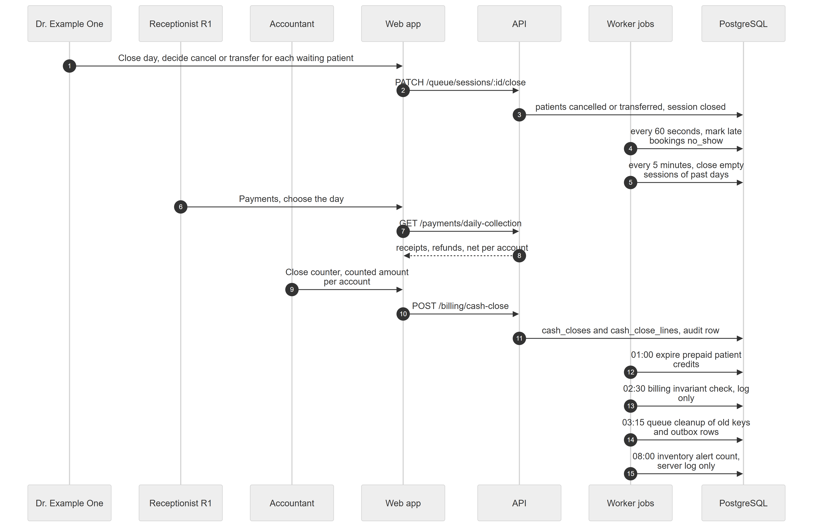

# Chapter 50 — Workflow: Closing the Clinic Day

This chapter describes how a clinic day ends at Example Clinic: the doctor closes the queue, late bookings become no-shows, reception reviews the day's collection, the accountant closes the counter, and the Platform's overnight jobs run. It is written for the product owner. Some of the work is done by people and some by background jobs in the worker process (Appendix E lists all jobs). Job times use the server clock, not each clinic's timezone.

## 50.1 Who is involved

- **Dr. Example One**: closes the queue.
- **Receptionist R1**: reads the day's collection.
- **Accountant**: closes the counter. Admin may also do this.
- **Worker process**: the one process that runs scheduled jobs.

## 50.2 The steps

*Figure 50.1 — People first, then the jobs that run on their own.*

The diagram has seven participants: Dr. Example One, Receptionist R1, Accountant, Web app, API, Worker jobs and PostgreSQL, and 15 messages. The doctor closes the day and decides cancel or transfer for each waiting patient (`PATCH /queue/sessions/:id/close`); the API cancels or transfers them and closes the session. In parallel, the worker marks late bookings as no-shows every 60 seconds and closes empty sessions of past days every 5 minutes. Receptionist R1 opens Payments and picks the day (`GET /payments/daily-collection`) and the API returns receipts, refunds and net per account. The Accountant closes the counter with a counted amount per account (`POST /billing/cash-close`) and the API stores the close and its lines with an audit row. The worker then runs four overnight jobs: expire prepaid credits at 01:00, billing invariant check at 02:30, queue cleanup at 03:15 and inventory alert count at 08:00.

### Step 1 — Queue day-end

**Module:** Queue. **Status:** [Implemented]. In **My Queue**, **Close day** is disabled while a patient is with the doctor. The "Close today's queue" dialog lists every remaining patient (waiting, skipped or at a test) with **Cancel** as the default or "Transfer to Dr. ..." for waiting patients only. Confirming cancels or moves them and closes the session. Cancelling a booked patient closes the appointment as cancelled. Everything succeeds or nothing does (Chapter 30).

### Step 2 — Automatic day-end

**Module:** Queue. **Status:** [Implemented]. Every 5 minutes the worker closes sessions of a past service day if they are empty. A session that still has patients is only logged as an alert and is never cancelled automatically, so someone must decide. The "past day" is judged by each location's timezone and day cut-off, not by the server date.

### Step 3 — No-show marking

**Module:** Appointments and Queue. **Status:** [Implemented]. Staff can press **No show** on a scheduled or confirmed booking (`appointments.cancel`). Otherwise the worker does it every 60 seconds once start time plus maximum lateness (45 minutes by default) has passed. The job writes with plain SQL, so there is no queue event, no audit row and no realtime message. A no-show no longer shows Check in in the web app, so a late patient usually has to be added as an ordinary walk-in (Chapter 29).

### Step 4 — Daily collection

**Module:** Billing. **Status:** [Implemented]. On **Payments**, the day picker (future days not allowed) shows receipts by their payment date and refunds by their refund date per payment account, with the net in hand (Chapter 34).

### Step 5 — Cash close

**Module:** Billing. **Status:** [Implemented]. **Close counter** computes for each payment account the expected money since the previous close, asks for the counted amount on accounts marked "Count physically at cash close", and requires a note when there is a difference. A close is a permanent record with a printable slip and a red "Flagged" badge when the difference exceeds the alert amount. Closing never blocks taking payments, and a close cannot be edited or deleted. It needs `billing.cash_close` (Admin, Accountant).

### Step 6 — Overnight jobs

**Module:** Several. Times are server time (Appendix E).

| Time | Job | Status |
|---|---|---|
| 01:00 | Patient credit expiry: marks credits past their expiry date as expired | [Implemented] (credit packages have no screen, so little to expire in practice) |
| 02:30 | Billing invariant check: re-checks ten money rules and logs any break | [Implemented], log only |
| 03:15 | Queue cleanup: deletes idempotency keys older than 24 hours and published outbox rows older than 7 days | [Implemented] |
| 08:00 | Inventory alerts: counts low and expiring items per location | [Partial], server log only |

The table lists the four daily jobs with what each does and its status. The credit job reads the server date rather than the location's, so a credit can expire a few hours early or late for a clinic in another timezone. Nobody is notified by the invariant check or the inventory alert; an operator must read the logs (Chapter 34, Chapter 39).

## 50.3 What can go wrong

- Closing the queue while someone is with the doctor: 409 `DOCTOR_BUSY`.
- A remaining patient without a decision: 422 `INVALID_TRANSITION`.
- A skipped or at-test patient cannot be transferred, only cancelled or brought back.
- Counter close: 422 when a count or a note is missing, or when the close period is stale.
- Overnight times differ from clinic local time when the server is in another timezone.
- Jobs run only in a worker (or all-in-one) process; if no worker runs, none of the jobs run. Exactly one worker must run.
- The invariant check only logs; a violation is not repaired or announced.

## 50.4 Data left behind

`queue_sessions` (closed), `queue_entries`, `queue_events` and `outbox` (for closes done by users), `appointments` (cancelled or no-show), `cash_closes`, `cash_close_lines`, `billing_audit_logs`, `patient_credits` (expired), and server log lines for the invariant check and the inventory alerts.
