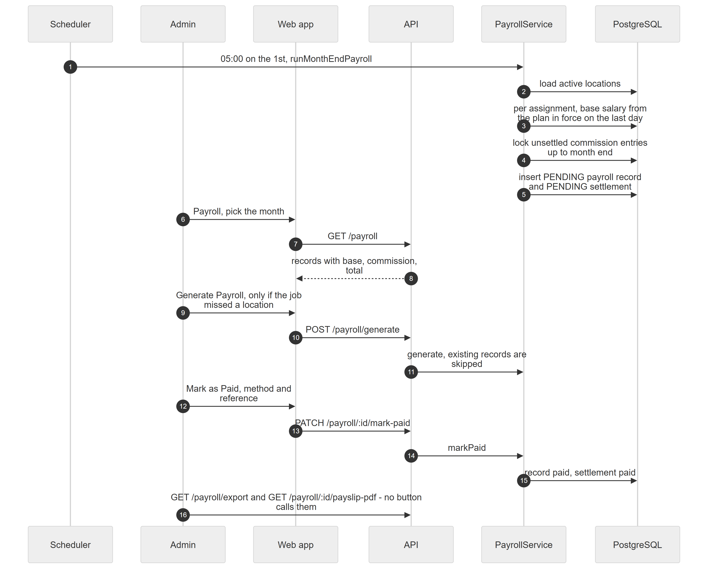

# Chapter 51 — Workflow: Month-End Payroll

This chapter follows payroll for one month at Example Clinic, from the automatic run on the 1st to the payment record. It is written for the product owner. Payroll combines two things: the base salary from each employee's compensation plan and the doctor commission earned but not yet paid out. The Platform records the payout; it does not move money.

## 51.1 Who is involved

- **Scheduler** (the worker process): runs the job.
- **Admin**: holds `payroll.manage` (feature `hr.payroll`, on by default). No other system role holds it.
- **Dr. Example One**: an employee with a salary and commission.

## 51.2 The steps

*Figure 51.1 — The automatic run, the optional manual run and the payment.*

The diagram has six participants: Scheduler, Admin, Web app, API, PayrollService and PostgreSQL, and 16 messages. At 05:00 on the 1st the Scheduler calls the month-end run on PayrollService, which loads the active locations. For each assignment it reads the base salary from the plan in force on the last day of the month, locks the unsettled commission entries up to month end, and inserts a pending payroll record and a pending settlement. The Admin opens Payroll for the month (`GET /payroll`) and sees records with base, commission and total. If the job missed a location, the Admin presses Generate Payroll (`POST /payroll/generate`) and existing records are skipped. The Admin presses Mark as Paid with a method and reference (`PATCH /payroll/:id/mark-paid`); the service sets the record and the settlement to paid. The last message shows the CSV export and payslip PDF endpoints, which no button calls.

### Step 1 — Automatic generation

**Module:** Payroll. **Status:** [Implemented]. The cron expression is `0 5 1 * *` with no timezone option, so it fires at 05:00 on the 1st in the server's timezone. A code comment says 00:05; the code wins. The month is taken from the server's own date (the previous month), not from each location's timezone. The job covers every active location of every organization, each in its own transaction, so one failing location does not stop the others. It does not check that the organization is active or that `hr.payroll` is on. It runs without a request, so the subscription read-only guard, which acts on web requests, does not apply to it (deduced from the guard being an HTTP guard) (Chapter 38, Appendix E).

### Step 2 — Base plus commission

**Module:** Payroll and Commissions. **Status:** [Implemented]. For each active assignment: skip if a record already exists for that employee, location and month; otherwise base salary = the plan version in force on the month's last day (else the first day); commission = the sum of unsettled commission entries created before the end of the month's last clinic day. A net-negative sum is not settled and waits for a later month. Total = base + commission. An employee with neither is listed as "no salary" and gets no record (Chapter 38, Chapter 35).

### Step 3 — Settlement lock

**Module:** Commissions. **Status:** [Implemented]. The entries are row-locked and tied to a **settlement** so they cannot be paid twice. Entries are never edited; a reversal after settlement lands as a negative entry in a later month's settlement (Chapter 35).

### Step 4 — Manual generation

**Module:** Payroll. **Status:** [Implemented]. **Generate Payroll** on `/payroll` takes a month and year, refuses future months and generates for the whole active location, even when pressed from an employee tab. It is safe to run after the automatic job.

### Step 5 — Review and edit

**Module:** Payroll. **Status:** [Implemented]. Records start as pending. Edit, delete and create-by-hand exist. A record that paid out commission cannot be deleted. Deleting an unpaid record releases its commission back to the pool. Putting a record on hold has an endpoint but no button; the edit dialog's status field can set it [Partial].

### Step 6 — Mark paid

**Module:** Payroll. **Status:** [Implemented]. **Mark as Paid** needs a method (cash, bank transfer or cheque) and optional reference and notes. The record becomes paid with time and payer, and the settlement becomes paid in the same transaction. No money moves and nothing is posted to the general ledger or expenses. Setting status to paid through the edit dialog does not pay the settlement, which is a trap: a later delete would release the commission.

### Step 7 — Payslip and export

**Module:** Payroll. **Status:** [Partial]. `GET /payroll/:id/payslip-pdf` returns an A4 PDF (Latin text only) and `GET /payroll/export?month&year` returns a CSV. Neither has a button in the web app, so they can be called only through the API. Deductions are always 0.00, net equals gross, and the designation column is empty.

## 51.3 What can go wrong

- Server timezone differs from the clinic's, so "the 1st at 05:00" falls at another local time, and the month boundary can shift near midnight.
- No worker process is running: nothing is generated.
- A location error is logged and skipped; no in-app notification tells anyone.
- Future month: 400 "Cannot generate payroll for future months".
- "Payroll already marked as paid" on a second payment.
- Paying through the edit dialog leaves the commission unpaid.
- No deductions, tax, overtime or unpaid-leave handling exist [Not implemented].
- Payroll changes are not written to the general audit log.

## 51.4 Data left behind

`payroll_records` (pending, then paid with `paid_at`, method, reference), `commission_settlements` (period, total, payroll record id, status), `commission_entries.settlement_id`. Records made by the job have no `created_by`.
