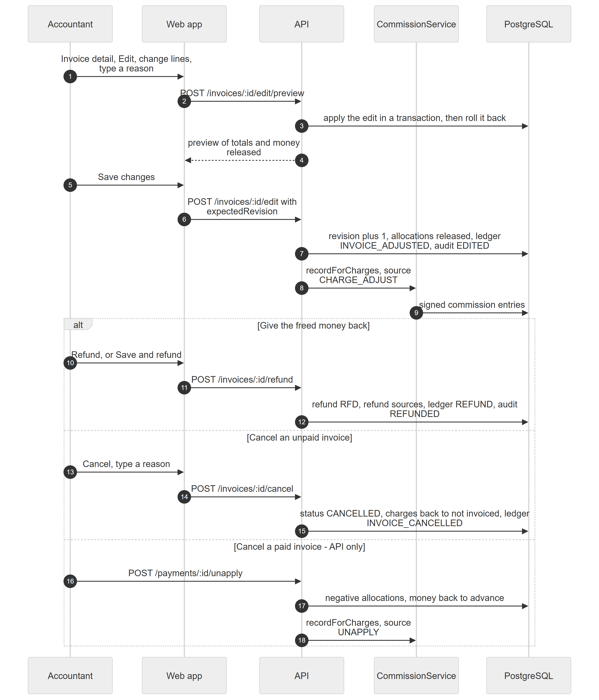

# Chapter 52 — Workflow: Correcting an Invoice and Refunding Money

This chapter follows what the Accountant does when an issued invoice turns out to be wrong: preview and save an edit that creates a new revision, cancel an unpaid invoice, refund money, or undo a payment first. It is written for the product owner, who needs to know what stays on record and how doctor commission follows each change. Invoices are never deleted; every change adds to the history.

## 52.1 Who is involved

- **Accountant** (or Admin): holds `billing.invoice.edit`, `billing.invoice.void` and `billing.refund.issue`. The last two are marked high risk.
- **Sample Patient A**: the patient whose invoice is corrected.
- **Dr. Example One**: the doctor whose commission adjusts.

## 52.2 The steps

*Figure 52.1 — Edit with preview, then refund or cancel.*

The diagram has five participants: Accountant, Web app, API, CommissionService and PostgreSQL, and 18 messages. The Accountant opens the invoice, presses Edit, changes lines and types a reason; the Web app calls `POST /invoices/:id/edit/preview`, the API applies the edit inside a transaction and rolls it back, and returns the preview. The Accountant presses Save changes (`POST /invoices/:id/edit` with the expected revision); the API raises the revision, releases allocations, posts an adjustment to the ledger and writes an audit row, then asks CommissionService to record the signed commission entries. An "alt" box has three outcomes. To give freed money back, the Accountant presses Refund or Save and refund (`POST /invoices/:id/refund`) and the API writes the refund, its sources, a ledger row and an audit row. To cancel an unpaid invoice, the Accountant presses Cancel with a reason (`POST /invoices/:id/cancel`), and the invoice becomes cancelled with its charges back to not invoiced. To cancel a paid invoice, an API client must first unapply the payment (`POST /payments/:id/unapply`), which writes negative allocations and reverses commission.

### Step 1 — Preview the edit

**Module:** Billing. **Status:** [Implemented]. On the invoice detail, **Edit** lets the Accountant change quantities, prices and discounts, void lines, add unbilled charges or add a manual line, with a reason of 5 to 300 characters. The preview really runs the edit in a transaction and discards it, so the numbers match what saving will do (Chapter 34).

### Step 2 — Save a revision

**Module:** Billing. **Status:** [Implemented]. Saving raises the revision number; the invoice number never changes. If a line's payable shrinks, the allocation above the new amount is released, newest first, and moves to the patient's advance. Older revisions can be printed from audit snapshots. If two people edit at once, the second gets `BILLING_INVOICE_REVISION_CONFLICT`. Voiding a line needs `billing.invoice.void`; changing a catalog price needs `billing.price.override`.

### Step 3 — Commission follows

**Module:** Commissions. **Status:** [Implemented] (backend only). On every edit the Platform recomputes the doctor's commission target per charge and inserts only the difference as a signed entry. A voided charge brings its commission to zero. Entries already settled in payroll are never changed; the correction lands in the next settlement (Chapter 35).

### Step 4 — Cancel an unpaid invoice

**Module:** Billing. **Status:** [Implemented]. **Cancel** needs a reason and is shown only when nothing is paid. The invoice keeps its totals and prints with a CANCELLED watermark, the number stays used, the charges return to Ready to bill, and the patient's statement gets a credit. Cancelled is final.

### Step 5 — Unapply a payment (backend only)

**Module:** Billing. **Status:** [Partial]. `POST /payments/:paymentId/unapply` takes back all or part of a payment's allocations and sends the money to advance. It adds negative rows and deletes nothing, and the receipt stays. No screen calls it, so cancelling an invoice that has payments cannot be done from the web app (`BILLING_INVOICE_HAS_PAYMENTS`: "Unapply its payments before cancelling this invoice").

### Step 6 — Refund

**Module:** Billing. **Status:** [Implemented]. A refund always comes out of the patient's advance. An **advance refund** returns unused money from the patient's Billing tab. An **invoice refund** returns money released from an invoice, optionally in the same step as the edit that released it. The accountant chooses the account under "Paid out from"; it is not forced to be the account that received the payment. Sources are chosen automatically: payments released from that invoice first, latest first, then other advance, newest first. A refund takes the next `RFD` number, needs a reason of 5 to 300 characters, and cannot be undone. Cash close subtracts refunds per account (Chapter 34, Chapter 50).

## 52.3 What can go wrong

- `BILLING_INVOICE_REVISION_CONFLICT`: someone else changed the invoice; reload.
- `BILLING_INVOICE_CANCELLED`: a cancelled invoice is read-only.
- `BILLING_REFUND_EXCEEDS_ADVANCE` and `BILLING_REFUND_EXCEEDS_INVOICE_REFUNDABLE`: the amount is above what can be returned.
- `BILLING_REFERENCE_REQUIRED` for an account that needs a reference.
- `BILLING_UNAPPLY_EXCEEDS_ALLOCATION`: more than was applied.
- Wrong refunds cannot be reversed; the only remedy is a new payment.
- Read-only mode refuses all of these with 402.

## 52.4 Data left behind

`invoices` (revision, status), `charges`, `payment_allocations` (including negative and release rows), `payments`, `refunds`, `refund_sources`, `ledger_entries` (INVOICE_ADJUSTED, INVOICE_CANCELLED, REFUND), `billing_audit_logs` (EDITED, CANCELLED, REFUNDED, UNAPPLIED with snapshots), `commission_entries` (signed differences), `document_sequences`.
