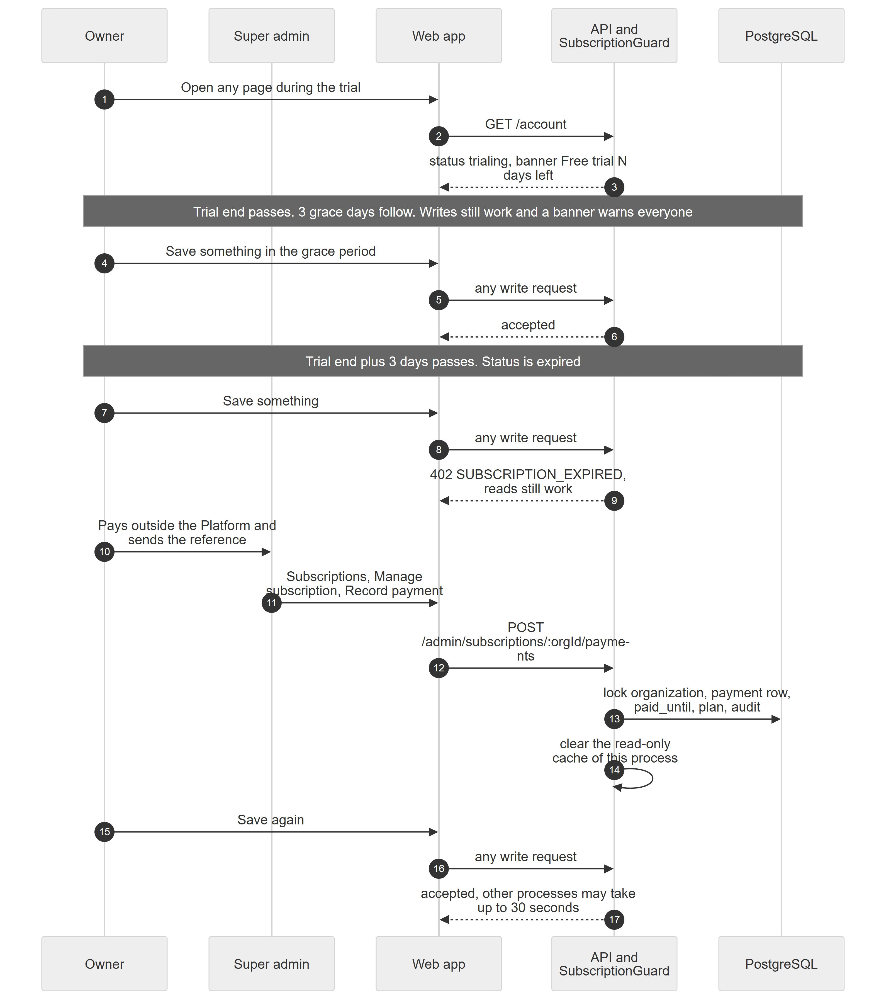

# Chapter 53 — Workflow: Subscription Expiry and Recovery

This chapter follows Example Clinic when its trial runs out and the clinic is brought back by a manual payment. It is written for the product owner. The Platform never charges anyone: the clinic pays outside the Platform and a super admin records the payment, which extends the period. The subscription status is never stored; it is worked out from two dates every time it is read.

## 53.1 Who is involved

- **Owner**: sees the banners and pays.
- **Other staff**: see warning banners and rejected saves.
- **Super admin**: records the payment and may change plan, dates and limits.

## 53.2 The steps

*Figure 53.1 — Trial, grace, read-only, payment, back to active.*

The diagram has five participants: Owner, Super admin, Web app, API and SubscriptionGuard (drawn as one box), and PostgreSQL, and 17 messages plus two notes. During the trial the Owner opens a page, the Web app calls `GET /account`, and the API answers status trialing with the banner "Free trial, N days left". A first note says that after the trial end passes there are 3 grace days in which writes still work and a banner warns everyone; a save in that period is accepted. A second note says that once the trial end plus 3 days has passed, the status is expired. A save then returns 402 `SUBSCRIPTION_EXPIRED`, while reads still work. The Owner pays outside the Platform and sends the reference to the Super admin, who opens Subscriptions, Manage subscription, Record payment (`POST /admin/subscriptions/:orgId/payments`). The API locks the organization, writes the payment row, sets `paid_until` and the plan and writes an audit entry, then clears the read-only cache of its own process. The Owner saves again and the write is accepted; other server processes may take up to 30 seconds to notice.

### Step 1 — Trial

**Module:** Subscriptions and Onboarding. **Status:** [Implemented]. Self-signup gives 14 days on the Professional plan (3 locations, 15 logins). Owners see "Free trial, N days left" with a **See plans** link. A clinic with no trial date and no paid date is "unmanaged": no limits, never expires (Chapter 45).

### Step 2 — Grace period

**Module:** Subscriptions and Onboarding. **Status:** [Implemented]. The period end is the later of the trial end and the paid-until date. For 3 days after it (`GRACE_DAYS`) the clinic works normally; everyone sees a warning that the clinic turns read-only in N days. A plan close to its end shows owners "Your plan renews in N days".

### Step 3 — Read-only mode (402)

**Module:** Subscriptions and Onboarding. **Status:** [Implemented]. After the grace days, the last global guard refuses every write with HTTP 402 and code `SUBSCRIPTION_EXPIRED`. Reads (GET, HEAD, OPTIONS) pass, public routes pass, super admins pass, and paths starting with `/auth/`, `/account`, `/me/` and `/admin/subscriptions` stay writable. The banner says "Subscription expired. The clinic is read-only" to owners and "read-only until the owner renews the plan" to others. Everything is affected, including the queue and billing. Jobs in the worker are not requests, so they keep running; this is deduced from the guard being an HTTP guard [Unverified].

### Step 4 — Pay outside the Platform

**Module:** Subscriptions and Onboarding. **Status:** [Implemented]. The owner opens **Settings → Plan & billing** and reads the "How to pay" text, which the super admin edits on the Subscriptions page (up to 2,000 characters). Methods recorded are bank transfer, JazzCash, EasyPaisa, cash, cheque and other.

### Step 5 — Super admin records the payment

**Module:** Subscriptions and Onboarding. **Status:** [Implemented]. On **Subscriptions**, **Manage subscription → Record payment** takes plan, months (1 to 36), amount, method, date, reference and notes. The new period starts where the current trial or paid period ends, or now if that is over, so early payment loses no days. The plan on the clinic becomes the plan paid for, so paying for Starter during a Professional trial lowers the limits at once.

### Step 6 — Active again

**Module:** Subscriptions and Onboarding. **Status:** [Implemented]. With `paid_until` in the future the status is active and writes resume. The decision is cached for 30 seconds per server process, so a renewal can take up to 30 seconds to be seen by a process other than the one that took the payment. A super admin can also set a future trial end or clear both dates to make the clinic unmanaged from the **Plan & limits** tab.

## 53.3 What can go wrong

- The owner never sees a renewal reminder email; none is sent.
- The grace period is only 3 days.
- Recording a payment overwrites the plan and can lower the limits.
- Staff cannot read the cause of a rejected save unless the banner is visible; the API message is "Your subscription has expired. The clinic is read-only until it is renewed."
- The Organizations screen's plan selector sends values the API rejects, so use the Subscriptions screen for plan changes (Chapter 45).
- Nothing charges the clinic, so a payment the super admin forgets to record keeps the clinic read-only.

## 53.4 Data left behind

`subscription_payments` (plan, months, amount, method, reference, period start and end, `recorded_by`), `organizations` (`paid_until`, `subscription_plan`, limits), `audit_logs` (before and after values). The status itself is not stored.
