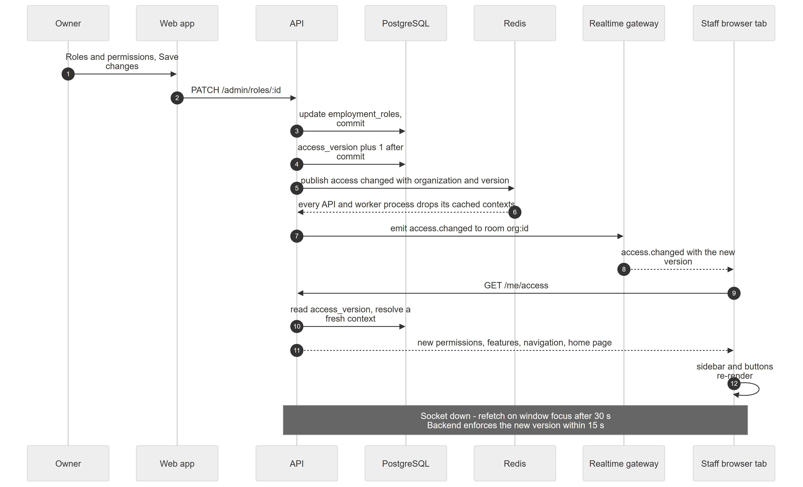

# Chapter 54 — Workflow: How an Access Change Reaches Every Screen

This chapter follows what happens after an owner edits a role, a feature switch or the sidebar layout: how the change reaches the server's caches and the staff members' open browser tabs without anyone signing out. It is written for the product owner. The key idea is the **access version**, a counter on the organization that goes up by one on every change to who can do what.

## 54.1 Who is involved

- **Owner** (or an Admin with `admin.roles.manage`): makes the change.
- **Staff member**: has the Platform open in a browser tab.
- **API and worker processes**: keep a cache of each user's access.

## 54.2 The steps

*Figure 54.1 — From Save changes to a re-drawn sidebar.*

The diagram has seven participants: Owner, Web app, API, PostgreSQL, Redis, Realtime gateway and Staff browser tab, and 12 messages plus one note. The Owner presses Save changes on the role (`PATCH /admin/roles/:id`). The API updates `employment_roles` and commits, then raises `access_version` by one after the commit. It publishes "access changed" with the organization and version to Redis, and every API and worker process drops its cached contexts. The API tells the realtime gateway to emit `access.changed` to the room for the organization, and the gateway sends it to the Staff browser tab with the new version. The tab calls `GET /me/access`; the API reads the version, resolves a fresh context and returns new permissions, features, navigation and home page, and the sidebar and buttons re-render. The note says that if the socket is down, the tab refetches on window focus once its data is 30 seconds old, and the backend still enforces the new version within 15 seconds.

### Step 1 — The owner edits

**Module:** Roles and permissions, Features, Customization. **Status:** [Implemented]. Three kinds of edit start the chain: a role at **Roles & permissions**, a feature switch at **Features** or the entitlement page, and the clinic sidebar layout at **Navigation**. Granting a high-risk permission asks for a reason (Chapter 11, Chapter 10).

### Step 2 — The version goes up

**Module:** Access control. **Status:** [Implemented]. `organizations.access_version` increases after any committed change to employment roles, assignments (role, location, active flag, portal access, login), organization feature flags or ownership. A database event subscriber does this automatically once per transaction, after the commit. Location feature overrides and nav layout changes bump it explicitly; saving the same nav layout again does not. The theme save has no bump in the code, so theme changes do not trigger this chain (Chapter 57).

### Step 3 — Server caches drop

**Module:** Access control. **Status:** [Implemented]. The new version goes over Redis to every API and worker process, which drop cached contexts and feature sets. The resolver's cache is keyed on user, organization, location and access version, holds up to 10,000 entries and lasts 5 minutes; the version itself is trusted for 15 seconds without a bus message. If Redis is down, other processes catch up within 15 seconds. Because the key includes the version, a stale entry is never matched after a bump.

### Step 4 — The browser is told

**Module:** Realtime. **Status:** [Implemented]. The gateway emits `access.changed` to the organization's room. The web app joins that room through the same socket used for the queue. A message whose version is not newer than the one the tab already has is ignored. After a reconnect the tab refetches in case messages were missed.

### Step 5 — The tab refetches and redraws

**Module:** Access control (web app). **Status:** [Implemented]. The tab invalidates its access query, loads `GET /me/access` and redraws the sidebar, buttons and home page from `can(...)`. Route permission checks happen when the user navigates. If the room is refused or the socket is down, the fallback is refetch on window focus with a 30-second freshness window (Chapter 57).

### Step 6 — Enforcement is already updated

**Module:** Access control (backend). **Status:** [Implemented]. The backend never trusts the screen. The access guard resolves access again on each request using the current version, so a removed permission is refused as soon as the version bump is visible to that process, even if the tab has not redrawn. A missing key means no access (fail-closed).

## 54.3 What can go wrong

- Redis is down: other server processes may take up to 15 seconds; tabs rely on window focus.
- Socket blocked or offline: the tab keeps old buttons until focus or the next reload, but the server still refuses actions.
- Raw SQL edits to roles do not bump the version unless done explicitly.
- A bump failure after commit is logged and the change itself stays saved, so caches may age out only on their own timers.
- Escalation protection: granting more than the editor holds is refused (`ESCALATION`).
- Super admin acting in the clinic is recorded as a platform action.

## 54.4 Data left behind

`organizations.access_version`, `employment_roles` (or `org_feature_flags`, `location_feature_overrides`, `nav_layouts`), `audit_logs` entries for the edit, and short-lived in-memory caches that hold no lasting data.
