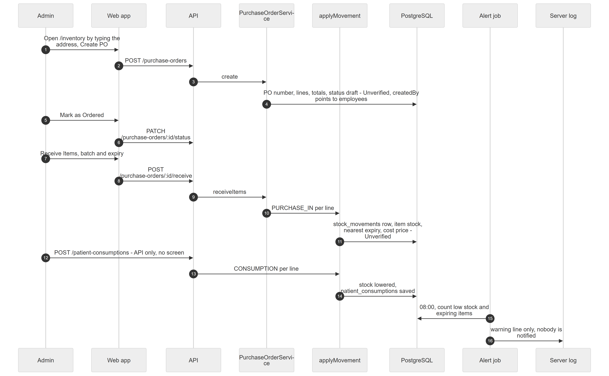

# Chapter 55 — Workflow: From Purchase Order to Consumption

This chapter follows a box of gloves from a purchase order to stock, then to use on a patient and to a low-stock alert. It is written for the product owner. The honest summary is that the chain is only partly connected: the pieces exist in the backend, several have no screen, two steps carry a database risk that could not be tested, and the final alert reaches nobody. Each link in the chain carries its own label.

## 55.1 Who is involved

- **Admin**: the only system role with inventory write permissions (`inventory.po.manage`, `inventory.stock.adjust`). The Assistant role can only view.
- **Worker process**: runs the alert job.
- Features: `inventory.core` and `inventory.alerts`, both off by default.

## 55.2 The steps

*Figure 55.1 — The inventory chain and where it breaks.*

The diagram has eight participants: Admin, Web app, API, PurchaseOrderService, applyMovement, PostgreSQL, Alert job and Server log, and 16 messages. The Admin opens `/inventory` by typing the address and creates a purchase order (`POST /purchase-orders`); the service stores the order number, lines, totals and status draft, with the Unverified note that the creator column points to employees. The Admin marks it ordered (`PATCH /purchase-orders/:id/status`), then receives items with batch and expiry (`POST /purchase-orders/:id/receive`). The service calls applyMovement with PURCHASE_IN per line, which writes a stock movement row and updates the item's stock, nearest expiry and cost price, again marked Unverified. A call to `POST /patient-consumptions` has no screen; it lowers stock per line and saves the consumption. At 08:00 the alert job counts low and expiring items and writes only a warning line to the server log.

### Link 1 — Reach the page

**Module:** Inventory. **Status:** [Partial]. The page `/inventory` works and needs `inventory.view`, but there is no sidebar entry and no screen links to it. Users must type the address. The feature `inventory.core` must be entitled and enabled first (Chapter 39).

### Link 2 — Purchase order

**Module:** Inventory. **Status:** [Unverified]. Screens and logic exist: **Create PO** with supplier, lines, quantity, unit price and tax; the server numbers it like `PO-2026-00001` and computes totals; status goes Draft then Ordered (**Mark as Ordered**), and only a draft can be cancelled. The risk: creation stores the signed-in user's id in `purchase_orders.createdBy`, which has a foreign key to `employees`. A user id and an employee id are different records, so the insert is expected to fail. Reading the entity and the controller confirms that the user id is passed to that column; it was not run. PO numbers are also unique across the whole database but counted per organization, so a second organization's first order of a year can collide (deduced from code). Purchase orders are not linked to expenses or lab payables (Chapter 39).

### Link 3 — Receive goods

**Module:** Inventory. **Status:** [Unverified]. **Receive Items** on an Ordered or Partially received PO takes quantities, batch and expiry per line; over-receiving is refused; the status becomes Partially received or Received. Each line adds a "purchase in" stock movement through the single `applyMovement` path, sets the item's cost price to the line price and moves the item's expiry date earlier if the batch expires sooner. It carries the same kind of foreign-key risk as the purchase order, through `stock_movements.performedBy`.

### Link 4 — Stock movement and manual adjustment

**Module:** Inventory. **Status:** [Unverified]. Every quantity change is a row in `stock_movements` with previous and new stock; stock cannot go below zero. The Adjust stock dialog offers manual adjustment, wastage, return to supplier and transfers (notes required for wastage and manual). A transfer is recorded at one location only; nothing is added at the other. The item row is read without a row lock, so two simultaneous adjustments could start from the same number.

### Link 5 — Patient consumption

**Module:** Inventory. **Status:** [Not implemented] in the web app. `POST /patient-consumptions` exists and prices each line at the item's current cost, then lowers stock in one transaction, but the component that would call it (`ConsumptionRecorder`) is placed on no screen, including the consultation workspace. Consumption templates (kits) can be created but nothing uses them. Consumed materials are not billed and do not show on the encounter (Chapter 39, Chapter 31).

### Link 6 — Low-stock alert

**Module:** Inventory. **Status:** [Partial]. At 08:00 server time, for every location where both features are on, the job counts low-stock items and items expiring within 30 days and writes one warning line to the server log. No user is notified, no inbox entry is created and nothing appears on a screen; a code comment says notifications are planned (Chapter 44, Appendix E).

## 55.3 What can go wrong

- The first purchase order, receive or adjustment may fail with a database foreign-key error, which would stop the whole chain [Unverified].
- The page is not discoverable without a sidebar entry.
- "Insufficient stock" when an outgoing movement would go below zero.
- "Cannot receive more than ordered".
- Alerts are visible only to whoever reads server logs.
- Stock movement history is the only audit trail; no separate log exists.
- With `inventory.core` off, nothing in the module is permitted.

## 55.4 Data left behind

`purchase_orders`, `purchase_order_items`, `stock_movements`, `inventory_items` (stock, expiry, cost), `patient_consumptions` and `patient_consumption_items` (API only), and server log lines from the alert job. No billing, ledger or notification rows are written by any step.
