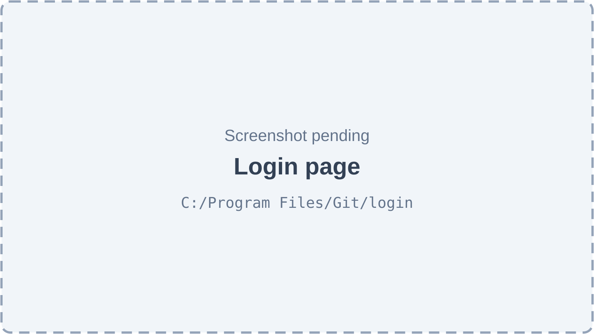
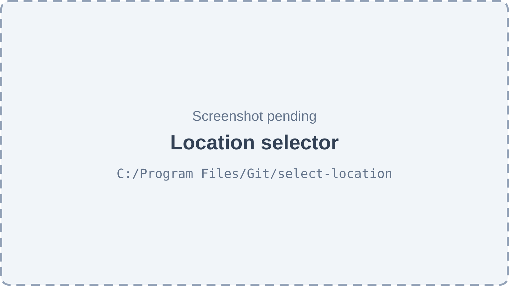
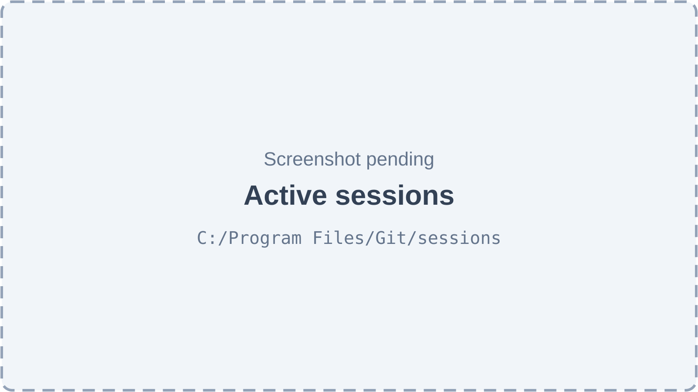
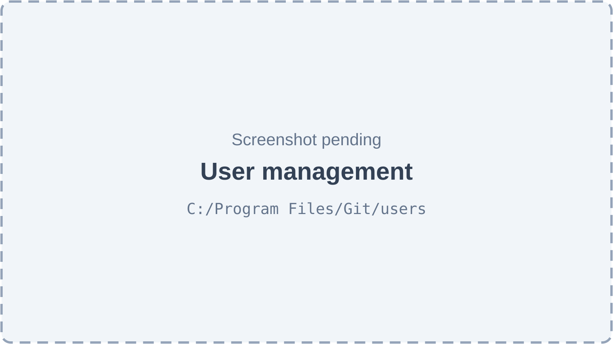
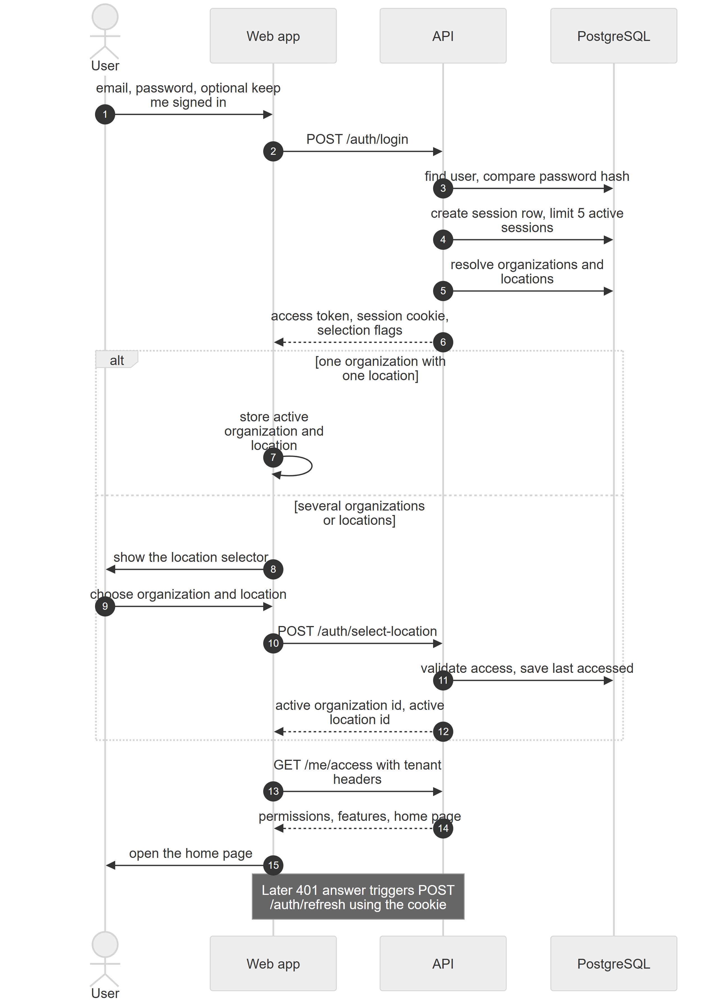
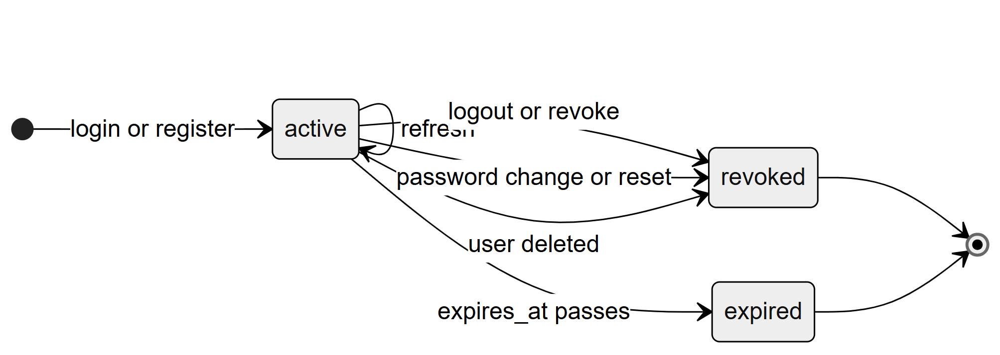

# Chapter 56 — Authentication and sessions

This chapter explains how a person proves who they are to the Platform and stays signed in: registering a clinic, signing in, choosing an organization and location, the short-lived access token and the long-lived session cookie, managing sessions, password flows, rate limiting and the staff-login administration screen. It is written for the product owner, who needs to know exactly how long a sign-in lasts, what a user can revoke and which protections exist today. What a signed-in person may then do is a different question, answered by Chapter 11 (roles and permissions) and Chapter 57 (access control in depth).

## 56.1 The model in one paragraph

**Status:** [Implemented]

A **user** is a login: an email address, a password hash and an account status (`active`, `suspended` or `deleted`). A user is not the same as an **employee**, who is the person record that the Employees module keeps (Chapter 37). A **staff login** links one user to one employee. Signing in creates a **session** row in the database and gives the browser two things. The first is an **access token**, valid for 15 minutes, which the web app keeps in memory only and sends as a Bearer header. The second is a **session cookie** named `refresh_token`, which is `httpOnly` (scripts cannot read it) and carries the session id and a long random secret. When the access token expires, the web app calls `POST /auth/refresh`; the cookie proves the session is still valid and a new access token is issued. Nothing about the login is stored in the browser's local storage.

**Technical references:** `backend/src/auth/auth.service.ts` · `AuthService` · `backend/src/session/session.service.ts` · `SessionService` · `backend/src/auth/jwt.service.ts` · `web-app/src/store/useAuthStore.ts`

## 56.2 Screens

The sign-in related screens are public pages (`/login`, `/register`, `/forgot-password`, `/reset-password`, `/verify-email`), the location selector (`/select-location`), the signed-in pages for sessions and security (`/sessions` and the Security and Sessions sections of Settings), and the staff-login administration page (`/users`).

*Figure 56.1 — Login page (screenshot pending).*

The login page shows the clinic's own name and logo when the browser knows which clinic it last used (Chapter 58 explains the public theme). It has an email field, a password field with a show and hide button, a "Keep me signed in for 30 days" check box, a "Forgot password?" link, a sign-in button and a link to the sign-up page. The sign-up page asks for clinic name, the owner's name, email, an optional phone number and a password, with a five-segment strength meter (Weak, Fair, Good, Strong, Very strong) that is advice only and does not block the form.

*Figure 56.2 — Location selector (screenshot pending).*

The selector is a two-step screen. Step one lists the organizations the user can enter; choosing one with a single location selects that location and continues at once. Step two lists the organization's locations as cards; the user picks one and continues. If an organization has no location, the screen says that a location must be created to continue.

*Figure 56.3 — Active sessions (screenshot pending).*

The sessions list (page title "Active Sessions", also available as the Sessions section of Settings) shows one row per active session with browser, operating system, device, IP address, the time it started and the time it was last active. The current session is marked. Every other row has a **Revoke** button, the current row has **Sign out**, and a **Sign out all others** button sits at the top.

*Figure 56.4 — User management (screenshot pending).*

The user administration page (`/users`, title "User Management", subtitle "Manage system access across roles and organizations") lists users by type and has a **Create User** button. The create form asks for name, email, password, role type (Super Admin, Owner or Staff), and, for a staff user, which employee the login is for. Each row can be edited (including its status) or deleted.

## 56.3 Features

### 56.3.1 Register a clinic (self-signup)

**Status:** [Implemented]

**What it does.** Lets a new clinic owner create the login and the clinic in one step. The Platform creates the user, a new organization with a main location and a 14-day trial (Chapter 45 covers subscriptions and onboarding), sends a verification email and signs the owner straight in.

**How the user does it.**
1. Open the sign-up page and enter clinic name, name, email, optional phone and a password.
2. Submit. The owner lands in the application, kept signed in for 30 days.
3. Later, click the link in the verification email.

**Behind the scenes — technically.** `POST /auth/register` is public and rate limited. `AuthService.register` creates the user, calls the clinic set-up service to create the organization, and sends the verification email. If clinic creation fails, the new user row is deleted so no empty login remains. It then runs the normal login flow with "keep me signed in" on.

**Rules and validations.**
- Email must be a valid address; name and clinic name are required (at most 255 characters); phone at most 20 characters; password at least 6 characters.
- An email that already exists is refused.
- The verification email failing to send is logged but does not stop registration.

**Who can do it.** Anyone; the route is public.

**Data read and written.** `users`, `organizations`, `locations`, owner link, subscription rows, `user_sessions`, `security_logs`.

**Error cases.** 429 when more than 5 sign-ups come from one address in an hour; 400 for invalid fields or a duplicate email.

**Technical references:** `backend/src/auth/auth.controller.ts` · `register` · `backend/src/subscriptions/clinic-setup.service.ts` · `web-app/src/features/auth/components/RegisterForm.tsx`

### 56.3.2 Verify an email address

**Status:** [Implemented]

**What it does.** Confirms that the owner controls the email address. Verification is informational: an unverified user can still sign in and work. The web app shows a "verify your email" banner until verification is done.

**How the user does it.** Click the link in the email, which opens `/verify-email?token=…`. The page shows "Verifying your email…" and then a success or failure message. A signed-in user whose address is still unverified can ask for a fresh link.

**Behind the scenes — technically.** The email carries a random 32-byte token; the database stores only its SHA-256 hash, valid for 48 hours. `POST /auth/verify-email` (public, 10 attempts per 15 minutes) hashes the supplied token, finds an unexpired match and sets `email_verified_at`. `POST /auth/resend-verification` (signed in, 3 per hour) issues a new token; if the user has no pending token it answers "Email already verified". Sending depends on SMTP settings in the server environment (`SMTP_USER`, `SMTP_PASS`).

**Rules and validations.** An invalid or expired token gives 400 "This verification link is invalid or has expired". Users created by an administrator through user administration are not sent a verification email.

**Who can do it.** Anyone holding the token; resend needs a signed-in user.

**Data read and written.** `users` (`email_verification_token`, `email_verification_expires`, `email_verified_at`).

**Technical references:** `AuthService.verifyEmail` · `AuthService.resendVerification` · `backend/src/common/services/mail.service.ts` · `web-app/src/features/account/pages/VerifyEmailPage.tsx`

### 56.3.3 Sign in

**Status:** [Implemented]

**What it does.** Checks the email and password, creates a session and returns the information the web app needs to continue: the user, an access token, the organizations and locations the user may enter, and flags saying whether an organization or location still has to be chosen.

**How the user does it.** Enter email and password, optionally tick "Keep me signed in for 30 days", and click sign in.

**Behind the scenes — in simple terms.** The server looks up the user, compares the password against the stored hash, refuses suspended or deleted accounts, records a new session, and works out where the person is allowed to go. The session lasts one day, or 30 days if the box was ticked. Only five sessions can be active at once; a sixth sign-in quietly revokes the oldest.

**Behind the scenes — technically.** `POST /auth/login` (public; 5 attempts per 15 minutes per address and route). `UserService.validateUser` compares with bcrypt (12 rounds). `SessionService.createSession` stores a bcrypt hash of a 64-byte random refresh secret, the user agent, parsed browser, operating system and device, and the client IP. `AuthorizationService.resolveUserAccess` returns the accessible organizations. The response also lists any lab memberships, so a user who works only for a lab is sent to the lab portal (Chapter 41). The cookie is `httpOnly`, `sameSite=lax`, `secure` in production, with a maximum age equal to the session's remaining lifetime.

**Rules and validations.**
- Email valid; password at least 6 characters.
- A wrong email or password gives a plain 401 with no hint about which was wrong.
- A suspended account gets 403 "Your account has been suspended. Please contact support."; a deleted account gets 403 "This account has been deleted."
- A session's expiry is fixed at sign-in and is never extended by refreshing.

**Who can do it.** Anyone with an account.

**Data read and written.** `users`, `user_sessions`, `employee_org_location_assignments`, owner links, `organizations`, `locations`, `security_logs` (a success row).

**Effects on other modules.** The login result seeds the web app's auth store, which every later request reads for its tenant headers (Chapter 8).

**Error cases.** 401 wrong credentials; 403 suspended or deleted; 429 too many attempts (message "Too many requests. Please try again later.", with a `retryAfter` value in seconds).

**Technical references:** `AuthService.login` · `SessionService.createSession` · `AuthorizationService.resolveUserAccess` · `web-app/src/features/auth/components/LoginForm.tsx`

### 56.3.4 Choose and switch organization and location

**Status:** [Implemented]

**What it does.** Decides which clinic and branch a person is working in. Every later request carries that choice in two headers.

**How the user does it.** After sign-in the selector appears when a choice is needed. Later, the location switcher in the page header changes the active location.

**Behind the scenes — in simple terms.** A single organization with a single location is chosen automatically. A super admin always picks an organization first. Otherwise the person picks, and the Platform remembers the last choice for next time.

**Behind the scenes — technically.** The login response sets `requiresOrgSelection` and `requiresLocationSelection`. `POST /auth/select-location` and `POST /auth/switch-location` (both signed in, context free) validate access with `AuthorizationService.validateAccess` and save `last_accessed_organization_id` and `last_accessed_location_id` on the user. Switching also returns the legacy permission flags for the new location (deprecated; the web app reads `GET /me/access`). Chapter 8 describes the choice flow and what each type of user may enter in full.

*Figure 56.5 — Sequence of a sign-in, the optional location choice and the first access fetch.*

The diagram has three participants besides the User: the Web app, the API and PostgreSQL. (1) The user enters email, password and the optional keep-me-signed-in choice. (2) The web app calls `POST /auth/login`. (3) The API finds the user and compares the password hash. (4) It creates the session row and enforces the limit of five active sessions. (5) It resolves the organizations and locations. (6) It answers with the access token, the session cookie and the selection flags. An "alt" box then shows two paths. If the user has one organization with one location, the web app stores them as active. Otherwise the web app shows the selector, the user chooses, the web app calls `POST /auth/select-location`, the API validates access and saves the last accessed choice, and returns the two active ids. After the box, the web app calls `GET /me/access` with the tenant headers and receives permissions, features and the home page, and opens the home page. A note says that a later 401 answer triggers `POST /auth/refresh` with the cookie.

**Rules and validations.** Both organization id and location id are required UUIDs. A request for a location the user may not enter gets 403 "You do not have access to this location".

**Who can do it.** Any signed-in user.

**Data read and written.** `users.last_accessed_*`.

**Error cases.** 403 no access; the web app shows the toast "Failed to select location".

**Technical references:** `AuthService.selectLocation` · `AuthService.switchLocation` · `web-app/src/features/auth/components/LocationSelector.tsx` · `web-app/src/components/layout/LocationSwitcher.tsx` · `web-app/src/routes/__root.tsx`

### 56.3.5 Stay signed in: access token, refresh cookie and silent refresh

**Status:** [Implemented]

**What it does.** Keeps a person signed in across page reloads and across the 15-minute life of the access token, without storing credentials in the browser.

**Behind the scenes — in simple terms.** The access token is a short pass kept only in the page's memory. When the page is reloaded the memory is empty, so the web app quietly asks the server for a new pass using the cookie. When a pass expires in the middle of work, the same quiet request happens and the failed request is repeated.

**Behind the scenes — technically.**
- The access token is a JWT signed with the server's access secret, expiring in 15 minutes, holding the user id, email, global role and session id. There is no JWT refresh token; the refresh secret is a random value whose bcrypt hash lives on the session row.
- On every app start the root route calls `POST /auth/refresh` once ("silent refresh"). On success the auth store is filled; on failure the user is treated as signed out.
- `POST /auth/refresh` (public) reads the cookie, validates the session (not revoked, not expired, secret matches), re-checks the account status, **rotates** the refresh secret (the old one stops working) and returns a new access token and the full login payload. The cookie's expiry is the original session expiry, not a fresh window.
- When any API call returns 401, the axios interceptor refreshes and retries once (Chapter 61 shows the sequence).
- The auth store is memory only; it never uses local storage.

**Rules and validations.** A missing, revoked or expired session gives 403 "Invalid or expired session" and the cookie is cleared. A session whose user turned suspended or deleted is revoked on the spot.

**Who can do it.** Any browser holding a valid cookie.

**Data read and written.** `user_sessions` (`refresh_token_hash`, `last_active_at`).

**Technical references:** `AuthService.refreshTokens` · `SessionService.rotateRefreshToken` · `JwtTokenService` · `backend/src/session/session-lifetime.ts` · `web-app/src/lib/api.ts`

### 56.3.6 Sign out, list and revoke sessions

**Status:** [Implemented]

*Figure 56.6 — Status lifecycle of a session.*

The diagram shows a session starting at a dot and entering **active** when the user logs in or registers. A loop on active is labelled refresh: a refresh rotates the secret but keeps the same session and the same expiry. Active moves to **revoked** in three ways: the user logs out or revokes a session (single, all others or all), the user changes or resets the password, or the user is deleted. Active moves to **expired** when `expires_at` passes, which is one day or 30 days after sign-in. Revoked and expired are both final states. (A sixth sign-in also revokes the oldest session; the diagram leaves that case out to stay readable.)

**What it does.** Lets a user end the current session, see every active session with device details, and end any of them.

**How the user does it.** Open Settings, Sessions (or `/sessions`). Click **Revoke** on a row, **Sign out** on the current row, or **Sign out all others**. The toasts are "Session revoked", "Signed out successfully" and "All other sessions revoked".

**Behind the scenes — technically.**

| Action | Endpoint | Notes |
|---|---|---|
| Sign out this session | `POST /auth/logout` | Public; reads the cookie, revokes that session, clears the cookie, writes a security log row |
| List active sessions | `GET /auth/sessions` | Newest activity first; marks the current one |
| Revoke one session | `DELETE /auth/sessions/:id` | Only the caller's own sessions; otherwise 404 |
| Revoke all others | `POST /auth/sessions/revoke-all` | Keeps the current session |
| Sign out everywhere | `POST /auth/logout-all` | Revokes all sessions including the current one, clears the cookie |

The table lists the five session endpoints. Revoking is a flag (`is_revoked`) on the row; rows are kept. There is no clean-up job for old session rows.

**Rules and validations.** A revoked session cannot refresh. An access token that was already issued stays valid until it expires, at most 15 minutes, because requests are checked by the token only.

**Who can do it.** Any signed-in user, on their own sessions.

**Data read and written.** `user_sessions`, `security_logs`.

**Error cases.** 404 "Session not found" for an id that is not the caller's.

**Technical references:** `backend/src/auth/auth.controller.ts` · `SessionService` · `web-app/src/features/auth/components/SessionManagement.tsx` · `web-app/src/routes/sessions.tsx`

### 56.3.7 Passwords: change, forgot and reset

**Status:** [Implemented] for change, forgot and reset. **Add password** is [Partial]: the endpoint exists but no screen calls it, because it is meant for accounts created through the disabled OAuth sign-in.

**What it does.** Lets a user change a known password, or recover from a forgotten one through an emailed link.

**How the user does it.**
- *Change:* Settings, Security, enter the current and new password. All other sessions are revoked, as the page says.
- *Forgot:* on the login page click "Forgot password?", enter the email and click "Send reset link". The page always says to check the inbox.
- *Reset:* open the link in the email, enter a new password.

**Behind the scenes — technically.**
- `POST /auth/change-password` (signed in) checks the current password with bcrypt, hashes the new one (12 rounds), and by default revokes every other session, keeping the current one.
- `POST /auth/forgot-password` (public, 3 per hour) always answers "If the email exists, a reset link will be sent", whether or not the address exists. For a real user it stores the SHA-256 hash of a random token, valid for 15 minutes, and emails the link.
- `PATCH /auth/reset-password` (public) hashes the supplied token, finds an unexpired match, sets the new password, clears the token and revokes **all** sessions of that user.
- `POST /auth/add-password` (signed in) sets a password only when the account has none; otherwise 400 "Account already has a password".
- All three paths write security log rows (change, reset requested, reset succeeded).

**Rules and validations.** Password rules are in section 56.5. A wrong current password gives 401 "Current password is incorrect". An invalid or expired reset token gives 400 "Invalid or expired token". Reset has no rate limit of its own; the token is single use and short lived.

**Who can do it.** Anyone for forgot and reset; signed-in users for change.

**Data read and written.** `users` (`password`, `password_reset_token`, `password_reset_expires`), `user_sessions`, `security_logs`.

**Technical references:** `AuthService.changePassword` · `AuthService.forgotPassword` · `AuthService.resetPassword` · `AuthService.addPassword` · `web-app/src/features/auth/components/ForgotPasswordForm.tsx` · `ResetPasswordForm.tsx` · `web-app/src/features/settings/pages/SettingsPage.tsx`

### 56.3.8 Rate limiting

**Status:** [Implemented], with a limit: the counters live in the memory of one API process.

**What it does.** Slows down guessing and abuse on the public and sensitive authentication routes.

**Behind the scenes — technically.** `RateLimiterGuard` counts requests per client address and route in a fixed window and answers 429 with `retryAfter` when the count is exceeded. The address comes from the first value of the forwarding header when present, otherwise the connection address.

| Endpoint | Allowed | Window |
|---|---|---|
| `POST /auth/login` | 5 | 15 minutes |
| `POST /auth/register` | 5 | 1 hour |
| `POST /auth/verify-email` | 10 | 15 minutes |
| `POST /auth/resend-verification` | 3 | 1 hour |
| `POST /auth/forgot-password` | 3 | 1 hour |

The table lists the five throttled endpoints with their allowed attempts per window. Other routes, including refresh, reset-password and all clinical routes, have no limiter. A separate small throttle (120 requests per minute per address by default) protects the public lab magic-link routes (Chapter 41). Because the counters are in process memory, they reset when the process restarts and are not shared between API processes, so with several API processes the effective limit is higher. The code notes that a shared store such as Redis would fix this.

**Who can do it.** Not applicable; it applies to everyone.

**Technical references:** `backend/src/auth/guards/rate-limiter.guard.ts` · `RateLimiterGuard` · `RateLimit` · `backend/src/lab-access/magic-links/magic-link-throttle.guard.ts`

### 56.3.9 Security log

**Status:** [Partial]

**What it does.** Keeps a record of authentication events in the table `security_logs`: user, event type, IP address, user agent, session, success flag and a small metadata object.

**What is written today.** Successful sign-in, sign-out, sign-out everywhere, password change, password reset requested, password reset succeeded, and a failed sign-in only for suspended or deleted accounts. The event list in the code also names email verification, session, token, OAuth, account and suspicious-activity events, but nothing writes them yet. A wrong password does not produce a row.

**What is missing.** No endpoint or screen reads the security log, and no job deletes old rows, so it is a write-only record that can be queried in the database only.

**Technical references:** `backend/src/auth/security-log.service.ts` · `SecurityLogService` · `backend/src/auth/enum/SecurityEventType.ts` · `backend/src/auth/entities/SecurityLog.ts`

### 56.3.10 User administration and staff logins

**Status:** [Implemented]

**What it does.** Lets a super admin, an owner, or a user with the permission `admin.users.manage` create, edit, suspend and delete logins. The most common case is giving an existing employee a login.

**How the user does it.**
1. Open **User Admin** (`/users`) and click **Create User**.
2. Choose the type. For Staff, pick the employee from the list of staff who have no login yet.
3. Enter name, email and a password of at least 8 characters, and save.

**Behind the scenes — technically.**

| Action | Endpoint |
|---|---|
| Profile of the caller | `GET /user/me` |
| List users by type (`super_admin`, `owner`, `employee`), paged | `GET /user` |
| Staff without a login | `GET /user/staff-candidates` |
| Create a user | `POST /user` |
| Edit a user (including status and password) | `PATCH /user/:id` |
| Delete a user | `DELETE /user/:id` |

The table lists the user endpoints. The controller is context free and checks access itself: a super admin may act with or without an organization; anyone else must send an organization header and hold `admin.users.manage` at their location.

A **staff login** (type `employee`) runs in one transaction that locks the employee's active assignments in the organization. It refuses an employee who already has a login (409 "This employee already has a login") and an email already in use. It creates the user, then links the user to all of the employee's active assignments and switches portal access on for them. The login grants no permission by itself: what the person can do comes from the role of each assignment (Chapter 11). Changing assignments bumps the organization's access version, so the change reaches open tabs (Chapter 57).

**Rules and validations.**
- Only a super admin can create or edit a super admin. Only an owner can add, edit or delete another owner.
- A non-super-admin manager may touch only users of their own organization, never a super admin, and cannot elevate a user to super admin.
- Creating a user checks the plan's login limit for the organization (error code `PLAN_LIMIT`); super admins may exceed it.
- Delete is a soft delete: the status becomes `deleted`, a deletion time is set and every session of the user is revoked.
- Passwords created here need 8 characters, which is stricter than the 6 required elsewhere.

**Who can do it.** Super admin, owner, or `admin.users.manage` (high-risk; the Admin system role holds it).

**Data read and written.** `users`, `organization_ownership`, `employee_org_location_assignments`.

**Error cases.** 403 for the manager-scope rules in this list; 409 existing login; 400 duplicate email.

**Technical references:** `backend/src/user/user.controller.ts` · `UserService.createUser` · `createStaffLogin` · `staffCandidates` · `web-app/src/features/users/` · `web-app/src/routes/users.tsx`

### 56.3.11 Sign-in with Google or GitHub

**Status:** [Not implemented]

The code for Google and GitHub sign-in exists but is **disabled**: neither the controller nor the two strategies are registered in the authentication module, so the `/auth/google` and `/auth/github` routes do not exist. The user table has a `provider` field and an `oauth_providers` table, and the service has an OAuth login method, but none of it can be reached. To switch it on, a developer would register the three classes, read callback addresses from the environment and add the routes to the public route list. The Platform therefore supports email and password only.

**Technical references:** `backend/src/auth/oauth.controller.ts` · `backend/src/auth/auth.module.ts` · `AuthService.handleOAuthLogin`

### 56.3.12 The first super admin

**Status:** [Partial]

There is no screen, command or seed that creates a super admin. The usual path is to register an account and then set `users.global_role` to `super_admin` directly in the database (Chapter 7, section 7.5, gives the steps). After that, other super admins can be created from User Admin. A super admin signs in, chooses any active organization, and may open the setup pages (Organizations, Locations, Lab Directory, Config Studio, Subscriptions) even before choosing a location.

**Technical references:** `backend/src/common/enums/global-role.enum.ts` · `web-app/src/routes/__root.tsx` · `SUPER_ADMIN_SETUP_PATHS`

## 56.4 Entities

The tables involved are `users`, `user_sessions`, `security_logs` and the unused `oauth_providers`; Chapter 13 describes them column by column. In short: each session belongs to exactly one user and is deleted if the user row is deleted; a security log row points to a user but is kept (the link is set to null) if the user is removed; a user is linked to organizations as an owner through the ownership table and to employees through assignments.

## 56.5 Password rules

**Status:** [Implemented]

| Where | Minimum length |
|---|---|
| Register, login, change password, reset password | 6 characters |
| Create user in User Admin | 8 characters |

The table shows the lengths the API enforces. There is no rule about letters, digits or symbols, no list of banned passwords and no expiry. The sign-up and reset pages show a strength meter, but it only advises. Passwords are stored as bcrypt hashes with 12 rounds and are never returned by the API.

## 56.6 Limitations and known gaps

- Revoking a session does not cancel an access token that was already issued; it works until it expires, at most 15 minutes.
- Rate-limit counters are per process and lost on restart.
- The security log has no reader and no clean-up; failed password attempts are not recorded.
- No two-factor authentication, no password strength enforcement and no lockout of an account after repeated failures.
- Session rows are never deleted, only flagged.

## 56.7 Owner's FAQ

**How long does a sign-in last?** One day by default and 30 days when "Keep me signed in for 30 days" is ticked. The length is fixed at sign-in; using the application does not extend it.

**If an employee leaves, how do I cut off access at once?** Set the user's status to suspended or delete the user in User Admin. Deleting revokes every session; a suspended user is refused at the next refresh. An access token already issued may still work for up to 15 minutes.

**Can one person have several logins on different devices?** Yes, up to five active sessions. A sixth sign-in revokes the oldest.

**What happens if someone forgets their password?** They use "Forgot password?". The link lasts 15 minutes and a successful reset signs the user out of every device.

**Can staff sign in with Google?** No. That feature is built but disabled.

**Where do I see failed sign-in attempts?** Nowhere in the application today. Only the throttle protects the login route.
