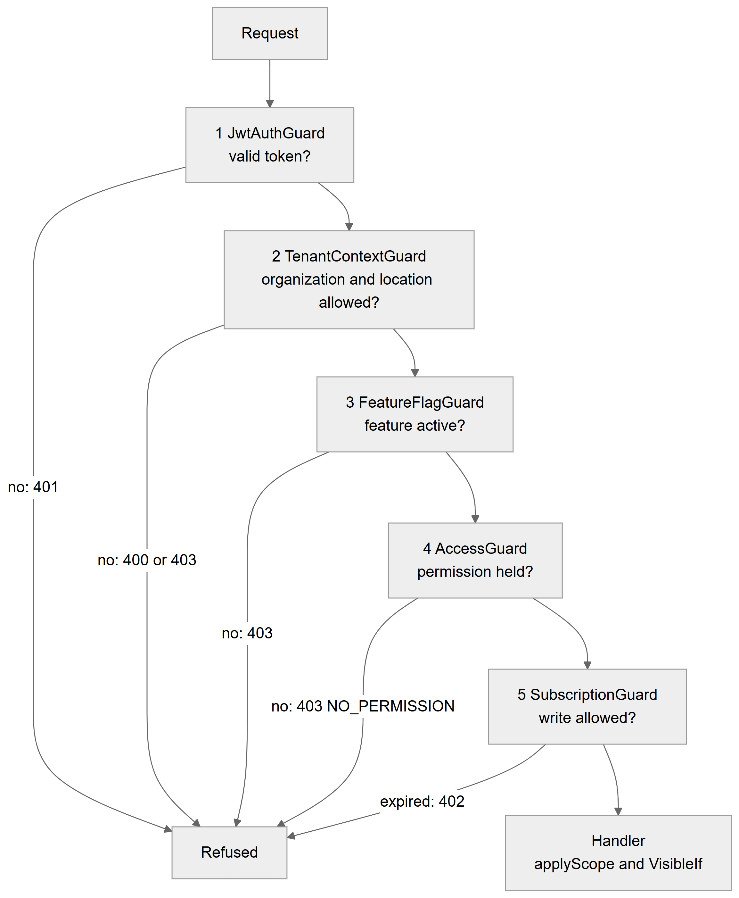
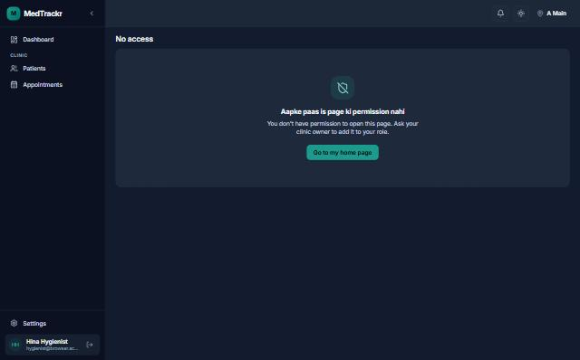
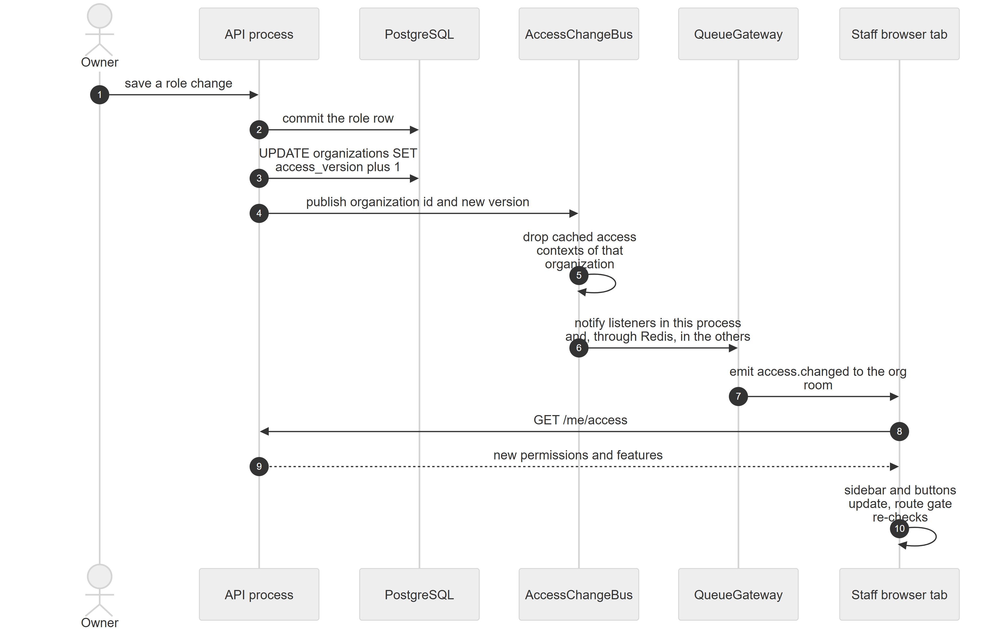

# Chapter 57 — Access control in depth

This chapter follows the Platform's access control from the first guard that sees a request to the last button hidden in the browser. It is written for the product owner, who needs to know where a permission is checked, how quickly a change reaches users and which protections do not exist. Chapter 11 explains the permission catalog, the system roles and the roles screen; this chapter does not repeat them and goes deeper into the mechanics. Customization screens (features, roles, sidebar, theme) are in Chapter 58.

## 57.1 The idea in one minute

**Status:** [Implemented]

Access control answers four separate questions, in this order: Is this a real, signed-in user? Is this user allowed to work in this organization and location? Is the feature switched on for this clinic? Does the user's role hold the permission this action needs? A fifth check asks whether the clinic's subscription still allows writing. Each question is a global guard that runs before the controller. After the guards, two more mechanisms narrow what a person sees inside a permitted action: **row scope** (only own, location or organization rows) and **field hiding** (prices removed from a response). The browser repeats the same questions only to decide what to show; the server never trusts the browser.

**Technical references:** `backend/src/app.module.ts` · `backend/src/access/` · `web-app/src/features/access/`

## 57.2 The five guards in order

**Status:** [Implemented]

Five global guards run on every HTTP request, in a fixed order, and the first refusal stops the request (Chapter 5, section 5.4, lists them with their skip rules).

*Figure 57.1 — The five global guards in the order they run, with the refusal each can give.*

The flowchart reads from top to bottom. A Request enters guard 1, `JwtAuthGuard`, which asks whether the token is valid; if not, the answer is 401 and the request is refused. Guard 2, `TenantContextGuard`, asks whether the organization and location in the headers are allowed for this user; if not, the answer is 400 (headers missing) or 403. Guard 3, `FeatureFlagGuard`, asks whether the required feature is active; if not, 403. Guard 4, `AccessGuard`, asks whether the permission is held; if not, 403 with the code `NO_PERMISSION`. Guard 5, `SubscriptionGuard`, asks whether a write is allowed; if the subscription has expired the answer is 402. A request that passes all five reaches the handler, where row scope and field hiding apply. Every refusal leads to the same "Refused" box.

The details that matter to an owner:

- **Guard 1 and public routes.** `JwtAuthGuard` skips only the routes in a fixed public list (sign-in, register, refresh, password routes, email verification, logout, the public theme, the waiting-room display state and the lab magic links). Marking a handler `@Public()` is not enough on its own; the route must also be in that list.
- **Guard 2 and super admins.** A super admin passes without headers. `@RequireSuperAdmin()` routes are checked here: anyone else gets 403 "Super admin access required". `@ContextFree()` routes skip the tenant check, and the handler then checks access itself. The guard has no path-prefix exceptions. A user passes for an organization if they own it, or if they have an active assignment at that exact location with portal access on.
- **Guard 3 only runs for tagged routes.** `@RequireFeature('key')` is needed only on routes that use `@AnyMember()`, because a permission already implies its feature (the access context drops permissions of inactive features).
- **Guard 4 attaches the access context.** Whenever the request names an organization, it puts the resolved access context on the request for the handler, even on routes with no permission marker.
- **Guard 5 is read-only mode.** It refuses writes with 402 `SUBSCRIPTION_EXPIRED` for a clinic whose subscription has lapsed. Reads, super admins and the paths for signing in, the account, `/me/` and subscription administration stay open.

**Technical references:** `backend/src/auth/guards/jwt.guard.ts` · `backend/src/auth/guards/tenant-context.guard.ts` · `backend/src/feature-flags/guards/feature-flag.guard.ts` · `backend/src/access/access.guard.ts` · `backend/src/subscriptions/subscription.guard.ts`

## 57.3 The decorators

**Status:** [Implemented]

| Decorator | Where | What it means | Enforced by |
|---|---|---|---|
| `@Can('a', 'b')` | handler or controller | Every listed permission is required; class-level and handler-level lists are merged | `AccessGuard` |
| `@AnyMember()` | handler or controller | Any active member of the location (owners and super admins too) | `AccessGuard` |
| `@Public()` | handler or controller | No sign-in required (plus the public route list) | all guards skip |
| `@ContextFree()` | handler or controller | No tenant headers needed; the handler checks access itself | `TenantContextGuard` skips |
| `@RequireSuperAdmin()` | handler or controller | Platform operator only | `TenantContextGuard` |
| `@RequireFeature('key')` | handler or controller | The feature must be active; class and handler lists are merged | `FeatureFlagGuard` |
| `@Access()` | handler parameter | Injects the `AccessContext` of the request | decorator |
| `@VisibleIf('perm')` | property of a response class | The field is removed from the response unless the caller holds the permission | global interceptor |

The table lists the eight decorators with their placement and meaning. The first five say who may call a handler. `@RequireFeature` adds a feature condition. `@Access()` and `@VisibleIf` are tools for handlers and response classes.

**The coverage test.** The test `access-coverage.spec.ts` loads every controller and fails if any handler lacks one of the markers `@Can`, `@AnyMember`, `@Public`, `@RequireSuperAdmin`, `@ContextFree` or an explicit `@UseGuards(...)`, or if any handler still uses the removed role decorator. Controllers under the path prefixes for authentication, sessions and health, and the hello endpoint, are exempt. This test is the safety net, because at runtime a handler with no marker passes the access guard.

**Technical references:** `backend/src/access/decorators/access.decorators.ts` · `backend/src/common/decorators/` · `backend/src/access/access-coverage.spec.ts`

## 57.4 The access context

**Status:** [Implemented]

For each request that names an organization, `AccessResolver` builds an `AccessContext`: user id, organization, location, access version, super-admin flag, owner flag, member flag, employee id, active features, granted permissions (feature-filtered, with implied permissions expanded), the role and its home page. Owners and super admins receive every permission at its widest scope. Staff receive the permissions of the role on their assignment at the active location, and only if portal access is on for that assignment. A role that is inactive or belongs to another organization gives nothing. A missing key means no access.

The context offers a small set of questions that code uses instead of role names:

- `can(permission)` and `canAll([...])`: is it granted.
- `scope(permission)`: `own`, `location` or `org`, or nothing. An unscoped grant reads as `org`.
- `applyScope(queryBuilder, permission, columns)`: adds the row filter to a database query. With `own` it adds a condition on the caller's employee id (or a custom condition). With `location` it adds a condition on the active location. With `org` it adds nothing, because the organization filter is the caller's. With no grant, or when the caller has no employee record or no location to match, it adds a condition that matches no rows. If a developer forgets to name the column, it throws an error rather than silently showing nothing.
- `decide(permission, { value, min, max, approvalFlow })`: returns allow, deny or "needs approval". Inside the range the answer is allow; outside it, allow only when the caller holds the escalation permission (today: preset discounts are escalated by the custom-discount permission), otherwise needs approval when the clinic runs an approval flow, else deny.

**Field hiding.** A response class can mark a property `@VisibleIf('patients.price.view')`. A global interceptor removes that property from every instance in the response when the caller lacks the permission, and removes every guarded field when there is no access context. It works only on class instances, not on plain object literals.

**Technical references:** `backend/src/access/access.resolver.ts` · `backend/src/access/access-context.ts` · `AccessContext` · `backend/src/access/visible-if/visible-if.ts` · `backend/src/patients/access/patient-scope.ts`

## 57.5 What the web app receives: `GET /me/access`

**Status:** [Implemented]

`GET /me/access` is a context-free route that checks membership itself. It needs the organization header and, for staff, the location header; without a location, staff roles give no permissions because roles are per location. It answers 400 without an organization, 403 when the caller has no access there. The answer has these parts: the access version; the organization and location ids; the super-admin and owner flags; the list of active feature keys; the granted permissions with their scope (or `true`); the roles (id, name and template key); the employee id; the home page; and the clinic's sidebar layout, which is null while the clinic uses the default. `GET /access/catalog` (needs `admin.roles.manage`) returns the catalog, bundles and role templates for the roles screen.

**Technical references:** `backend/src/access/access.controller.ts` · `MeAccessController` · `AccessCatalogController`

## 57.6 In the browser

**Status:** [Implemented]

- **`AccessProvider`** loads `/me/access` for the active organization and location. The data is fresh for 30 seconds and refetched when the window regains focus, when the realtime socket announces `access.changed` and after a reconnect.
- **`useAccess()`** returns `can(permission)`, which takes one permission or a list and means any-of; `canAll(list)` for all-of; `scope(permission)`; feature checks; the owner and super-admin flags; the home page and the sidebar layout. The `<Can perm="...">` component wraps content the same way. When no payload exists yet for a super admin on a setup page, a fallback allows everything; a loaded payload is always the source of truth.
- **Route gate.** Each route file declares `staticData: { can: ... }`. One component, `RouteAccessGate`, mounted in the root route (`__root.tsx`), reads the requirement of every matched route and shows the No access page when any requirement fails. While access is loading it shows a skeleton; if loading fails it shows "Couldn't load your access" with a retry button. Routes without a requirement pass.
- **Sidebar.** The sidebar comes from a developer-owned registry of 39 items. Each item declares its own requirement: a permission (any-of), `superAdminOnly` (six items: Organizations, Subscriptions, Lab Directory, Form schemas, Workflows, Stage templates), `labMember` (the Lab portal item) and `ownerOrSuperAdmin` (the flag exists but no item uses it today). The clinic's saved layout only arranges, renames and hides these items; items a user may not open are removed before display. Registry items that the layout forgot appear in a trailing "More" section so a new page never disappears silently.
- **Home page.** After sign-in, the role's home page is used, then the clinic's home page, and the page is opened only if the user passes the same sidebar and route checks; otherwise the Dashboard opens.

*Figure 57.2 — The No access page shown when a role lacks the permission of the page.*

The screenshot was taken on 2026-10-23 in dark theme and shows the former working name of the product in the corner; the product is now called the Platform and each clinic sets its own name. A test user in a custom role opened a page their role does not allow. The sidebar is short: Dashboard, and under "Clinic" only Patients and Appointments, with Settings and the user at the bottom. The main area is titled "No access" and shows a shield icon, a Roman-Urdu headline meaning that the user has no permission for this page, an English sentence saying the user does not have permission and should ask the clinic owner to add the page to their role, and a button, "Go to my home page". The user can click the button to go to the role's home page, or to the Dashboard if the role has none.

**Technical references:** `web-app/src/features/access/components/AccessProvider.tsx` · `RouteAccessGate.tsx` · `NoAccess.tsx` · `web-app/src/features/access/lib/access.ts` · `web-app/src/features/access/nav/nav.registry.ts` · `resolveNav.ts` · `homeRoute.ts` · `web-app/src/routes/__root.tsx`

## 57.7 How fast a change reaches users

**Status:** [Implemented]

Each organization has a counter, `organizations.access_version`. It is raised by one after any committed change that can alter someone's access: employment roles (any column), assignments (role, location, organization, active flag, portal access or linked login), organization feature flags, ownership, location feature overrides and sidebar layout changes. An entity subscriber does this automatically for writes made through the data layer, once per transaction after the commit and never on rollback. Code that uses raw SQL or database cascades must bump explicitly; the employee delete path does.

*Figure 57.3 — Sequence from an owner's role change to the refreshed browser tabs.*

The diagram has six participants: the Owner, the API process, PostgreSQL, the `AccessChangeBus`, the `QueueGateway` and a Staff browser tab. (1) The owner saves a role change. (2) The API commits the role row. (3) The API increments `access_version` of the organization. (4) The API publishes the organization id and new version to the bus. (5) The bus drops cached access contexts of that organization. (6) It notifies listeners in this process and, through Redis, in the other processes. (7) The gateway emits `access.changed` to the organization's room. (8) The browser tab calls `GET /me/access`. (9) The API answers with new permissions and features. (10) The sidebar and buttons update and the route gate checks again.

The timing rules are:

- **Version cache.** Each process caches the current version of an organization for 15 seconds. The bus updates it at once in every process that hears the change.
- **Context cache.** Access contexts are cached in process memory, at most 10,000, for at most 5 minutes, keyed by user, organization, location and version. A new version means a new key, so stale entries are never used.
- **Redis.** One Redis channel carries access-change messages between API and worker processes. If Redis is down, only the process that made the change learns at once; the others catch up within 15 seconds, when their cached version expires.
- **Feature cache.** The enabled-feature set is cached for a short time and dropped by the same bus.
- **Browser.** Open tabs refetch when told, on focus, and in any case after 30 seconds of staleness.

In practice, an owner's change reaches other staff within seconds, and within 15 seconds even when Redis is unavailable. A person who is already inside a permitted request is not interrupted.

**Technical references:** `backend/src/access/version/access-version.service.ts` · `AccessVersionService` · `access-version.subscriber.ts` · `access-change-bus.ts` · `web-app/src/features/access/hooks/useAccessSocket.ts`

## 57.8 The lab portal is a separate door

**Status:** [Implemented]

Lab staff do not use the clinic guards for their screens. Every lab portal controller uses its own `LabPortalGuard` after the global guards (which skip these routes as context free). It rejects any request carrying clinic headers (400 `LAB_PORTAL_CLINIC_CONTEXT`), so lab and clinic scopes cannot mix. It requires an active membership of an active lab; the lab is named by an `x-lab-id` header, or is the user's only lab (several labs without a header gives 400 `LAB_SELECTION_REQUIRED`). Another lab's id looks exactly like a lab that does not exist (403 `LAB_ACCESS_DENIED`). A lab role list on the handler (lab admin or technician) is checked against the membership. Super admins hold no lab membership and are refused. Chapter 41 describes the portal itself.

**Technical references:** `backend/src/labs/portal/lab-portal.guard.ts` · `LabPortalGuard` · `backend/src/labs/portal/lab-memberships.ts`

## 57.9 Row-level security does not exist

**Status:** [Not implemented]

The database has no row-level security policies. Tenant isolation is enforced by the application: handlers filter every query by the organization (and often the location) taken from the validated tenant context, and by `applyScope` for own, location and organization reach. A bug in a query that forgets the organization filter would therefore not be stopped by the database. The safeguards are the coverage test, the single `@ActiveTenant()` source of the organization, and code review. Chapter 8 describes the tenant model.

## 57.10 Limitations and known gaps

- Tenant isolation is application-level only (section 57.9).
- A handler without a marker passes the access guard at runtime; only the coverage test prevents it.
- Contexts and version numbers are cached in process memory; with Redis down, other processes may lag up to 15 seconds.
- An access token already issued is not re-checked against the session; permissions, however, are checked on every request from the access context, so a role change takes effect without a new token.
- The `ownerOrSuperAdmin` sidebar flag is unused today.

## 57.11 Owner's FAQ

**I removed a permission from a role. When does it stop working?** Within seconds for open screens (the browser is told over the realtime connection) and on the next request on the server. At worst 15 seconds if the message bus is down.

**A user opens a page by typing its address. Can they bypass the sidebar?** No. The route gate shows No access and the API refuses the data calls with 403 `NO_PERMISSION`. Hiding a sidebar item is cosmetic; the checks are the permission on the route and on the API.

**Does the sidebar layout give anyone access?** Never. The layout only arranges pages the registry knows; every item still needs the viewer's permission.

**Can the database stop one clinic seeing another's data?** Not by itself. The application filters every query by organization; there are no database row-level policies.

**Who can see which patients?** The scope of `patients.view`: a doctor sees own patients, front desk sees the location, an admin sees the organization (Chapter 11).

**What does 402 mean?** The clinic's subscription expired; the clinic is read-only until a payment is recorded (Chapter 45).
