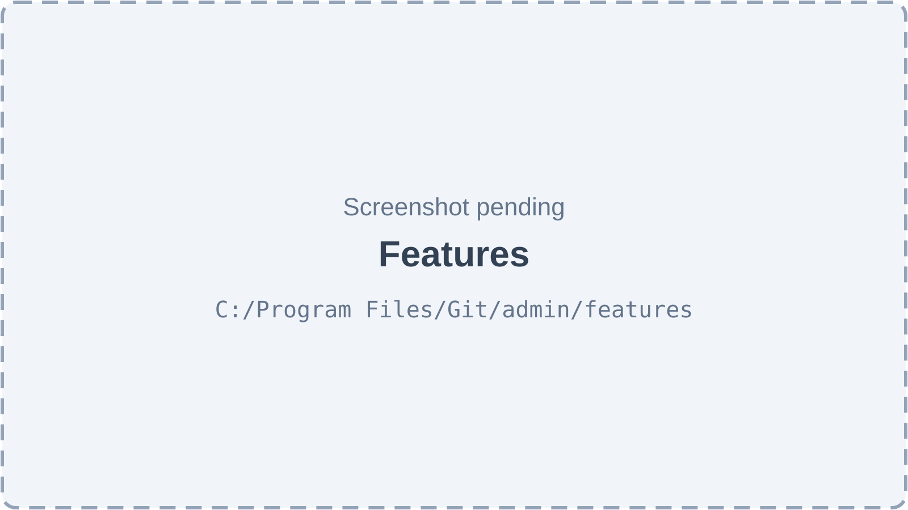
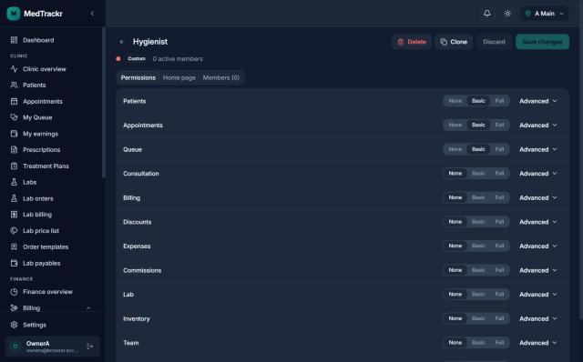
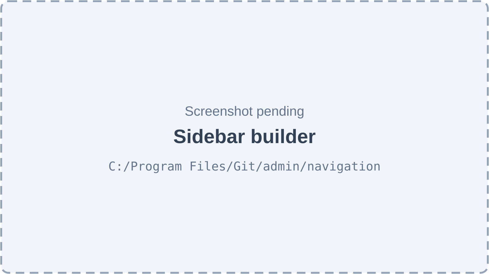
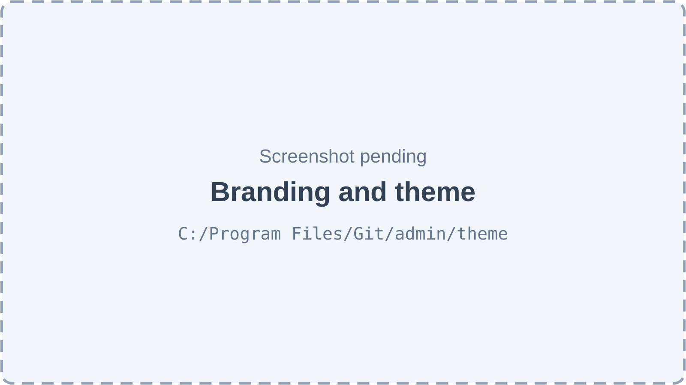
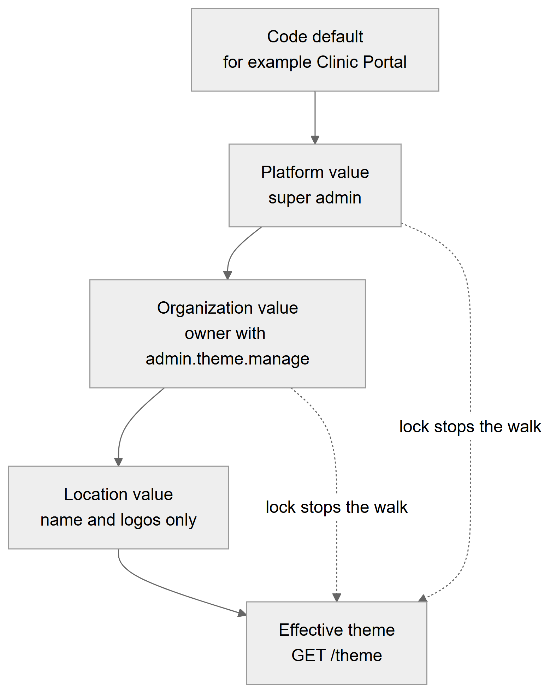
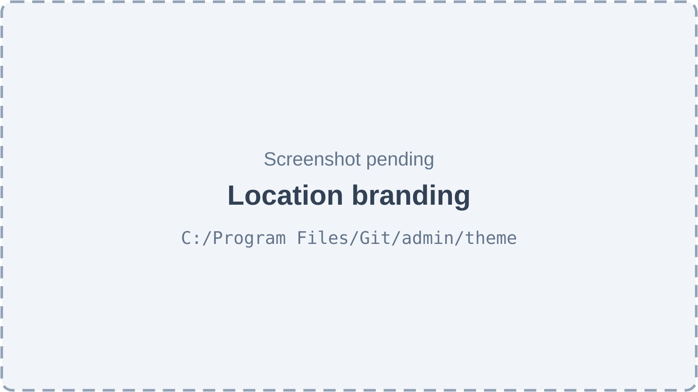

# Chapter 58 — Clinic customization

This chapter describes how a clinic shapes the Platform to its own way of working: which features are on, which roles exist and what they may do, how the sidebar is arranged, how the application looks, and where each role starts. It is written for the product owner, who needs to know what an owner can change without a developer and what only the platform team can change. Four setup screens carry this work: Features, Roles and permissions, Sidebar and Branding and theme. The permission model behind them is in Chapters 10 and 11 and the access mechanics are in Chapter 57; this chapter restates what is needed and describes the screens.

## 58.1 The four setup screens

**Status:** [Implemented]

| Screen | Route | Sidebar label (section "Clinic setup") | Permission to open |
|---|---|---|---|
| Features | `/admin/features` | Features | `admin.features.manage` |
| Roles | `/admin/roles` | Roles & permissions | `admin.roles.manage` |
| Sidebar builder | `/admin/navigation` | Sidebar | `admin.nav.manage` |
| Branding and theme | `/admin/theme` | Theme | `admin.theme.manage` |

The table lists the four screens, their routes, the labels in the sidebar and the permission each route needs. The owner always has all four permissions. The Admin system role holds them by default. Every save on these screens increases the organization's access version or invalidates the settings cache, so changes reach other users quickly (Chapter 57, section 57.7).

**Technical references:** `web-app/src/routes/admin.features.tsx` · `admin.roles.index.tsx` · `admin.navigation.tsx` · `admin.theme.tsx` · `web-app/src/features/access/nav/nav.registry.ts`

## 58.2 Features screen

**Status:** [Implemented]

**What it does.** Lets the owner switch the features in the clinic's plan on or off for the whole clinic, or switch one off at a single location. A feature is only available if the platform team has **entitled** the clinic to it; the owner then decides whether it is **enabled**; and a **location override** can switch it off at one branch. Chapter 10 describes the three switches and the catalog in full.

*Figure 58.1 — Features screen (screenshot pending).*

The page is titled "Features" with the subtitle "Turn the features in your plan on or off for the clinic, or for one location." Features are listed in rows, each with a name, a switch and a button that opens the locations sheet. A filter row narrows the list. Features the clinic is not entitled to cannot be switched on. If there are no features the page says "No features yet" and that the platform has not set up any features for the clinic.

**How the user does it.**
1. Open **Features** in the sidebar.
2. Move a switch to turn a feature on or off. Turning a feature off first opens a dialog titled "Turn off <feature>?" that lists the permissions the feature carries and the roles that will lose them. This is the **impact preview**.
3. Click **Turn off** to confirm.
4. To switch a feature off for one branch only, open the locations sheet and move the switch of that location.

**Behind the scenes — technically.**

| Action | Endpoint |
|---|---|
| List features for the clinic | `GET /admin/features` |
| Impact of turning one off | `GET /admin/features/:key/impact` |
| Switch on or off | `PATCH /admin/features/:key` |
| Switch off or on at one location | `PUT /admin/features/:key/locations/:locationId` |

The table lists the four endpoints; all need `admin.features.manage`. The impact call returns the catalog permissions the feature carries and, for each active role of the organization that grants any of them, the permissions it would lose. Turning on a feature the clinic is not entitled to gives 403 `NOT_ENTITLED`. Every change writes an `audit_logs` row; a super admin acting inside a clinic is recorded as the platform.

**Technical references:** `backend/src/feature-flags/admin-features.controller.ts` · `FeatureAdminService.getImpact` · `web-app/src/features/feature-settings/`

## 58.3 Roles builder

**Status:** [Implemented]

**What it does.** Lets the owner (or anyone with `admin.roles.manage`) create custom roles, copy a system role, choose a level for each module, set a home page and see members. Chapter 11, section 11.5, describes the rules in detail: escalation protection, reason for high-risk grants, read-only system roles, unique names and the ban on deleting a role that has members.

*Figure 58.2 — The role editor for a custom role, showing None, Basic and Full per module.*

The screenshot was taken on 2026-10-23 in dark theme and shows the former working name of the product in the corner. It shows a custom role open in the editor. The header holds the role name and the actions Delete, Clone, Discard and Save changes. Three tabs sit under it: Permissions, Home page and Members. On the Permissions tab each module has a row with three level buttons, None, Basic and Full, and an Advanced control that opens the module's full permission list with a check box and, for scoped permissions, a scope selector. A module whose permissions match no level exactly shows Custom. The left sidebar shows the full owner menu.

**What the levels mean.** **None** grants nothing from the module. **Basic** grants an everyday set. **Full** grants every permission of the module at its widest scope. **Advanced** lets the owner tick individual permissions. **Clone** copies any role, including a system role, with the same permissions and home page, and moves nobody to the copy. **Members** lists the employees who hold the role, per location; roles are assigned on each employee's page.

**Technical references:** `backend/src/employees/employment-roles.admin.controller.ts` · `backend/src/access/catalog/bundles.ts` · `web-app/src/features/roles/`

## 58.4 Per-role home page

**Status:** [Implemented]

**What it does.** Sets the page a member of the role lands on after signing in. The five system roles have defaults (Admin: dashboard; Doctor: the doctor's queue; Receptionist and Assistant: appointments; Accountant: billing).

**How the user does it.** Open a custom role, choose the **Home page** tab, pick a page in the "Page" list and save. The clinic as a whole can also set a **Clinic home page** on the Sidebar screen; it is used when the role sets none.

**Rules and validations.** The value must be an in-app path starting with a single slash, with no address or scheme. At sign-in the web app uses the role's page, then the clinic's page, then the Dashboard; the page opens only if the user passes the permission checks for it, otherwise the Dashboard opens. A home page never widens access.

**Technical references:** `web-app/src/features/roles/components/HomePageTab.tsx` · `web-app/src/features/access/nav/homeRoute.ts` · `backend/src/access/nav/nav-layout.dto.ts`

## 58.5 Sidebar builder

**Status:** [Implemented]

**What it does.** Lets the owner rename, hide, group and reorder the pages in the sidebar for the whole clinic. Each person still sees only the pages they may open, so the layout can never give access.

*Figure 58.3 — Sidebar builder (screenshot pending).*

The page is titled "Sidebar" with the subtitle "Rename, hide and reorder the pages in your clinic's sidebar. Each person still sees only the pages they have access to." A line at the top says whether the clinic uses the standard sidebar or a custom one, or that there are unsaved changes. The buttons are **Discard changes** (when dirty), **Reset to default** and **Save**. A "Clinic home page" selector (default: Dashboard) comes first. The editor is a drag-and-drop area of sections; each section has a label that can be renamed, can contain pages and collapsible groups, and has a remove button. An **Add section** button adds a section. Pages that are not in any section wait in a tray called "Not placed". Each page can be renamed inline, hidden with a toggle, or dragged to another place. On the right, a live preview shows the sidebar as the owner would see it, with a note that other roles see only their pages. Leaving with unsaved changes asks "Leave without saving?".

**How the user does it.**
1. Open **Sidebar** under Clinic setup.
2. Drag pages between sections or the tray, rename sections and pages, hide pages, add groups.
3. Choose a clinic home page.
4. Click **Save**. To undo everything, click **Reset to default** and confirm; sections, renames, hidden pages and the clinic home page are removed.

**Behind the scenes — technically.** The layout is stored as one JSON document per organization in `nav_layouts`; a column for a role exists but only the clinic default is written today. Endpoints (all need `admin.nav.manage`): `GET /admin/navigation` (null while the clinic uses the default), `PUT /admin/navigation` and `DELETE /admin/navigation`. Saving and resetting bump the access version and write an audit row.

**Rules and validations.**
- At most 20 sections; labels at most 40 characters; at most 100 items in a list.
- Item keys must look like `nav.something`; no key may appear twice anywhere.
- A section entry is either a link (a key) or a group (a label and items, no key).
- The home route must be an in-app path.
- Footer items (Settings) stay pinned and cannot be arranged.
- Pages the layout forgets appear in a "More" section, so nothing disappears by accident.

**Data read and written.** `nav_layouts`, `audit_logs`.

**Technical references:** `backend/src/access/nav/nav-layouts.controller.ts` · `NavLayoutsService` · `nav-layout.dto.ts` · `web-app/src/features/nav-builder/` · `web-app/src/features/access/nav/resolveNav.ts`

## 58.6 Sidebar registry flags

**Status:** [Implemented]

The list of pages that can appear is owned by developers in `nav.registry.ts`: 39 items. The clinic's layout only arranges them. Each item has one requirement: a permission or list of permissions (any-of), `superAdminOnly` (Organizations, Subscriptions, Lab Directory, Form schemas, Workflows and Stage templates), `labMember` (Lab portal) or `ownerOrSuperAdmin` (defined but unused). Section 57.6 describes how the sidebar is filtered. Adding a new page needs a code change; the owner cannot create sidebar items.

## 58.7 Theme and branding

**Status:** [Implemented]

**What it does.** Controls the clinic's name, logos, brand colour, sidebar style and default light or dark mode, for staff screens, the login page and printouts.

*Figure 58.4 — Branding and theme (screenshot pending).*

The page is titled "Branding & theme" with the subtitle "Your clinic's name, logo, colours and look — for staff screens, the login page and printouts." It has a back link to Settings and a button that opens the per-location sheet. The controls are on the left and a live preview is on the right. The controls are: Clinic name; Logo (light); Logo (dark); Browser tab icon; Brand colour; Sidebar style; Default mode. Each can carry a lock switch labelled "Locations can't override". Buttons are **Save theme** (enabled only when the form changed and is valid) and a reset button that asks "Reset to default?".

**The seven keys.**

| Key | Meaning | Allowed values | Scopes that may set it |
|---|---|---|---|
| `theme.app_name` | Clinic name shown in the application (default "Clinic Portal") | 1 to 60 characters | organization, location |
| `theme.logo_url` | Light-mode logo | http or https address | organization, location |
| `theme.logo_dark_url` | Dark-mode logo | http or https address | organization, location |
| `theme.favicon_url` | Browser tab icon | http or https address | organization |
| `theme.brand_color` | Brand colour (default blue) | `#rrggbb` | organization |
| `theme.sidebar_style` | Sidebar look | light, dark or brand | organization |
| `theme.default_mode` | Starting mode | light, dark or system | organization |

The table lists the seven theme keys with their meaning, allowed values and the levels that may set them. Only the name and the two logos can differ per location. The platform level may set any key. Each key can be locked by the platform for organizations, or by the organization for its locations.

**The cascade.**

*Figure 58.5 — The theme cascade from code default to the effective theme, with locks.*

The flowchart reads from top to bottom. The code default (for example the name "Clinic Portal") feeds the Platform value set by the super admin. That feeds the Organization value set by an owner with `admin.theme.manage`. That feeds the Location value, which may set only the name and logos. The last box is the effective theme returned by `GET /theme`. Two dotted arrows from the Platform and Organization boxes straight to the effective theme show that a lock stops the walk: a value locked at a higher level wins over anything set lower down.

**Logos.** A logo is uploaded with `POST /uploads`, which accepts one file up to 15 MB; the theme screen accepts images up to 2 MB and stores the returned address as the value.

**Brand colour contrast check.** When the owner picks a colour, the screen checks it against accessibility rules. It warns if the button text on the colour has less than 4.5 to 1 contrast, and warns if the colour on a white page has less than 3 to 1 (links and outlines will be hard to see, and a darker shade is used for brand text). When both pass, the screen says "Contrast OK" with the ratio. The warning is advice; it does not block saving.

**Public theme for the login page.** `GET /public/theme/:organizationId` (optionally with a location) is public and returns theme tokens only, nothing else about the clinic. An unknown organization gets the platform theme. The login page learns which clinic to show from an organization parameter in the address or from the last clinic used in that browser. The browser also keeps a copy of the last theme and its colours so the loading screen is on-brand before the server answers; local storage is used only for this convenience.

*Figure 58.6 — Location branding (screenshot pending).*

The sheet is titled "Location branding" with the text "A branch can show its own name and logo. Empty fields use the clinic's." It opens from the button on the theme page. A "Location" list chooses the branch, then an "Overrides" section holds "Name at this location", "Logo (light)" and "Logo (dark)". Saving applies the override; empty fields inherit.

**Endpoints.**

| Action | Endpoint | Permission |
|---|---|---|
| Resolved theme for the signed-in clinic | `GET /theme` | any member |
| Organization view and save | `GET` and `PUT /admin/theme` | `admin.theme.manage` |
| Location view and save | `GET` and `PUT /admin/theme/location/:locationId` | `admin.theme.manage` |
| Platform view and save | `GET` and `PUT /platform/theme` | super admin |
| Public theme | `GET /public/theme/:organizationId` | none |

The table lists the endpoints. A write sends values by short key (a null or empty text clears the value, which inherits) and optional locks (organization and platform only; a location cannot lock). Values are validated by the registry's schema for each key. A write to a key locked higher up fails with 403 `SETTING_LOCKED`. The write takes a row lock, increases the row's version, writes an audit row and invalidates the settings cache in every process through Redis; without Redis the other processes catch up within the 60-second cache time.

**Data read and written.** `config_values` (one row per scope, scope id and key, with the value, a lock flag, a version and the editor), `audit_logs`.

**Technical references:** `backend/src/settings-registry/theme/theme.controller.ts` · `ThemeService` · `theme.settings.ts` · `backend/src/settings-registry/settings-registry.service.ts` · `SettingsRegistryService` · `web-app/src/features/theme/` · `web-app/src/features/theme/lib/color.ts`

## 58.8 Settings registry

**Status:** [Partial]

The settings registry (`config_values`) is the general store for new settings with the platform, organization and location cascade and locks. Today only the seven theme keys are defined in it. Older settings live in their own typed tables, for example the queue policies and the location billing settings, and keep working unchanged. The code does not move them into the registry.

## 58.9 Limitations and known gaps

- The sidebar layout is per clinic only; per-role layouts are not written yet (the column exists).
- The owner cannot add new sidebar pages or permissions; both are fixed in code.
- Only the name and logos can be customized per location.
- The brand colour check is advice, not a rule.
- Fonts, spacing and corner radius cannot be customized.

## 58.10 Owner's FAQ

**Who can switch a feature on that my plan does not include?** Only the platform team, by entitling it. The owner can only enable features the clinic is entitled to.

**If I hide a page in the sidebar, can people still open it?** Yes, by address, if their role allows it. Hiding is cosmetic; use roles to remove access.

**Can each branch have its own logo?** Yes. Each branch can have its own name and light and dark logos; the colour and mode are clinic wide.

**Why can I not change the colour?** The platform team may have locked that key for clinics. The screen marks such a key as locked at a higher level.

**Where do I set what a role sees first?** On the role's Home page tab. The clinic-wide fallback is on the Sidebar screen.

**What happens to people when I turn a feature off?** They lose the permissions that belong to the feature at once, and the dialog before you confirm lists the roles affected.
