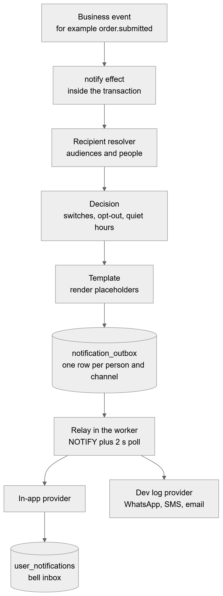
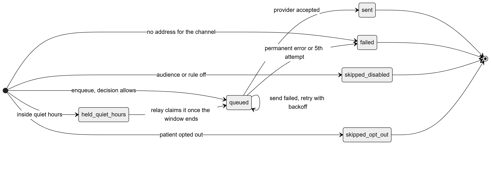

# Chapter 59 — Notification mechanics

This chapter explains how a notification travels inside the Platform, from the business event that causes it to the bell icon where a staff member reads it. It is written for the product owner who wants to understand the pipeline and its guarantees. The Notifications module chapter (Chapter 44) describes the settings screen, the event catalog and what users see; this chapter covers only the mechanics. Today the Platform delivers notifications **in the application only**: WhatsApp, SMS and email are prepared in the code but have no real sender.

## 59.1 The pipeline

**Status:** [Implemented] for in-app delivery. [Not implemented] for WhatsApp, SMS and email.

A **notification event** is a named thing that happens, such as `order.submitted` or `item.ready` (21 are seeded, all about lab orders, shipments, stages, appointments linked to labs and payments). When a workflow step runs the `notify` effect, the Platform decides who should be told, whether each person wants it, what the message says and when it may be sent. The result is one row per person and channel in a table called `notification_outbox`. A separate loop in the worker process sends those rows later. This is the **transactional outbox** pattern: the notification row is written in the same database transaction as the business change, so it exists only if the change was committed.

*Figure 59.1 — The path of a notification from the business event to the inbox.*

The flowchart reads from top to bottom. A "Business event" (for example `order.submitted`) triggers the "notify effect", which runs inside the transaction of the change. The effect asks the "Recipient resolver" for the audiences and people to tell. For each person and channel a "Decision" step applies the switches, the patient's opt-out and quiet hours. A "Template" step renders the message, filling placeholders. The result is stored in the database table `notification_outbox`, one row per person and channel. The "Relay in the worker", woken by a database NOTIFY and by a two-second poll, claims due rows. The "In-app provider" writes the user's copy into `user_notifications`, which is the bell inbox. A second branch, the "Dev log provider", handles WhatsApp, SMS and email by writing the message to the server log instead of sending it.

**Technical references:** `backend/src/notifications/services/notification.service.ts` · `NotificationService.enqueue` · `backend/src/notifications/effects/notify.effect.ts` · `backend/src/notifications/delivery/`

## 59.2 Event, recipients and audiences

**Status:** [Implemented]

The `notify` effect names an event code (and may narrow the audiences). An unknown code fails the whole transition, so a typo can never silently drop messages. Who receives the message is decided by a **recipient resolver** registered per kind of subject: the module that owns the subject says how to find its doctor, coordinator, lab and patient. Today only the lab order workflow registers one, so lab events are the only ones that produce notifications.

There are four **audiences**: patient (the only external audience), doctor, coordinator and lab. A recipient is a user (a signed-in person), a patient or a lab contact. The same person listed twice, or under two audiences, gets one row per channel. If an event is not meant for an audience, enqueueing for it fails with `NOTIFICATION_AUDIENCE_INVALID`. A patient is looked up in the same organization, so a clinic can never message another clinic's patient.

**Technical references:** `backend/src/notifications/effects/notification-recipients.registry.ts` · `NotificationRecipientsRegistry` · `backend/src/notifications/notifications.enums.ts`

## 59.3 Rules and the decision order

**Status:** [Implemented]

For every recipient and channel the Platform makes one decision. The first check that matches wins:

1. An internal audience with a mandatory event on the in-app channel is queued, ignoring settings.
2. If the audience's master switch is off, the row is stored as `skipped_disabled`.
3. If the rule for this event and channel is off, it is `skipped_disabled`.
4. If the patient opted out of the channel, it is `skipped_opt_out`.
5. If the time is inside the audience's quiet hours (and the channel is not in-app), it is `held_quiet_hours` until the window ends.
6. Otherwise it is `queued` for now.

Skipped rows are still written, so the clinic can see in its message log why nothing was sent. Defaults apply when a clinic has set nothing: the patient audience and every patient rule are off; internal audiences are on, with in-app on and the external channels off. The channels offered per audience in code are in-app only for doctor, coordinator and lab, and none for patients, so patients receive nothing today.

**Quiet hours** are a start and end time per audience. The window can cross midnight (for example 22:00 to 08:00); equal start and end means no window. They use the audience setting's timezone if it names one, otherwise the timezone of the location the event belongs to (Chapter 62), otherwise UTC. In-app messages are never held, because they are silent.

**Technical references:** `backend/src/notifications/decision/notification-decision.ts` · `decide` · `quietHoursEnd`

## 59.4 Templates

**Status:** [Implemented]

A template has a subject, a body, a channel, a language (English, Urdu or Roman Urdu) and optional provider reference. The body uses placeholders such as `{clinic_name}` and `{recipient_name}`, plus the event's own. An unknown placeholder becomes empty text so no raw braces ever reach a person. The Platform picks the clinic's own template in the person's language, then the platform's template in that language, then the same two in English. A rule can name a specific template. If no template exists, the event's name and description are used.

**Technical references:** `backend/src/notifications/templates/template-render.ts` · `renderTemplate` · `pickTemplate`

## 59.5 Outbox, relay and sending

**Status:** [Implemented]

*Figure 59.2 — Status lifecycle of a row in `notification_outbox`.*

The diagram starts at a dot and shows several entry points. A row is created as `queued` when the decision allows sending, as `held_quiet_hours` when it falls inside quiet hours, as `skipped_disabled` when a switch or rule is off, as `skipped_opt_out` when the patient opted out, and directly as `failed` when the channel needs an address and the recipient has none. A held row becomes `queued` when the relay claims it once the quiet window has ended. A queued row becomes `sent` when the provider accepts it. A queued row whose send fails stays `queued` and is tried again after a pause. It becomes `failed` on a permanent error or at the fifth attempt. `sent`, `failed` and both skipped statuses are final. The status `delivered` exists in the code for providers that report delivery but nothing sets it today.

The relay (`NotificationRelayService`) runs only in processes that run jobs, which is the worker. It is woken at once by a database NOTIFY sent inside the enqueue transaction (so it fires only on commit) and also polls every two seconds, which picks up retries and quiet-hours rows that are due. If the NOTIFY connection fails, it logs a warning and relies on polling.

Sending works like this:

- A row is **claimed** with one short statement that locks it so no other worker takes it, adds one to its attempt count and pushes its due time out by a five-minute lease. If a worker dies mid-send, the row reappears after the lease.
- The provider is called with no transaction open; the result is written back only if this claim is still the latest.
- A failure is retried after 30 seconds, 2 minutes, 10 minutes and one hour; the fifth failure makes the row `failed`. A provider can mark an error permanent to skip retries.
- Delivery is at least once. The in-app copy is protected by a unique link to the outbox row, so a retry after a crash never shows the same message twice.
- Batches of 50 are processed until nothing is due.

**Providers.** The in-app provider writes `user_notifications` (user, event, title, body, link, read time). The development provider logs WhatsApp, SMS and email messages and marks them sent, so flows run end to end; it sends nothing to anyone. A real provider can take over a channel through the provider registry.

**Technical references:** `backend/src/notifications/delivery/notification-relay.service.ts` · `notification-dispatcher.service.ts` · `in-app.provider.ts` · `dev-log.provider.ts` · `channel-provider.registry.ts`

## 59.6 The inbox and the settings screen

**Status:** [Implemented]

The bell shows the signed-in user's inbox through `GET /me/notifications` (paged, with an unread-only filter), `GET /me/notifications/unread-count`, `POST /me/notifications/:id/read` and `POST /me/notifications/read-all`. These routes are context free: a user's inbox spans every clinic they work at, and lab users have no clinic location. Clinic settings are under `/notification-settings` and need `notifications.settings.manage`: the overview with master switches and quiet hours, audience updates, the rules matrix, templates (create, change, reset to platform wording) and the message log. A patient's channel preferences are read with `patients.view` and changed with `patients.edit`. Chapter 44 describes these screens.

## 59.7 Limitations and known gaps

- Only lab-related events exist; no appointment reminders or billing notices are produced.
- WhatsApp, SMS and email have no provider; patients cannot be reached.
- Only the lab workflow registers recipients.
- Inventory alerts are not notifications; they go to the server log only (Chapter 63).
- The status `delivered` is never set.

## 59.8 Owner's FAQ

**If a lab order is rolled back, is a notification still sent?** No. The notification row is part of the same transaction and disappears with it.

**Why did a staff member not get a message?** Check the log in notification settings: it shows each row with its status and reason, such as an audience switched off or a rule disabled.

**Can I send reminders to patients by WhatsApp?** Not yet. The decision logic and templates exist, but the channel is commented out and no provider is connected.

**What happens if the worker is down?** Rows stay queued in the database and are sent when the worker returns; nothing is lost.

**Can quiet hours delay an in-app message?** No. Quiet hours apply only to external channels.
