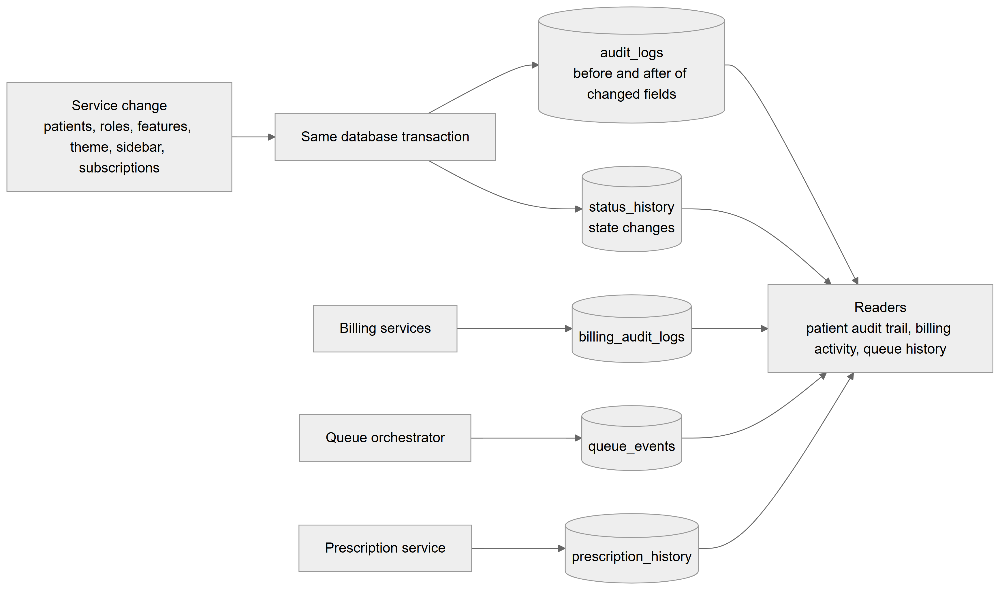

# Chapter 60 — Audit logging

This chapter explains how the Platform records who changed what and when: the history tables, the modules that write to them today, who may read them and what is kept for how long. It is written for the product owner, who must be able to answer an auditor's question honestly. The most important message is that audit coverage is **uneven**: patients and several administration areas are recorded in detail, while appointments, employees, payroll and organizations are not yet recorded in the general audit log.

## 60.1 The history tables

**Status:** [Implemented]

The Platform has several history tables, written by different modules at different times.

| Table | Written by | What a row says |
|---|---|---|
| `audit_logs` | the shared audit service | One change: entity type and id, action (create, update, void, delete, export, view_sensitive), the **changed fields** before and after, actor, actor side (clinic, lab, platform, system), IP address and request id |
| `status_history` | the shared audit service | One state change: from state, to state, action code, actor, channel (app, portal, magic link, proxy, QR), reason |
| `billing_audit_logs` | billing services | One billing event with before and after, reason, amount, actor and the actor's role |
| `queue_events` | the queue orchestrator | One queue event with a running sequence number, status before and after |
| `prescription_history` | the prescription service | One prescription event: created, amended (with a full snapshot of the earlier version), finalized, printed, shared |

The table lists the five history tables and what each row records. `audit_logs` and `status_history` are the general tables. The other three are older, module-specific histories that stay as they are.

**Append only.** `audit_logs` and `status_history` are protected by database triggers that reject any update or delete, so a row, once written, cannot be changed through the application or by accident. `commission_entries` has a similar trigger (Chapter 35). `billing_audit_logs`, `queue_events` and `prescription_history` are append-only by convention: the code only inserts, but no trigger enforces it.

**Written in the same transaction.** The shared service always writes in the caller's transaction, so the history commits or rolls back together with the change. An update that changed nothing writes no row.

**Subject.** Each general row can carry a `subject_id`, the record whose history it joins. For example, a patient's vitals row carries the patient as subject, so one query returns the patient's whole history.

**Technical references:** `backend/src/common/audit/audit.service.ts` · `AuditService` · `backend/src/common/audit/entities/` · `backend/src/migrations/1792490000000-lab-management-foundation.ts` · `backend/src/billing/audit/billing-audit.service.ts` · `backend/src/queue/entities/queue-event.entity.ts` · `backend/src/prescriptions/entities/prescription-history.entity.ts`

*Figure 60.1 — Writers, history tables and readers.*

The flowchart reads left to right. A box "Service change" (patients, roles, features, theme, sidebar, subscriptions) leads to "Same database transaction", which writes two tables: `audit_logs` (before and after of changed fields) and `status_history` (state changes). Three other writers stand alone: "Billing services" write `billing_audit_logs`, the "Queue orchestrator" writes `queue_events` and the "Prescription service" writes `prescription_history`. All five tables feed a single box, "Readers", which names the patient audit trail, the billing activity feed and the queue history.

## 60.2 What is recorded today

**Status:** [Partial] — coverage differs by module. The table states what the code does now.

| Area | Written to the general audit log? | Detail |
|---|---|---|
| Patients | Yes, [Implemented] | Create, update and delete of the patient; activate and deactivate (as status history); 13 kinds of patient records (dental info, tooth chart, vitals, treatment plans and plan items, prescriptions as listed on the patient, documents, consents, communications, recalls, referrals, feedback and insurance). Delete rows keep the last snapshot and the counts of linked records. Patient import and queue walk-in patient creation are audited the same way. File addresses and signatures are never stored in the log. |
| Patient exports | Yes | Every patient CSV export writes an `export` row with the number of rows and the filters used |
| Report exports | Yes | Every Excel or PDF report export writes an `export` row with the report, format and period |
| Employment roles | Yes | Each create, edit, clone and delete, with before and after values and the reason for high-risk grants |
| Organization features and location overrides | Yes | Each switch, with the platform recorded as actor when a super admin acts |
| Subscriptions and subscription payments | Yes | Payments and status changes |
| Theme and registry settings | Yes | One row per changed key |
| Sidebar layout | Yes | Save and reset |
| Billing | Own table | `billing_audit_logs` for charges, invoices, payments, refunds, discounts, cash close and settings |
| Lab modules | Yes | Lab orders, items, attachments, shipments, production, links, members, catalog, patient lab invoices, credits, vendor bills, statements and payments |
| Workflow engine | Yes | Transitions write status history; form schemas, workflow and stage templates write audit rows |
| Queue | Own table | `queue_events`, written for every queue change |
| Prescriptions | Own table | `prescription_history` |
| **Appointments** | **No** [Not implemented] | No audit row is written for booking, rescheduling, cancelling or status changes |
| **Employees (staff records, salary, schedules)** | **No** [Not implemented] | Only role definitions are audited, not employee data |
| **Payroll** | **No** [Not implemented] | No audit rows for payroll records or payments |
| **Organizations and locations** | **No** [Not implemented] | Settings and details of organizations and locations are not audited, apart from features, theme and subscriptions |
| Encounters, treatments, inventory | **No** [Not implemented] | Not audited |
| Sign-in events | Separate | `security_logs` (Chapter 56) |

The table lists each area, whether it writes to the general audit log and what is recorded. It was built by searching the code for every writer of the audit service. The audit rollout plan names appointments, staff, payroll and organizations as later phases; their code is not written yet.

**Technical references:** `backend/src/patients/patient-audit.ts` · `recordPatientChange` · `backend/src/patients/patients.service.ts` · `backend/src/reports/reports.controller.ts` · `backend/src/employees/employment-roles.service.ts` · `backend/src/feature-flags/feature-admin.service.ts` · `backend/src/settings-registry/settings-registry.service.ts` · `backend/src/subscriptions/subscriptions.service.ts`

## 60.3 Reading the history

**Status:** [Partial]

| Reader | Endpoint | Permission | Screen |
|---|---|---|---|
| Patient audit trail | `GET /patients/:id/audit-trail` | `admin.audit.view` | A history sheet on the patient page, shown only to holders of the permission |
| Queue history of a session | `GET /queue/sessions/:id/events` | `admin.audit.view` | Queue history |
| Billing activity feed | `GET /billing/activity` | `billing.activity.view` | Billing activity page |
| Entity timelines for labs | lab endpoints | lab permissions | Activity timelines on lab pages |

The table lists the readers. The patient audit trail merges `audit_logs` and `status_history` for the patient and every record under them, newest first (up to 200 entries), and the values are redacted for readers who lack the clinical or document permissions. The permission `admin.audit.view` is "View the audit log" in the Admin group; the owner and super admin hold it, and the Admin system role holds the whole Admin group by default (Chapter 11).

There is **no organization-wide audit page**: no screen or endpoint lists all changes of a clinic, searches by user or date, or exports the log. The general tables can be read only through the entity or subject timelines in the table and, for developers, in the database.

## 60.4 Retention

**Status:** [Not implemented]

The Platform has no retention or purge policy for audit data. The audit tables are append-only, so nothing deletes them. The only clean-up job in the area removes queue idempotency keys older than 24 hours and published realtime outbox rows older than 7 days (Chapter 63), which are technical records, not history. `security_logs` and session rows are also never purged. A clinic with a legal retention limit has no built-in way to apply it.

## 60.5 Who is the actor

Each general row stores the user id, the **actor side** and, when available, the IP address and a request id taken from an `x-request-id` header if the caller sent one. The side is clinic for clinic staff, lab for lab members, platform for a super admin and system for background jobs. A super admin acting inside a clinic is recorded as platform.

## 60.6 Limitations and known gaps

- Appointments, staff data, payroll and organization settings have no audit history.
- No organization-wide audit viewer, filter or export.
- No retention policy.
- Three of the five history tables are append-only by convention only.
- Reading sensitive patient data is not logged; the action `view_sensitive` exists but is not written by any reader.
- Encounter notes in progress are not audited; the plan is one snapshot at completion (not built).

## 60.7 Owner's FAQ

**Can I see who edited a patient's phone number?** Yes, if you hold `admin.audit.view`: open the patient and the audit history. It shows the old and new value, who and when.

**Can I see who cancelled an appointment?** Not from an audit log today. Appointments are not audited. The appointment row itself shows its status and cancellation reason.

**Can someone delete a history row to hide a change?** Not through the application. For `audit_logs` and `status_history` the database itself rejects updates and deletes.

**Who is told when patient data is exported?** Nobody is notified, but each export writes a record with who, when, how many rows and the filters.

**How long are audit records kept?** Forever, because nothing deletes them.
