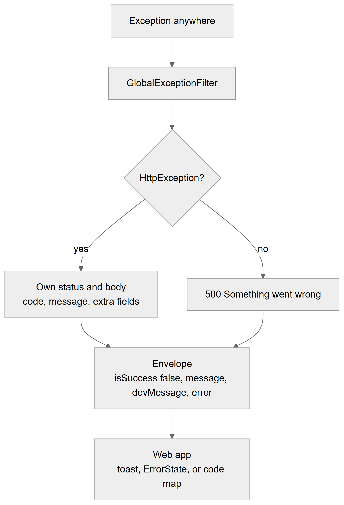
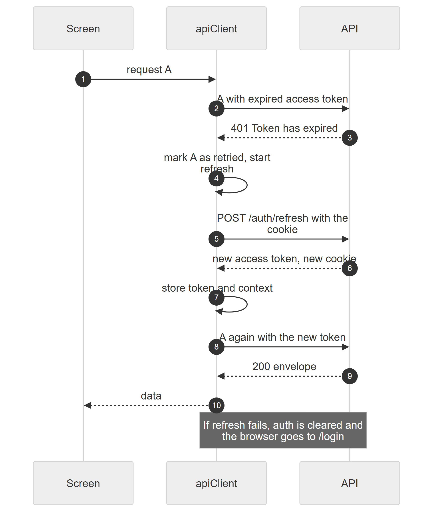

# Chapter 61 — Error handling

This chapter describes how the Platform reports problems: the shape of every API answer, the families of error codes, how validation and database conflicts become messages, how retries stay safe, and what the web app shows the user. It is written for the product owner and for support staff who read an error message and need to know what it means. Chapter 5 traces one request through the system and shows the main status codes; this chapter goes into the error side in more detail.

## 61.1 The envelope

**Status:** [Implemented]

Every controller answers inside one JSON envelope built by `ResponseWrapper`. On success the fields are `data` (the payload), `message` (for example "Patient created successfully"), `isSuccess` (true) and `httpStatusCode` (always 200 in the envelope, even when the HTTP status is 201). On failure the global exception filter `GlobalExceptionFilter` builds the same envelope with `isSuccess` false, the real HTTP status in `httpStatusCode`, a short `message` for people, a `devMessage` with a technical text for developers and an `error` field holding the exception body. The web app reads `res.data.data` on success and `err.response.data.message` (or `error.code`) on failure.

**Technical references:** `backend/src/common/dtos/ResponseWrapper.ts` · `backend/src/common/exceptions/HttpExceptionHandler.ts`

## 61.2 What the filter does with an error

**Status:** [Implemented]

*Figure 61.1 — How an exception becomes an envelope and a message on screen.*

The flowchart reads from top to bottom. An "Exception anywhere" in the request reaches `GlobalExceptionFilter`. The filter asks whether it is an HTTP exception. If yes, the request keeps its own status and body, with a code, a message and any extra fields. If no, which means an unexpected failure, the answer is 500 with the message "Something went wrong". Both branches build the envelope: `isSuccess` false, `message`, `devMessage` and `error`. The web app then shows a toast, an `ErrorState` panel or a friendly text chosen by the error code.

Categories of error:

- **Expected HTTP errors.** Business rules and security refusals are thrown as typed exceptions with a status and, in most modules, a machine-readable `code`. The message is written for the user.
- **Validation errors.** The global validation pipe rejects bad input (section 61.3). Several messages are possible; the envelope's `message` shows the first one.
- **Unexpected errors.** Anything that is not an HTTP exception, such as an unhandled database failure, is logged with its stack on the server and answered as 500 "Something went wrong". The user-facing text never contains internals.
- **Rate limit.** A throttled request is answered 429 with "Too many requests. Please try again later." and a number of seconds to wait (Chapter 56).

Every error is logged by the application logger together with the request address.

## 61.3 Validation

**Status:** [Implemented]

The global validation pipe converts input to the types named in each request class and has `whitelist` and `forbidNonWhitelisted` on. A request that contains a field the API does not define is **rejected** with 400, not silently ignored, and a field with a wrong type or format is rejected with a message such as "email must be an email". Request classes use validation decorators for lengths, formats, enumerations and nested objects. The same rules appear in the web app as form schemas, so most mistakes are caught before the request leaves the browser; the server rule is the one that counts.

## 61.4 Error code families

**Status:** [Implemented]

| Status | Code or family | Meaning |
|---|---|---|
| 400 | `IDEMPOTENCY_KEY_REQUIRED`, `REASON_REQUIRED`, `INVALID_PERMISSIONS`, validation messages | The request is incomplete or malformed |
| 401 | (message only) | No token, expired token or bad token; the web app tries to refresh |
| 402 | `SUBSCRIPTION_EXPIRED` | The clinic is read-only because its subscription lapsed |
| 403 | `NO_PERMISSION` with the missing permissions, `NOT_ENTITLED`, `ESCALATION`, `SYSTEM_ROLE_READ_ONLY`, `SETTING_LOCKED`, `FORBIDDEN`, `LAB_ACCESS_DENIED` | The caller is not allowed |
| 404 | `NOT_FOUND`, `BILLING_NOT_FOUND`, `LAB_NOT_FOUND`, and similar | The record does not exist in this organization |
| 409 | `DOCTOR_DOUBLE_BOOKED`, `VERSION_CONFLICT`, `STALE_VERSION`, `ALREADY_CHECKED_IN`, `ACTIVE_WITH_OTHER_DOCTOR`, `DOCTOR_BUSY`, `ROLE_NAME_TAKEN`, `ROLE_HAS_MEMBERS`, `REQUEST_IN_FLIGHT`, `BILLING_DUPLICATE`, `PLAN_LIMIT` and similar | The request conflicts with the current state or with another request |
| 422 | `INVALID_TRANSITION`, `IDEMPOTENCY_KEY_REUSED`, `NOT_TODAY`, `LATE_LIMIT_EXCEEDED`, `SESSION_NOT_OPEN`, many `BILLING_*`, `FORM_*` and `WORKFLOW_*` codes | The request is well formed but the rules refuse it |
| 429 | `MAGIC_LINK_RATE_LIMITED` and the login throttle | Too many requests |
| 500 | `BILLING_INVARIANT_VIOLATION`, `WORKFLOW_MISCONFIGURED`, anything unexpected | A bug or a broken money rule |
| 503 | `LOCK_TIMEOUT` | The queue was busy; retry |

The table groups the codes by HTTP status and shows what each family means. It lists examples, not every code. The codes are thrown by several module-specific error builders, each of which passes the code in `error.code`:

- **Billing** (`billing-errors.ts`): about 40 `BILLING_*` codes plus `COMPENSATION_*` and `COMMISSION_*` for the commission rules. Each maps to a fixed status, for example allocation larger than the balance is 422 and a duplicate is 409.
- **Queue** (`queue.errors.ts`): `NOT_FOUND`, `FORBIDDEN`, `INVALID_TRANSITION`, `SESSION_NOT_OPEN`, `DOCTOR_BUSY`, `VERSION_CONFLICT`, `ALREADY_CHECKED_IN`, `ACTIVE_WITH_OTHER_DOCTOR`, `LATE_LIMIT_EXCEEDED`, `NOT_TODAY`, `LOCK_TIMEOUT`, `IDEMPOTENCY_KEY_*`, `REQUEST_IN_FLIGHT`, `REASON_REQUIRED`.
- **Workflow engine** (`engine-errors.ts`): form, workflow and stage template codes, `INVALID_TRANSITION`, `TRANSITION_FORBIDDEN`, `TRANSITION_INPUT_REQUIRED`, `TRANSITION_REASON_REQUIRED`.
- **Labs** (`lab-errors.ts`, plus lab billing, catalog, orders and payables): `LAB_*` codes, including `LAB_PORTAL_CLINIC_CONTEXT` and `LAB_SELECTION_REQUIRED`.
- **Notifications** (`notification-errors.ts`): `NOTIFICATION_*` codes and `PATIENT_NOT_FOUND`.
- **Access and features**: `NO_PERMISSION`, `ESCALATION`, `INVALID_PERMISSIONS`, `NOT_ENTITLED`, `SETTING_LOCKED`, `PLAN_LIMIT`.

`DOCTOR_DOUBLE_BOOKED` is the appointment overlap error (Chapter 29): the database rejects two bookings of one doctor at overlapping times, and the service turns the failure into a 409 with that code.

**Technical references:** `backend/src/billing/common/billing-errors.ts` · `backend/src/queue/queue.errors.ts` · `backend/src/engine/common/engine-errors.ts` · `backend/src/labs/common/lab-errors.ts` · `backend/src/notifications/notification-errors.ts` · `backend/src/access/decorators/access.decorators.ts`

## 61.5 Safe retries: idempotency keys and If-Match

**Status:** [Implemented]

Two mechanisms protect against double clicks, flaky networks and two people editing the same record.

**Idempotency-Key.** A client sends a header `Idempotency-Key` (1 to 150 characters) on actions that must not run twice. The server stores the key, a hash of the request and, once finished, the response, inside the same transaction as the work. If the same key arrives again with the same request, the stored answer is replayed and nothing runs twice. The same key with a different request gives 422 `IDEMPOTENCY_KEY_REUSED`. The same key while the first request is still running gives 409 `REQUEST_IN_FLIGHT`. A missing key where one is required gives 400 `IDEMPOTENCY_KEY_REQUIRED`. The key is required on every queue change, on patient check-in from an appointment, on money-moving lab billing posts and on the workflow engine transitions; the web app creates a fresh key for each open sheet or action. Queue idempotency keys are deleted after 24 hours by a nightly job.

**If-Match and versions.** Records that two people may edit carry a version number. A client may send `If-Match: <version>` (queue entries, lab order actions) or the version in the body; the server checks it while holding a row lock and, if the record has moved on, answers 409 with `VERSION_CONFLICT` or `STALE_VERSION` and the current state or version. The web app reloads and asks the user to try again, with texts such as "Someone else changed this just now. The latest version is loaded".

**Technical references:** `backend/src/common/idempotency/idempotency.service.ts` · `IdempotencyService` · `backend/src/common/errors/optimistic-lock.ts` · `assertVersion` · `backend/src/queue/decorators/queue-request.decorators.ts`

## 61.6 Database constraints become messages

**Status:** [Partial]

The database enforces uniqueness and exclusion rules, and several services translate the database error into a clear conflict. The translation is per service; there is no global mapping.

- **Exclusion constraint on appointments** (`no_doctor_overlap`): Postgres error 23P01 becomes 409 `DOCTOR_DOUBLE_BOOKED`. Compensation plan versions and lab prices use similar exclusion constraints with their own messages.
- **Unique violations** (23505) are translated in billing, lab billing, lab orders, lab catalog and lab payables into codes such as `BILLING_DUPLICATE`.
- **Foreign key violations** (23503) are translated when deleting an employee that is still referenced.
- **Lock timeouts** in the queue become 503 `LOCK_TIMEOUT`.

A database error that no service translates reaches the filter as an unexpected error and is answered as 500 "Something went wrong". A duplicate patient number or purchase order number, for instance, would currently surface this way (Chapter 62).

## 61.7 In the web app

**Status:** [Implemented]

- **401 and refresh.** The shared axios client refreshes the access token on a 401 and retries once (Chapter 56).
- **Toasts.** Mutations report failures with a toast (the library `sonner`, at the top right, closable, 4 seconds). Many hooks have a helper that reads `err.response.data.message` and falls back to a text such as "Failed to create item". About 180 places raise an error toast.
- **Friendly code maps.** Billing, labs, lab orders, lab catalog, lab payables, lab billing and the engine studio each have a small map from an error code to a plain sentence, for example the billing code for a missing document code becomes "Set a document code for this location in Billing settings first." If a code has no entry, the server's own message is shown, then a generic text.
- **Stale screens.** The queue hook shows "Someone else just changed this patient — showing the latest." as a warning on `VERSION_CONFLICT` and refreshes the screen.
- **Page states.** Every list or detail screen uses `LoadingSkeleton` while loading (table, cards, stats or detail shape), `EmptyState` when there is nothing (icon, title, message and an optional action) and `ErrorState` when a request failed (title "Something went wrong", a sentence and a **Try again** button). A route-level error boundary, `RouteError`, shows the error message with a retry button for render failures.
- **Access errors.** A missing route permission shows the No access page, not an error (Chapter 57). The access gate shows "Couldn't load your access" if `/me/access` fails.
- **Query settings.** Queries retry twice and mutations once, with 5 minutes of freshness.

**Technical references:** `web-app/src/lib/api.ts` · `web-app/src/lib/query-client.ts` · `web-app/src/features/billing/lib/billing-errors.ts` · `web-app/src/features/engine-studio/lib/studio-errors.ts` · `web-app/src/features/queue/hooks/useQueueAction.ts` · `web-app/src/components/feedback/ErrorState.tsx` · `EmptyState.tsx` · `LoadingSkeleton.tsx` · `web-app/src/components/shared/RouteError.tsx`

*Figure 61.2 — How an expired access token is replaced without the user noticing.*

The diagram has three participants: the Screen, the `apiClient` axios instance and the API. The screen sends request A. The client sends A with an expired access token. The API answers 401 "Token has expired". The client marks A as retried and starts a refresh. It sends `POST /auth/refresh` with the cookie. The API answers with a new access token and a new cookie. The client stores the token and context, sends A again with the new token, gets a 200 envelope and returns the data to the screen. A note says that if the refresh fails, the stored login is cleared and the browser goes to `/login`. While one refresh is running, other requests that fail with 401 wait in a queue and are retried with the new token.

## 61.8 Limitations and known gaps

- Error messages are in English. Only the No access headline carries a Roman-Urdu line.
- Code-to-sentence maps exist for some modules only; others show the server's text.
- There is no central error-tracking service; errors are written to the server log.
- Database errors are translated service by service, so an untranslated one shows as a generic 500.
- The error body includes a developer message field in every failure.

## 61.9 Owner's FAQ

**A user says "Something went wrong". What now?** It is an unexpected server error. Ask for the time and the page; the server log holds the cause. Other failures give a specific message.

**What does 402 mean?** The subscription expired; the clinic is read-only until a payment is recorded.

**What does "Someone else changed this" mean?** Another person saved the same record first. The latest data is loaded; redo the change.

**What happens if the receptionist double-clicks "Check in"?** The second click carries the same idempotency key, so the first result is returned and only one token is issued.

**Does the API ignore fields it does not know?** No. It rejects them with 400.
