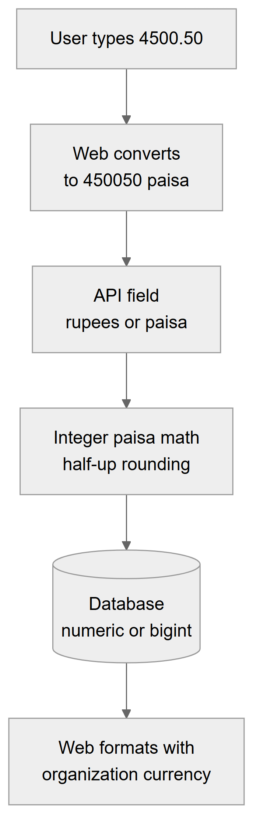

# Chapter 62 — Time, money and document numbers

This chapter explains three rules that run through every module: how the Platform decides what time it is for a clinic, how it stores and calculates money, and how it numbers invoices, patients, orders and other documents. It is written for the product owner, because mistakes in these three areas, a wrong day, a wrong rupee or a duplicate number, are the ones that clinics notice first. The chapter states the rules, where they are followed strictly, and where the code still departs from them.

## 62.1 Clinic time

**Status:** [Implemented] for the rule. [Partial] for coverage: some jobs and statistics still use the server clock.

**The rule.** Every clinic date and time follows the **location's** timezone (the `timezone` of the location, for example a Pakistan or a Gulf timezone). Working hours, appointment availability, the same-day duplicate check, the queue's day boundary, token days and quiet hours all use it. A clinic in one timezone and a server in another still agree on what "today" means for the clinic.

**How it works.** `ClockService` is the single source of "now" and "today" for clinic logic. Its main functions are:

- `now()`: the current instant (tests can replace it).
- `timezoneFor(locationId)`: the location's timezone name, defaulting to UTC when the stored name is not valid, cached for 60 seconds.
- `today(timezone)`: the location-local date as `YYYY-MM-DD`.
- `wallClock(timezone, instant)`: the local weekday and `HH:MM`.
- `dayRange(timezone, date)`: the start and end instants (in UTC) of a local day.
- `at(timezone, date, time)`: the instant when the clinic's wall clock reads a given date and time.

The code rule is: never use `new Date()` together with `setHours()` for a clinic day or time, because those use the server's timezone. Appointments, queue and notifications follow it (Chapters 29, 30 and 59).

**Where the server clock is still used.** These places do not use the location's timezone:

- **Scheduled jobs.** Daily and monthly jobs run on the worker's server timezone, for example the 01:00 credit expiry, the 02:30 billing check, the 08:00 inventory alert and the payroll run at 05:00 on the 1st (Chapter 63 and Appendix E). The queue's day-end job is an exception: it decides what a past clinic day is from each location's policy.
- **Credit expiry.** The check works out "today" from the server's local date, so a prepaid credit can expire a few hours early or late for a clinic in another timezone.
- **Statistics.** The financial summary takes its default date and its month list from the server date.
- **Numbering years.** The year inside purchase order and prescription numbers is the server's year.
- **Leave balance year** uses the server year.
- **The lab catalog calendar** fixes its "today" to one specific timezone (Asia/Karachi) regardless of the location.
- **Exports** that print a date (patient export file name) use the server date.

For a clinic whose timezone differs from the server's by a few hours, the differences matter only near midnight or at month boundaries.

**Technical references:** `backend/src/common/clock/clock.service.ts` · `ClockService` · `backend/src/common/clock/tz.util.ts` · `backend/src/billing/patient-credits.service.ts` · `backend/src/billing/financial-summary.service.ts` · `web-app/src/features/lab-catalog/lib/money.ts` · `catalogToday`

## 62.2 Money

**Status:** [Implemented]

**What is stored.** Money has two storage styles, depending on the module:

| Style | Where | Meaning |
|---|---|---|
| `numeric(12,2)` rupees | Patient billing: charges, invoices, payments, refunds, ledger entries | Exact decimal with two places |
| `bigint` minor units (`*_minor` columns) | Commissions (rules, entries, settlements, compensation plans), the lab billing tables (invoice, credits, payments), and a few billing fields | Whole number of the smallest unit |
| `decimal(10,2)` | Inventory prices and quantities, payroll records, employee salary on assignments | Exact decimal |

The table shows the three styles. A **minor unit** is the smallest unit of the currency (for PKR, one paisa: a hundredth of a rupee). Columns and fields are named `*_minor` / `*Minor`, not after paisa, so the names fit any currency; "PKR" is the default currency and not a limit. Amounts cross the API as numbers with at most two decimals in the billing module, and as integer paisa in the lab and commission modules.

**How it is calculated.** All billing math is done in **integer paisa** so that no floating-point error can creep in. `money.ts` holds the helpers: `toMinor` and `fromMinor`, `sumMinor`, `percentOf` and `basisPointsOf`. A percentage with up to two decimals is turned into basis points (17.5 percent becomes 1750) and applied with exact big-integer arithmetic.

- **Rounding is half up** (0.5 paisa rounds to the next whole paisa), the same everywhere, including tax.
- **Splitting.** When an amount is shared in proportion (for example tax spread over charges), each share is rounded down and the leftover paisa go to the largest share, so the shares always add up exactly to the total.
- **Database columns** are read through transformers: `numeric` comes back from the database as text and is rounded to two decimals; `bigint` comes back as text and is converted to a number, which is exact for any clinic amount.

*Figure 62.1 — How an amount typed by a person travels to the database and back.*

The flowchart reads top to bottom. A user types 4500.50. The web app converts the text to 450050 paisa with integer-only code (no floating point). The API receives the amount as rupees or paisa depending on the field. Server code calculates in integer paisa with half-up rounding. The value is stored in the database as `numeric` or as `bigint` paisa. When the screen reads it back, the web app formats it with the organization's currency.

**Tax is exclusive.** Prices are before tax. Tax equals the taxable amount (the sum of active charge net amounts after discounts) times the rate, rounded half up once per invoice. The total is subtotal minus discount plus tax. The rate is copied onto the invoice when it is issued from the location's billing settings, and later edits use that copy, not the current setting. Tax is spread over the invoice's charges so that payments can be allocated charge by charge; tax is never revenue and never earns commission. Lab invoices use the same half-up rounding and keep tax in its own paisa column.

**Currency.** Each organization has a `currency` (default PKR). It is returned with the organization list after sign-in. The web app's `activeCurrency()` and `useCurrency()` read it, and `formatMinor` writes amounts as "PKR 4,500.50". Number grouping uses a Pakistani locale. The currency is a display label: there is no conversion and no multi-currency ledger.

**Technical references:** `backend/src/billing/common/money.ts` · `money-column.ts` · `minor-column.ts` · `backend/src/billing/tax/invoice-tax.ts` · `backend/src/organizations/entities/organization.entity.ts` · `web-app/src/lib/currency.ts` · `web-app/src/features/lab-catalog/lib/money.ts`

## 62.3 Document numbering

**Status:** [Partial]. Billing and lab documents are numbered safely; some older numbers are not.

There are four numbering families.

| Family | Documents | Format | How it counts |
|---|---|---|---|
| Per location, per type, per year | Patient invoices (`INV`), receipts (`REC`), refunds (`RFD`) | location code, type, year, five digits, for example `MAIN-INV-2026-00001` | Table `document_sequences` |
| Per organization sequence | Lab order (`LAB`), shipment (`SHP`), lab invoice (`LINV`), lab receipt (`LRC`), payment reversal (`LRV`), credit note (`LCN`), lab refund (`LRF`), vendor bill (`VB`), vendor payment (`VP`) | prefix and at least four digits, for example `LAB-0001` | Table `number_sequences` |
| Count plus one in application code | Patient number, treatment plan number, patient-page prescription number | `P-00001`, `TP-00001`, `RX-00001` | Number of existing rows plus one |
| Last number plus one in application code | Purchase order number, prescription number from the prescriptions module | `PO-2026-00001`, `RX-2026-00001` | Reads the latest row and adds one |

The table lists the four families with their formats. Invoices, receipts and refunds need the location's **document code** (2 to 6 letters or digits, set in billing settings and locked after the first invoice); without it the Platform refuses to issue the document.

**The safe families.** The first two families use a database counter row that is locked until the surrounding transaction ends. Concurrent requests wait their turn, no number repeats, and a rollback gives the number back, so numbers have no gaps. The service refuses to run outside a transaction. Invoice sequences restart each year, per location. Lab sequences never restart.

**The risky families.**

- **Patient, plan and prescription numbers (count plus one).** The next number is the count of rows for the organization plus one. Two registrations at the same moment can compute the same number, and the second save fails on the unique index. Patients are deleted permanently, so after a deletion the count drops and the next number can repeat one that is still in use (the patient count includes soft-deleted rows but not permanently deleted ones). The result in either case is a failed save that the user sees as a generic error, not a wrong document.
- **Purchase order and prescription numbers (last plus one).** The next number reads the most recent row of the organization and adds one, with the year taken from the server clock. Two simultaneous requests can read the same row. In addition, the unique index on the purchase order number and on the prescription number covers all organizations together, so two clinics that both reach the same sequence in the same year would collide.

These are reliability risks, not security ones. A collision stops the save; it does not issue a duplicate.

**Technical references:** `backend/src/billing/numbering/document-sequence.service.ts` · `DocumentSequenceService` · `backend/src/common/sequences/number-sequence.service.ts` · `NumberSequenceService` · `backend/src/patients/patients.service.ts` · `generatePatientNumber` · `backend/src/inventory/services/purchase-order.service.ts` · `generatePoNumber` · `backend/src/prescriptions/services/prescription.service.ts` · `generatePrescriptionNumber`

## 62.4 Limitations and known gaps

- Several jobs and statistics use the server timezone, not the clinic's.
- Two storage styles for money (decimal rupees and integer paisa) exist side by side; conversion happens at module boundaries.
- Count-based and last-number-based document numbers can collide under concurrency, and purchase order and prescription numbers are unique across all clinics together.
- No multi-currency support or conversion.
- Tax is exclusive only; there is no tax-inclusive pricing.

## 62.5 Owner's FAQ

**What time does "today" mean for my branch?** The branch's own timezone, set on the location.

**Why can a daily job run at an odd hour for my clinic?** Jobs follow the server's timezone. A job set for 01:00 runs at 01:00 server time.

**Can an invoice number repeat?** No. Invoice, receipt and refund numbers come from a locked counter per branch and year.

**Can two patients get the same patient number?** The database refuses a duplicate, so the second save fails and must be tried again.

**Are my prices with or without tax?** Without. Tax is added on top at the rate set for the branch when the invoice is issued.

**Can I invoice in another currency?** You can set the organization's currency label, but there is no conversion.
