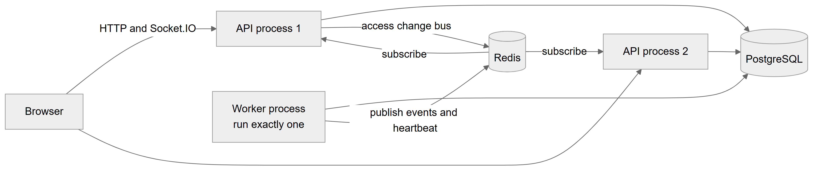

# Chapter 63 — Realtime updates and background jobs

This chapter explains the two ways the Platform acts without a user clicking: it pushes live updates to open screens over a socket connection, and it runs timed jobs and background loops in a worker process. It is written for the product owner who must understand which processes to run and what happens when Redis or the worker is down. Appendix E holds the full job table; this chapter restates the essentials and explains how the pieces fit together. The queue module (Chapter 30) and notifications (Chapters 44 and 59) are the main users of these mechanisms.

## 63.1 Process roles

**Status:** [Implemented]

The backend is one program that starts in one of three roles, chosen by the start command.

| Role | Start file | Serves web requests and sockets | Runs jobs and relays | Needs Redis |
|---|---|---|---|---|
| `api` | `main.api.ts` | Yes | No | Yes, to receive events |
| `worker` | `main.worker.ts` | No | Yes | Yes, to send events |
| `all` | `main.ts` | Yes | Yes | No |

The table shows the three roles. In production, run two or more `api` processes behind a load balancer and **exactly one** `worker`. In development, the single `all` process does everything and needs no Redis, because the relay hands events directly to the local socket gateway. The job scheduler is enabled only in processes whose role is not `api`, so adding API processes never duplicates a job.

*Figure 63.1 — The browser, two API processes, one worker, PostgreSQL and Redis.*

The flowchart reads left to right. The Browser talks to API process 1 and API process 2 over HTTP and Socket.IO. Both API processes read and write PostgreSQL. The Worker process, marked "run exactly one", also uses PostgreSQL. The worker publishes events and a heartbeat to Redis. Redis delivers them to both API processes through a subscription. A further arrow shows an API process using Redis for the access change bus, which is how one API process tells the others that access changed (Chapter 57).

**Technical references:** `backend/src/common/runtime/process-role.ts` · `backend/src/main.ts` · `main.api.ts` · `main.worker.ts` · `backend/src/app.module.ts` · `AppModule.forRole`

## 63.2 The realtime gateway

**Status:** [Implemented]

**What it does.** Pushes small "something changed" messages to open browser screens so that the reception board, doctor screen, waiting-room display and permission-aware screens stay live without constant refreshing.

**How it connects.** A Socket.IO gateway listens at the path `/realtime` of the API. The web app connects with websocket transport and passes its access token in the handshake. The token is verified once, when the socket connects. A browser with no token may connect anonymously, but may join only the public display room. After connecting, the client sends a `subscribe` message naming a room; the server answers with success or a reason.

**Rooms.**

| Room | Who may join | What it carries |
|---|---|---|
| `session:<id>` | Users with access to the queue session's location | Events for one doctor's queue (doctor screen, reception) |
| `location:<id>:board` | Users with access to the location | Events of every queue at the location (reception board) |
| `location:<id>:display` | Anyone, no sign-in | Waiting-room TV events; payloads carry token numbers and doctor names, never patient names |
| `org:<id>` | Users with access to the organization (super admin, owner, or an active staff assignment) | The `access.changed` event with the organization id and the new version |

The table lists the four room types. Anything else gets "Unknown room"; a room the user may not enter gets "No access to this room".

**Events are nudges.** A message carries a sequence number (`seq`). The browser keeps the sequence of the snapshot it loaded, ignores older or duplicate messages and fetches a fresh snapshot when it sees a newer one. This makes delivery at least once safe, because a duplicate does nothing.

**Technical references:** `backend/src/queue/realtime/queue.gateway.ts` · `QueueGateway` · `web-app/src/features/access/hooks/useAccessSocket.ts`

## 63.3 From a commit to a screen: outbox, relay, Redis

**Status:** [Implemented]

When a queue action changes state, the same database transaction also writes an event row in the `outbox` table and sends a database NOTIFY, so an event exists only if the change was committed. The **outbox relay** in the worker takes unpublished rows (up to 100 at a time, locking them so a second relay would skip them), publishes each to one Redis channel, waits until Redis accepted the whole batch and only then marks the rows as published. If Redis is down, the batch is rolled back and tried again every second. It is woken by the NOTIFY and also polls every second as a fallback. Every API process subscribes to the channel and emits each message to its own local sockets, so a browser connected to any API process sees every event. Chapter 5, section 5.8, shows this as a sequence diagram.

**Heartbeat and watchdog.** The worker publishes a heartbeat to the same channel every 5 seconds. Each API process runs a watchdog: it considers the bus healthy only while it is subscribed and has seen a heartbeat within 15 seconds. When the bus is unhealthy (Redis or worker down), the API process **refuses new socket connections and drops existing ones**, using a transport close so that browsers keep trying to reconnect. Screens then fall back to polling about every 10 seconds and reload their data once the socket returns. At start-up the gateway stays closed until the first heartbeat arrives.

**Access changes.** The access change bus is a second, separate path on its own Redis channel. When an organization's access version is bumped, the bus notifies the local caches and the local gateway, and publishes to Redis so the other processes do the same. Each process then emits `access.changed` to its sockets in the `org:<id>` room. This path does not use the outbox or the worker (Chapter 57).

**Single-process mode.** In the `all` role, the relay publishes straight to the local gateway.

**Technical references:** `backend/src/queue/realtime/outbox-relay.service.ts` · `OutboxRelayService` · `redis-realtime.publisher.ts` · `redis-realtime.subscriber.ts` · `realtime-bus.ts` · `in-process-realtime.publisher.ts` · `backend/src/access/version/access-change-bus.ts`

## 63.4 Scheduled jobs

**Status:** [Implemented] (the inventory alert job is [Partial])

All jobs run in the worker (or the `all` process). The schedules are in **server time**; none sets a timezone.

| Job | Schedule | What it does |
|---|---|---|
| Queue no-show marker | every 60 seconds | Marks a booked patient as no-show once they have not checked in by the start time plus the location's maximum lateness |
| Queue call timeout | every 15 seconds | Skips a called patient who never came, when the queue policy sets a timeout |
| Queue session day-end | every 5 minutes | Closes empty queue sessions of a past clinic day; leaves non-empty ones open and logs an alert |
| Queue cleanup | daily at 03:15 | Deletes queue idempotency keys older than 24 hours and published outbox rows older than 7 days |
| Patient credit expiry | daily at 01:00 | Marks prepaid credits past their expiry date as expired |
| Billing invariant check | daily at 02:30 | Recomputes billing totals, checks money rules including the commission ledger and logs any break |
| Month-end payroll | 05:00 on the 1st of each month | Generates payroll records for the month just ended for every active location; locations already generated are skipped |
| Inventory alerts | daily at 08:00 | Counts low-stock and soon-expiring items and writes a warning to the server log only |

The table lists the eight timed jobs. The first four keep the live queue consistent; the others handle daily and monthly housekeeping. Appendix E gives the same table with statuses and references. The queue day-end job is the only one that respects each location's clinic day, taken from its queue policy.

**Background loops.** Three loops run continuously in the worker. The **queue outbox relay** (section 63.3). The **notification relay**, which is woken by a database NOTIFY and polls every two seconds, sends notification rows to the inbox (Chapter 59). The **heartbeat** is published every 5 seconds. Both relays follow the outbox pattern: a change and its message commit together, and a separate loop delivers the message later. If the database NOTIFY connection drops, each relay logs a warning and keeps working by polling.

**Other timers.** The in-memory rate limit tables in the authentication guards and the magic-link throttle are swept every minute or when they grow large; they do not need the worker.

**Technical references:** `backend/src/queue/jobs/queue-jobs.service.ts` · `backend/src/billing/patient-credits.service.ts` · `backend/src/billing/invariants/billing-invariant.job.ts` · `backend/src/payroll/payroll.service.ts` · `backend/src/inventory/services/inventory-alerts.service.ts` · `backend/src/notifications/delivery/notification-relay.service.ts` · `docs/handbook/src/appendix/appE-scheduled-jobs.md`

## 63.5 Limitations and known gaps

- Exactly one worker must run; nothing in the code stops a second worker, and a second worker would run each timed job a second time (the relays are safe with several workers, the timed jobs are not guaranteed to be).
- Job times follow the server timezone, not the clinics'.
- Inventory alerts reach only the server log, not any user.
- In the split `api`/`worker` setup realtime depends on Redis; without it screens poll about every 10 seconds. A single `all` process needs no Redis.
- The access token is checked once when a socket connects; the connection continues after the token expires.
- There is no clean-up job for session rows, security logs or the notification outbox.

## 63.6 Owner's FAQ

**What happens if Redis is down?** Realtime stops: the API refuses sockets and screens poll every ten seconds, so they update a little later. Access changes still reach the process that made them at once and the others within 15 seconds.

**What happens if the worker is down?** No timed jobs run, no notifications are sent and no queue events are published. Rows wait in the database and are processed when the worker returns. Screens fall back to polling.

**Can I run two workers for safety?** No. Run exactly one. A second worker would repeat the scheduled jobs.

**Do I need Redis on my laptop?** No. The single `all` process does not need it.

**Can the waiting-room TV show patient names?** No. The public display room carries token numbers and doctor names only.
