# Dental Lab Module — ERD & End-to-End Flows

Generated from the live TypeORM entities (schema source of truth), cross-checked with
[`backend/docs/data-model/ENTITY_CATALOG.md`](../backend/docs/data-model/ENTITY_CATALOG.md),
[`handbook/src/part4-data-model/ch25-labs.md`](handbook/src/part4-data-model/ch25-labs.md),
[`handbook/src/part5-modules/ch42-lab-finance.md`](handbook/src/part5-modules/ch42-lab-finance.md) and
[`handbook/src/part6-workflows/ch49-dental-lab-case.md`](handbook/src/part6-workflows/ch49-dental-lab-case.md).

**Legend**

- Solid line (`||--o{`) = **enforced foreign key** (a real DB constraint).
- Dotted line (`||..o{`) = **logical reference only** (plain `uuid` column, checked in the app).
- Directories (`labs`, `lab_members`) are **platform-level**: they carry no `organization_id`.
  Everything a clinic owns is tenant-scoped by `organization_id`; lab-side rows additionally carry
  `lab_id` so every lab query can filter on it.
- Actor columns (`created_by`, `assigned_by`, `decided_by`, `requested_by`, `issued_by`, …) point at
  `users` logically, never by FK.
- Money in this module is `bigint` **paisa** (100 paisa = 1 rupee), never `numeric` rupees.
  Tax is **basis points** (`10000 bp = 100%`).
- `status_code` columns are free text because order/item/stage states are **workflow data**
  (`workflow_template_versions`), not enums. Fixed enums are only the ones documented below.

**The three realms**

| Realm | Question it answers | Tables | Section |
| --- | --- | --- | --- |
| Directory, links, access | Who is the lab, who works there, how does it reach an order? | `labs`, `lab_clinic_links`, `lab_members`, `magic_links` | §1 |
| Catalog, orders, production | What is being made, from what price, and where is it now? | 21 tables | §2–§4 |
| Lab money | What does the patient owe the clinic, and what does the clinic owe the lab? | 14 tables + ledger hooks | §5–§7 |

**Contents**

1. [Directory, links, members & magic links](#1-directory-links-members--magic-links)
2. [Catalog & pricing](#2-catalog--pricing)
3. [Orders: header, lines, item parts, records](#3-orders-header-lines-item-parts-records)
4. [Production: stages, assignments, shipments, remakes, warranties](#4-production-stages-assignments-shipments-remakes-warranties)
5. [Lab receivables (patient side)](#5-lab-receivables-patient-side)
6. [Lab payables (lab side)](#6-lab-payables-lab-side)
7. [Finance hooks: history, events, commission, ledgers](#7-finance-hooks-history-events-commission-ledgers)
8. [End-to-end flows](#8-end-to-end-flows)
9. [State machines](#9-state-machines)
10. [Invariants](#10-invariants)
11. [Known gaps](#11-known-gaps)
12. [Source index](#12-source-index)

---

## 1. Directory, links, members & magic links

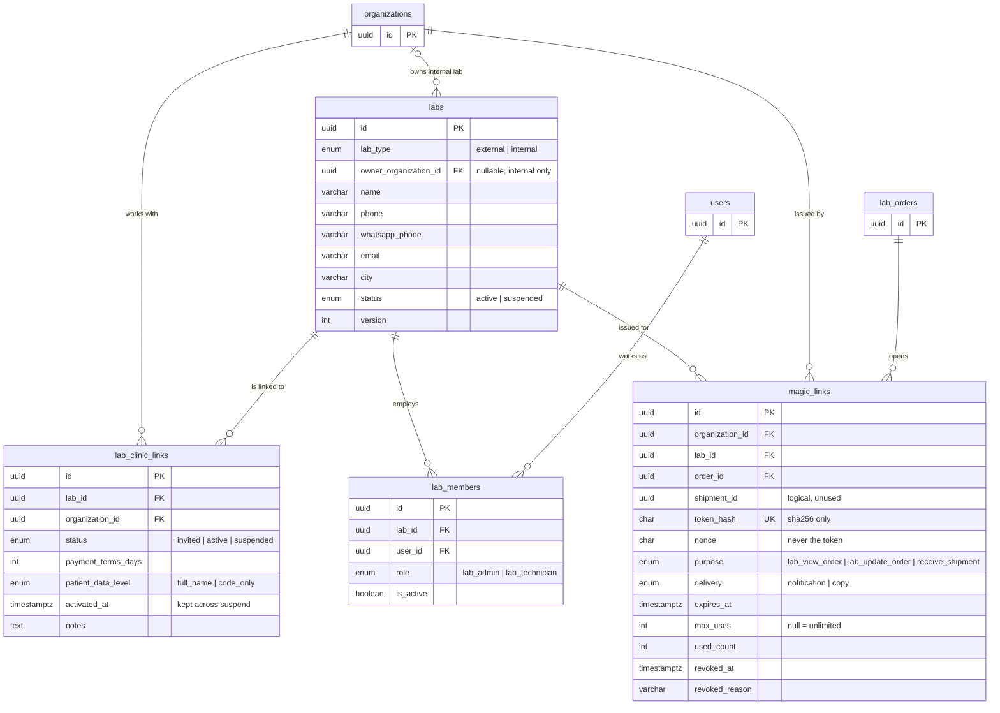

**Rules encoded here**

- `labs` is the **only** platform-level directory. `CHECK chk_labs_owner` enforces
  `(lab_type = 'internal') = (owner_organization_id IS NOT NULL)`: an external lab has no owner
  clinic, an internal lab belongs to exactly one clinic organization.
- `lab_clinic_links` is the contract between one clinic and one lab — unique per
  `(lab_id, organization_id)`. It carries the **payment terms** (default 30 days → vendor-bill due
  date) and the **patient data level** the lab may see (`full_name` or `code_only`).
- A lab user is a `lab_member` of a lab and **never** a clinic member. `LabPortalGuard` resolves
  lab access from *active membership of an active lab* only; every lab query starts from `lab_id`.
- Link lifecycle is `invited → active ⇄ suspended`, reason required to suspend. Reactivation is
  restricted to the side that suspended it (platform admin excepted), so one party cannot silently
  lift the other's block.
- Magic links are order-scoped and no-login. The token is **HMAC(server secret, nonce)**; only
  `token_hash` + `nonce` are stored, so the outbox never holds a usable token. Every action through
  a link writes `status_history` with `via = magic_link`; proxy entries write `via = proxy` and
  `on_behalf_of_lab_id`.
- A link is dead (`410`) when revoked, expired, used up, its order is `completed` / `cancelled` /
  `rejected_by_lab`, or its lab is suspended. An unknown or malformed token is `404`.
  Closing an order revokes all of its links (`order_closed`).

---

## 2. Catalog & pricing

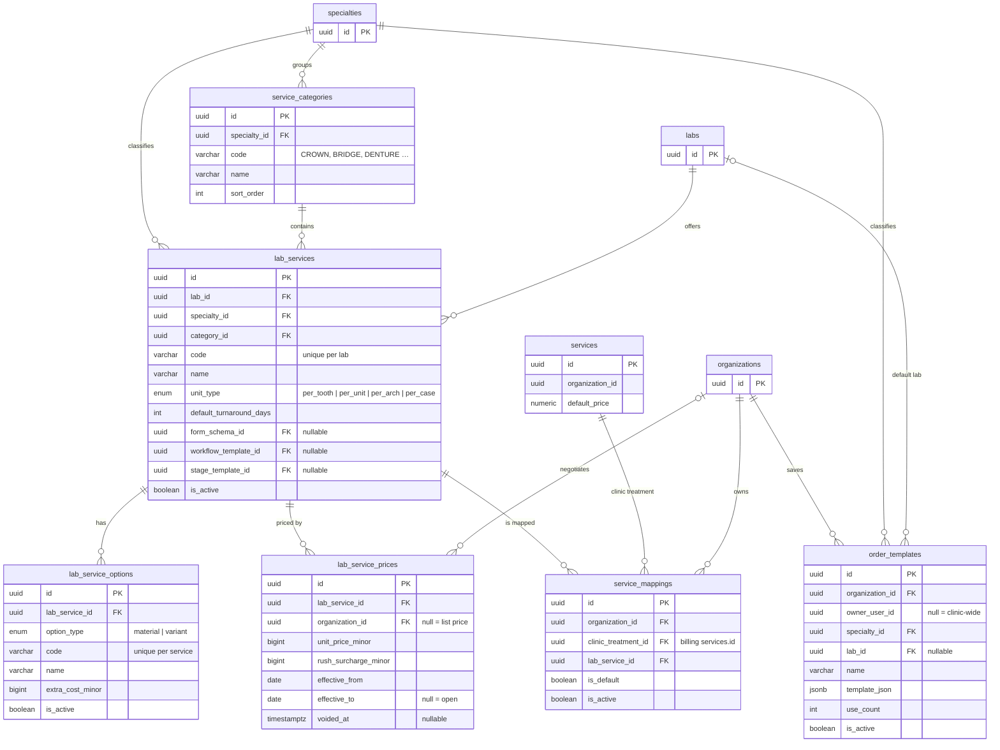

**Both prices of a line are resolved on one day, from different places**

| Price | Source | Notes |
| --- | --- | --- |
| **Lab cost** (what the clinic pays the lab) | `lab_service_prices` for the day | Negotiated row (`organization_id` set) beats the lab's list row (`organization_id` null). `unit price = base + Σ option extras + rush surcharge`. |
| **Patient price** (what the patient pays the clinic) | `service_mappings` → billing `services.default_price` (+ location/doctor `service_prices` overrides) | The lab price list never leaks into the patient price. No mapping → line error `patient_price_missing`. |

- `lab_service_prices` has an **exclusion constraint** (`excl_lab_service_prices_overlap`) that
  forbids overlapping date windows for the same `(lab_service_id, organization_id)` while not
  voided. A price entered by mistake is voided, never deleted.
- `service_mappings` keeps one active mapping per `(organization, lab_service)` and at most one
  active `is_default` per `(organization, clinic_treatment)`, so a lab service is billed as exactly
  one clinic treatment per clinic.
- A service pins its behaviour by reference: `form_schema_id` (answers), `workflow_template_id`
  (item lifecycle), `stage_template_id` (try-in rounds). Copies are pinned at submit/accept, so
  editing a template never changes work already in progress.
- `order_templates` stores a doctor's saved order body. `owner_user_id = null` means clinic-wide.
  The body is validated on save and **again at submit** against the form version current then.

---

## 3. Orders: header, lines, item parts, records

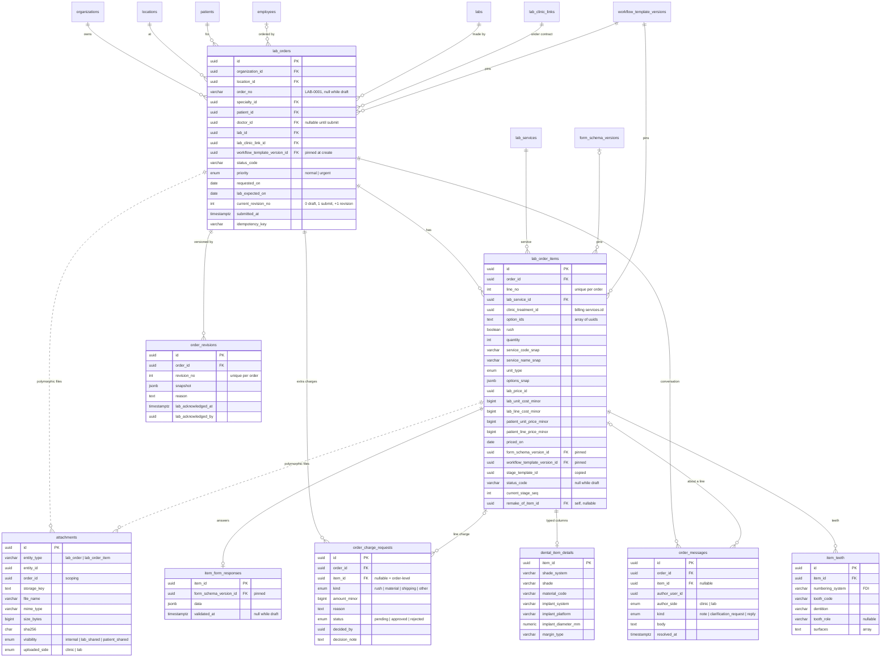

**What the columns mean**

- `lab_orders` is a **case container**: one patient, one doctor, one lab, one contract. A draft has
  no `order_no`, `current_revision_no = 0`, and items with `status_code = null`.
- `lab_order_items` is one piece of work. The `*_snap` and `*_minor` columns are **frozen at submit**
  and may only be changed by a revision or an approved charge request
  (`snapshot-freeze.ts` rejects every other update once `status_code` is set).
- `quantity` for a `per_tooth` service is **derived from the marked teeth** (`item_teeth` count),
  not typed. For every other unit type the entered quantity stands.
- `item_teeth` is one row per tooth per line (FDI code, dentition, role, surfaces). `dental_item_details`
  is a 1:1 promotion table: the form's `promotions` map copies typed answers into columns at submit,
  so reports read columns instead of JSON.
- `item_form_responses` stores the **normalised** answers against the pinned form version.
  `validated_at` is null while the order is a draft.
- `order_revisions` is the audit of *what the lab was asked to make*: rev 1 at submit, +1 per
  revision, each with a full `snapshot` JSON. Rows are never overwritten; the lab acknowledges each.
- `order_messages` carries the clinic ↔ lab conversation. A `clarification_request` is resolved by
  the clinic's `reply` (revision), which sets `resolved_at`.
- `order_charge_requests` is the **only** way a frozen price moves besides a revision:
  - item-level approved → added to `lab_line_cost_minor` (and to the vendor bill);
  - order-level approved → a separate charge row, billed to the patient and the lab.
- `attachments` is polymorphic (`lab_order` | `lab_order_item`) with the parent checked in the app.
  Files are never deleted; downloads are short-lived signed URLs. The lab only ever sees
  `lab_shared` (and later `patient_shared` on the patient portal).

---

## 4. Production: stages, assignments, shipments, remakes, warranties

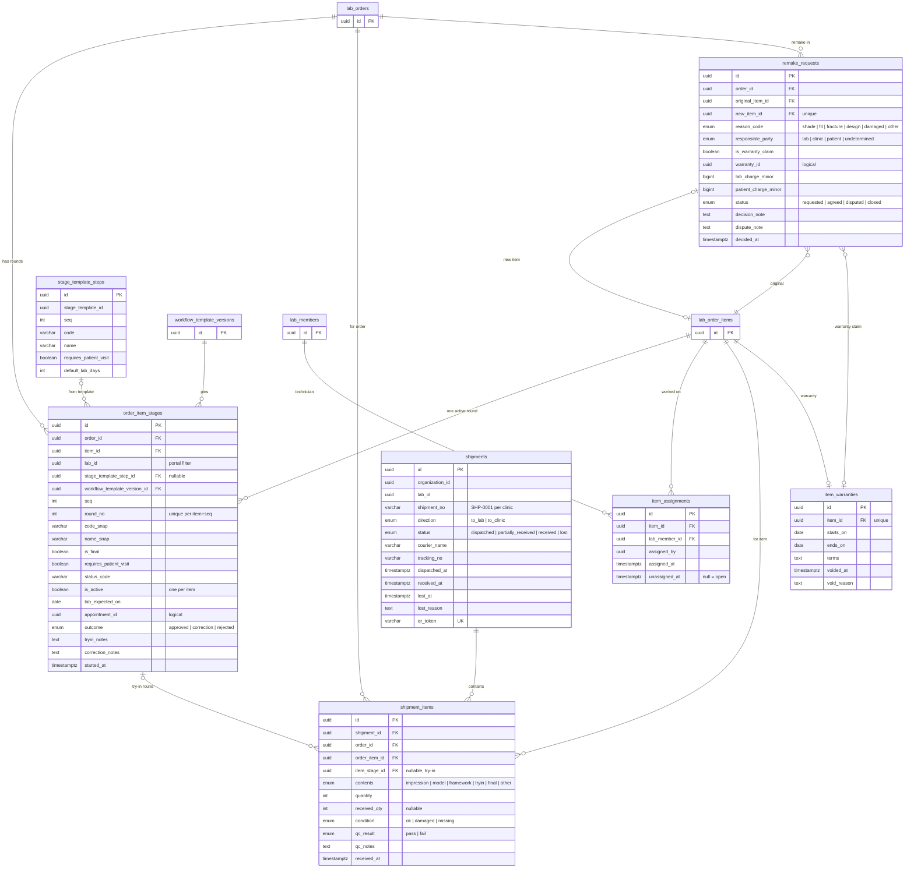

**Stage rows are rounds, not mutable steps**

- At lab accept, `init_stages` creates **round 1** of every step of the item's stage template
  (names/codes copied to `code_snap` / `name_snap`; expected dates cumulative from
  `default_lab_days`; the final step reuses `lab_orders.lab_expected_on`).
- `UNIQUE (item_id, seq, round_no)` means a correction never edits the old round — it closes it and
  inserts `round_no + 1` for the same `seq`.
- `is_active` is set from the workflow state category on every stage transition (`active` and
  `waiting` count as active). A **partial unique index** (`uq_order_item_stages_one_active`) makes
  "one active round per item" a database fact, not a convention.
- `item_assignments` is append-only history: reassigning closes the open row (`unassigned_at`) and
  inserts a new one. The partial unique index `uq_item_assignments_open` allows one open assignment
  per item.
- A shipment is a **parcel**, not an order: it may carry items of several orders of one clinic and
  one lab, in either direction. `qr_token` is printed on the slip and opens the receive screen.
  `shipment_items.item_stage_id` ties a `to_clinic` line to the try-in round it delivers.
- `remake_requests` allows only **one open request per original item**
  (`status IN ('requested','disputed')`, partial unique). Agreeing creates a **new item** in the same
  order (`lab_order_items.remake_of_item_id`), copying the original's snapshot, options, answers,
  teeth and pinned versions. The new item starts at the item workflow's initial state, so the lab
  accepts it like new work.
- `item_warranties` is 1:1 with a delivered item: starts on the delivery day, runs `N` months
  (default 12), and ends the day before the anniversary (`warrantyEndsOn`). One row per item, voided
  rather than deleted.

---

## 5. Lab receivables (patient side)

Full money rules live in [`finance-billing-erd.md`](finance-billing-erd.md) §5; this is the lab
module's view.

```mermaid
erDiagram
    patients ||--o{ lab_invoices : "billed"
    patients ||--o{ lab_payments : "pays"
    patients ||--o{ lab_credit_notes : "credited"
    patients ||--o{ lab_refunds : "refunded"
    lab_orders |o--o{ lab_invoices : "billed from"
    lab_invoices ||--o{ lab_invoice_lines : "has"
    lab_order_items |o--o{ lab_invoice_lines : "at most one live line"
    order_charge_requests |o--o{ lab_invoice_lines : "at most one live line"
    lab_invoices ||--o{ lab_payment_allocations : "settled by"
    lab_payments ||--o{ lab_payment_allocations : "settles"
    lab_invoices ||--o{ lab_credit_notes : "corrected by"
    lab_credit_notes |o--o{ lab_refunds : "paid out as"
    lab_refunds ||--o{ lab_refund_sources : "funded by"
    lab_payments ||--o{ lab_refund_sources : "advance funds"

    lab_invoices {
        uuid id PK
        uuid organization_id
        uuid location_id
        uuid patient_id FK
        uuid order_id FK "nullable"
        varchar invoice_no "null while draft"
        enum status "draft | issued | partially_paid | paid | void"
        date issued_on
        date due_on
        bigint subtotal_minor
        bigint discount_minor
        bigint tax_minor
        bigint total_minor
        bigint credited_minor
        bigint paid_minor
        bigint balance_minor
    }
    lab_invoice_lines {
        uuid id PK
        uuid invoice_id FK
        int line_no
        enum line_kind "lab_item | lab_charge | manual"
        uuid lab_order_item_id FK "nullable"
        uuid order_charge_request_id FK "nullable"
        uuid clinic_treatment_id
        uuid doctor_id "commission input"
        varchar description
        int quantity
        bigint unit_price_minor
        bigint discount_minor
        int tax_rate_bp
        bigint tax_minor
        bigint line_total_minor
        boolean is_void
    }
    lab_payments {
        uuid id PK
        uuid patient_id FK
        varchar receipt_no "LRC-0001"
        bigint amount_minor "negative on reversal"
        enum method "cash | card | bank_transfer | wallet"
        enum status "posted | reversed"
        uuid reversal_of_id FK "unique"
        bigint allocated_minor
        bigint refunded_minor
        varchar idempotency_key
    }
    lab_payment_allocations {
        uuid id PK
        uuid payment_id FK
        uuid invoice_id FK
        bigint amount_minor
        timestamptz reversed_at
        enum release_reason "payment_reversed | credit_note"
    }
    lab_credit_notes {
        uuid id PK
        uuid invoice_id FK
        uuid patient_id
        varchar credit_note_no "LCN-0001"
        bigint amount_minor
        text reason
        enum status "issued | applied | refunded"
        bigint released_minor
        bigint refunded_minor
    }
    lab_refunds {
        uuid id PK
        uuid patient_id FK
        uuid credit_note_id FK "nullable"
        varchar refund_no "LRF-0001"
        bigint amount_minor
        enum method
        text reason
        varchar idempotency_key
    }
    lab_refund_sources {
        uuid id PK
        uuid refund_id FK
        uuid payment_id FK
        bigint amount_minor
    }
```

**Rules encoded here**

- A `draft` invoice is an **estimate**: no number, editable, owes nothing. `issued` numbers it
  (`LINV-…`), sets `issued_on`/`due_on` from `lab_billing_settings.due_days`, and freezes the lines.
- Default lines at creation are **every unbilled, billable item of the order**; `cancelled` and
  `rejected` items are never billed. An invoice can also add approved charge requests and manual
  lines.
- An item or a charge request can sit on **at most one non-void line** (partial unique indexes), so
  nothing is billed twice; voiding the invoice frees it.
- `lab_payments` belongs to the **patient**, not an invoice. Unallocated + unrefunded money is the
  patient's advance. A wrong payment is never deleted — a mirror row (`amount < 0`,
  `reversal_of_id`) is created, at most one per payment.
- Allocations are never deleted: a reversal or credit note sets `reversed_at` and a
  `release_reason`. Advance application uses the **oldest payment first**.
- A credit note lowers an issued invoice; paid money above the new total is released from the
  newest allocations back to advance (`released_minor`) and can then be refunded. A refund is always
  paid **out of advance**, with `lab_refund_sources` naming the funding payments.
- Cached totals (`paid_minor`, `credited_minor`, `balance_minor`, `status`) are written **only** by
  `LabBillingTotals`, recomputed from source rows, never incremented by hand.

---

## 6. Lab payables (lab side)

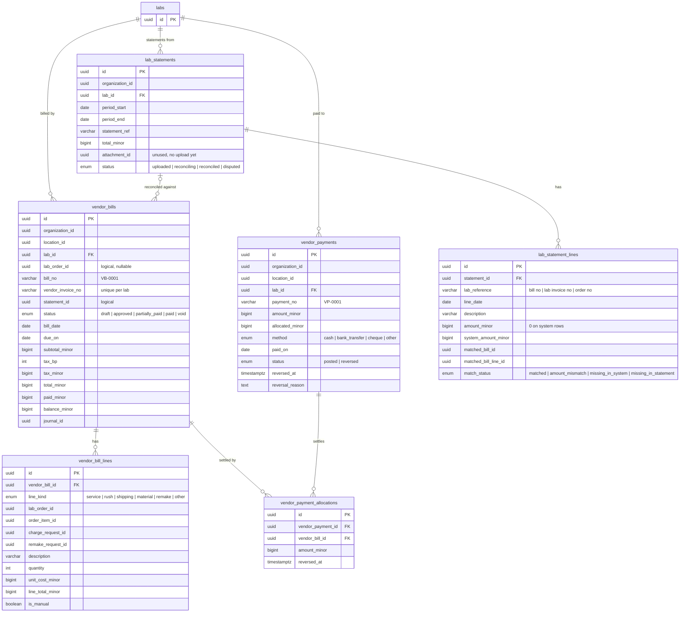

**Rules encoded here**

- **One open draft per order** (`uq_vendor_bills_order_draft`). Every lab accept re-syncs it
  idempotently, and approval re-syncs once more in its own transaction. The draft holds every
  **accepted** item at its frozen `lab_line_cost_minor` (approved item charges included), plus
  approved **order-level** charges.
- Draft planning is incremental: `approved bills + draft = what the order says`. A cost that rose
  after approval (a later approved charge) lands on a **new draft as the difference**; a zero cost
  (lab-fault remake) is listed for the record but never opens a draft; a cost that fell is left to a
  manual credit note.
- Only accepted items are billed: acceptance is detected from `status_history` (`to_state =
  'accepted'`), which survives later state changes and pre-dates the effect.
- Line kinds mirror the cost: `service`, `rush`, `shipping`, `material`, `remake`, `other`.
  `is_manual` lines are preserved across re-syncs.
- `bill_date` is the draft day; `due_on` defaults to `bill_date + lab_clinic_links.payment_terms_days`
  (fallback 30). `tax_bp` is basis points of the subtotal, default 0.
- Approval freezes the lines and posts **Dr LAB_COST / Cr LAB_PAYABLE**. Voiding is refused once
  `paid_minor > 0`; an allowed void posts the mirror journal.
- A vendor payment settles approved / partially paid bills through allocations that never exceed
  the payment or a bill's balance. Journals: **Dr LAB_PAYABLE** (allocated) + **Dr LAB_ADVANCES**
  (unallocated rest) / **Cr CASH|BANK**. Reversal mirrors the journals, reverses the allocations and
  sets `reversed_at`; nothing is deleted.
- Statement reconciliation is reference + amount based: the reference (normalised upper-case) is
  matched against `vendor_invoice_no`, then `bill_no`, else an `order_no` whose bills are summed.
  Each bill is used once. Exact amount → `matched`; different → `amount_mismatch`; unknown reference
  → `missing_in_system`. Unclaimed period bills are added as `missing_in_statement` rows.
  The period is non-void bills with `bill_date` in range and `total_minor > 0`.

---

## 7. Finance hooks: history, events, commission, ledgers

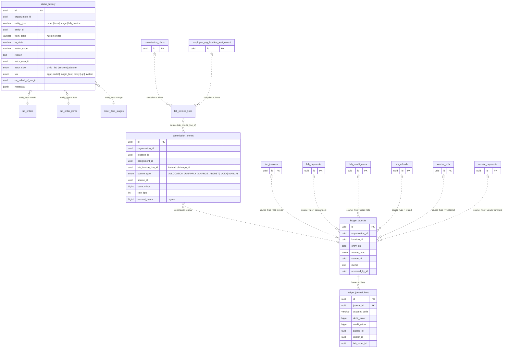

**How the glue behaves**

- `status_history` is **append-only** (UPDATE/DELETE rejected by trigger). States are free text
  because workflows are data. It is the source of truth for "was this item ever accepted?" and for
  every audit trail shown to either side.
- Lab billing emits domain events (`invoiceIssued`, `invoiceVoided`, `paymentCollected`,
  `advanceApplied`, `paymentReversed`, `creditNoteIssued`, `refundPaid`) inside the same
  transaction. `LabFinanceListeners` turns them into commission entries and journals, so money and
  books cannot diverge.

| Operation | Journal |
| --- | --- |
| Issue invoice | Dr PATIENT_RECEIVABLE (total) · Cr LAB_REVENUE (total − tax) · Cr TAX_PAYABLE (tax) |
| Collect payment | Dr CASH/BANK (amount) · Cr PATIENT_RECEIVABLE (allocated) · Cr PATIENT_ADVANCES (rest) |
| Apply advance | Dr PATIENT_ADVANCES · Cr PATIENT_RECEIVABLE (per funding payment) |
| Reverse payment | Dr PATIENT_RECEIVABLE (released) + Dr PATIENT_ADVANCES (rest) · Cr CASH/BANK |
| Credit note | Dr LAB_REVENUE (net) + Dr TAX_PAYABLE (tax) · Cr PATIENT_RECEIVABLE; released money: Dr PATIENT_RECEIVABLE / Cr PATIENT_ADVANCES |
| Refund | Dr PATIENT_ADVANCES · Cr CASH/BANK |
| Approve vendor bill | Dr LAB_COST · Cr LAB_PAYABLE |
| Pay vendor | Dr LAB_PAYABLE (allocated) + Dr LAB_ADVANCES (rest) · Cr CASH/BANK |
| Commission | Dr COMMISSION_EXPENSE / Cr COMMISSION_PAYABLE (negative delta mirrors) |

- Commission is snapshotted **at issue** per line: the doctor's assignment at the invoice's
  location, the compensation plan in force on the issue date, and the resolved rate or fixed amount.
  Nothing is snapshotted while the `billing.commissions` feature is off.
- Lab allocations are per invoice, not per line. A line's collected share is proportional to its
  pre-tax amount:
  `lineCollected = round(preTax × min(allocated, total − credited) / total)`.
  Entries are the **signed difference to a cumulative target**, so installments never drift and a
  reversal or credit note takes commission back automatically.
- `lab-finance` writes standard ledger journals (`source_type` + `source_id`), so months, trial
  balances and doctor settlements pick lab work up without a separate book.

---

## 8. End-to-end flows

### 8.0 The happy path at a glance

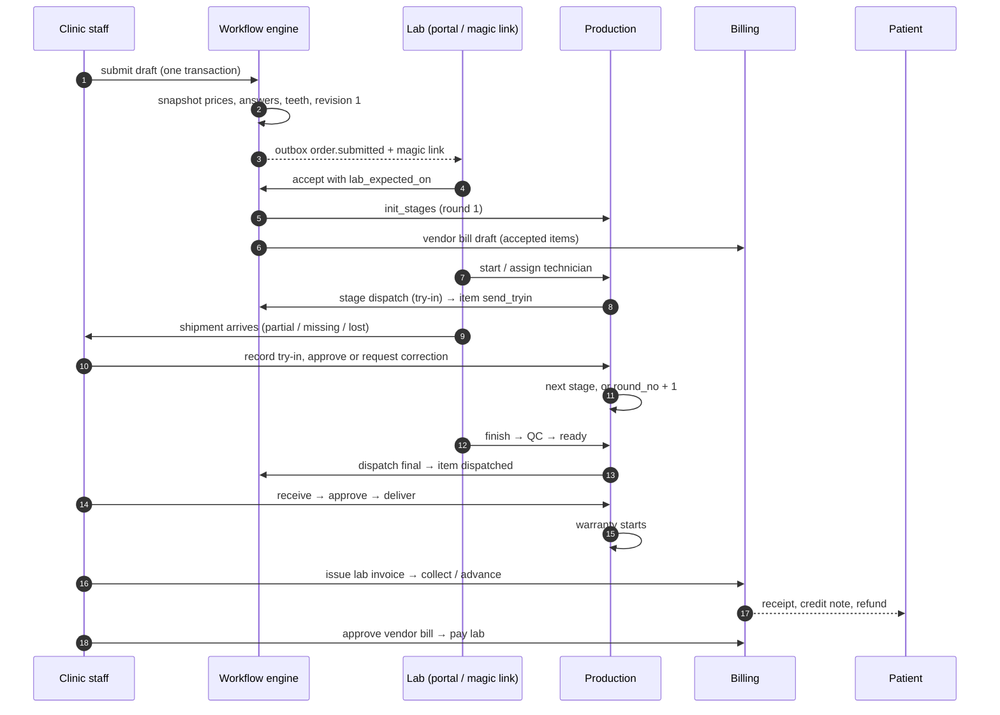

### 8.1 Draft → submit (clinic)

1. **Draft** (`POST` draft, `Idempotency-Key`): creates `lab_orders` in `draft` and its
   `lab_order_items`. The order's `workflow_template_version_id` is pinned now; items keep
   `status_code = null` and no prices. A repeated key returns the same draft
   (`uq_lab_orders_org_idempotency`).
2. **Line entry**: each line points at a `lab_services` row of the chosen lab, carries option ids,
   `rush`, quantity and the form answers. Teeth are charted in the form (`tooth_chart` answers).
3. **Submit** — one transaction:
   - validates the idempotency key, re-reads the locked draft;
   - validates every answer against the **pinned** `form_schema_version`;
   - derives `quantity` from teeth for `per_tooth` services (`teeth_required` otherwise);
   - resolves **both** prices on the submit day (lab cost from `lab_service_prices`, patient price
     from the mapped clinic treatment), and refuses a line whose service belongs to another lab;
   - writes the snapshot columns, `item_teeth`, `dental_item_details` (promotions) and
     `item_form_responses` (normalised answers, `validated_at`);
   - transitions `draft → submitted`, assigns `LAB-xxxx`, sets `current_revision_no = 1`,
     estimates `lab_expected_on` (requested day, else submit day + longest turnaround);
   - writes `order_revisions` rev 1 (full snapshot), item `status_history` rows, flips the template's
     `use_count`, and enqueues `order.submitted` (lab recipients only) in the outbox;
   - creates a magic link when the lab has a phone/WhatsApp/email;
   - completes the idempotency record. Any failure rolls all of it back.
4. **Warnings** do not block submit: `LAB_DUE_AFTER_NEXT_APPOINTMENT` when the estimated return is
   after the patient's next appointment.

### 8.2 Lab receives the order: accept / clarify / reject

| Action | Who | Effect |
| --- | --- | --- |
| **Accept** | `lab_admin` | Requires a future `lab_expected_on`. Writes it on the order, accepts every `pending_acceptance` line, derives the order to `accepted`, notifies the doctor. |
| **Clarify** | `lab_admin` | Optional `item_id`; writes an `order_messages` row (`clarification_request`) and transitions the order to `clarification_needed`. The clinic's reply is a revision. |
| **Reject** | `lab_admin` | Requires a reason; `submitted → rejected_by_lab`. The clinic can `reopen → draft` and fix it. |

Accept is the **fan-out point**: each accepted item triggers `init_stages` (round 1 of its stage
template) and the vendor-bill draft sync. Both run from the item-transition listener, so they also
happen for old workflow versions that never listed the effect; both are idempotent.

### 8.3 Revisions and charge requests

**Revision** (`revise`): allowed while the order is `submitted`, `accepted`, `in_progress`,
`partially_ready`, `ready`, `partially_received`, `under_review` or `clarification_needed`.

- Changes answers/options/rush/quantity per line, re-validates the form, re-derives teeth/quantity,
  and **re-prices on the original `priced_on` day** (not today) so a later price-list change cannot
  silently re-price existing work.
- Re-applies approved item charges on top of the re-priced line, bumps `current_revision_no`,
  writes a new `order_revisions` snapshot, and — if the order was `clarification_needed` — resolves
  the open clarifications and transitions `reply → submitted`.
- Never overwrites the previous revision.

**Charge request** (`requestCharge`, lab side): `kind` (rush/material/shipping/other), amount, reason,
optional `item_id`.

- Clinic `decideCharge` (needs `lab.orders.create`): approve or reject with a note. Approved
  **item-level** charge → `lab_line_cost_minor += amount` (a controlled snapshot write), so it flows
  into the vendor bill. Approved **order-level** charge stays a separate row and is billed to the
  patient as `lab_charge` and to the lab as a bill line.
- Charges are idempotent by state: a decided charge cannot be decided again.

### 8.4 Production: start → technician → stages → try-in loop → finish → QC → ready

1. **Start** (`lab` staff): `accepted → in_production`. Stages are created if missing and round 1
   starts (`ensureActiveStage`), with `started_at` set.
2. **Assign** a technician: closes the open `item_assignments` row (if any) and inserts a new one.
   One open assignment per item is a partial unique index.
3. **Try-in round** (only when the stage template has more than one step):
   - lab dispatches the round (`stage: at_lab → sent_to_clinic`, item `send_tryin`);
   - clinic receives (`stage: sent_to_clinic → received`, item `received`/`waiting`);
   - clinic records the visit (`record_tryin`) with an optional appointment;
   - doctor **approves** → stage `approved`; if it was not the final step, the item goes `resume`
     (`in_production`) and the listener starts the next stage; if it was the final step, the item is
     approved directly;
   - doctor **requests correction** → stage `correction` with `outcome = correction` and notes; a new
     round (`round_no + 1`) is inserted and the item goes back to production. Corrections are
     refused on the final stage — final work is approved or rejected (remake).
4. **Finish** (`finish`): `in_production → qc`. **QC fail** (reason required) → back to
   `in_production`; **QC pass** → `ready`. Final work must be `ready` before it can ship.
5. Item without stages (single-step service): no `order_item_stages` at all; it goes straight from
   `in_production` to `qc` to `ready`.

### 8.5 Shipments: dispatch → receive (partial / missing / lost)

**Dispatch** (`to_clinic` = lab ships, `to_lab` = clinic ships):

- Builds one `shipments` row (`SHP-xxxx`, `qr_token`) with lines across orders of one clinic + lab.
- `to_clinic` planning is driven by the **active stage**:
  - non-final round at the lab → contents `tryin`, item `send_tryin`, stage `dispatch`;
  - final round → item must be `ready` (QC passed) → item `dispatch`, stage `dispatch`;
  - item without stages → only `ready` may ship;
  - work whose earlier shipment was lost/missing may ship again without a status change.
- `to_lab` lines record impressions/models/work returning for a correction; they do not move item
  status.

**Receive** (only the receiving side; QR or app):

- Per line: `received_qty`, `condition`, `qc_result`, notes. `missing` closes the line with
  `received_qty = 0`; a received `to_clinic` line drives stage `receive` and item `receive`.
- Lines left out stay open → shipment becomes `partially_received`. All lines closed → `received`.
- **Lost** marks every open line `missing`, sets `lost_at`/`lost_reason`, status `lost`, and leaves
  the work owed: the item/stage is not advanced, so the lab can remake and ship again.

### 8.6 Approve → deliver → warranty

1. Doctor **approves** received work. With stages this is the final stage's `approve`; an item
   without stages is approved directly. `received → approved`.
2. **Deliver** (`approved → delivered`), the doctor confirms the fit. The item listener starts the
   warranty: `starts_on = delivery day`, `ends_on = day before the N-month anniversary`, default
   12 months, one row per item.
3. Order status derives to `completed` when **all** items are approved/delivered (a manual hold on
   the order wins while it is on).

### 8.7 Remake decision and responsibility pricing

- **Trigger**: doctor rejects received final work (`reject_work`, reason required) → item
  `remake_required`, final round closes as `rejected`, a `remake_requests` row opens. Or, after
  delivery, `requestRemake` (after-care: a fracture months later) leaves the item `delivered` but
  opens a request.
- **Warranty check**: an active warranty on the decision day sets `is_warranty_claim = true` and
  `warranty_id`. `disputed` is allowed (the lab disagrees) and still counts as open.
- **Decision** (`decideRemake`, one transaction, pessimistic lock + version):
  - `close` → status `closed`, no new item;
  - `agree` → status `agreed`, responsibility set, **new item** created with
    `remake_of_item_id`, copying the original's snapshot/answers/teeth/details, line number
    `max + 1`, at the workflow's initial state; the order is re-derived with `reopen` (a completed
    order reopens), and the lab is notified.

| `responsible_party` | Lab charge | Patient charge |
| --- | --- | --- |
| `lab` (lab's fault) | 0 | 0 |
| `clinic` | frozen lab cost | 0 |
| `patient` | frozen lab cost | frozen patient price |
| `undetermined` | not agreed yet | not agreed yet |

The new item is then accepted/billed like any other, and the vendor-bill draft includes it with the
responsibility's cost (a lab-fault remake is a 0 line, kept for the record).

### 8.8 Patient billing: draft → issue → pay/advance → credit → refund

1. **Create draft** from an order (or a patient): default lines = every unbilled billable item at
   its frozen patient price (teeth in the description); approved charge requests and manual lines
   can be added. Tax rate comes from `lab_billing_settings.tax_rate_bp` (or the request).
2. **Edit draft** freely (lines are replaced; the estimate is not a posted record). Only a draft can
   be edited.
3. **Issue** (`draft → issued`): requires ≥1 line; assigns `LINV-xxxx`, sets `issued_on`/`due_on`,
   recomputes totals, snapshots commission per line, and optionally **applies the patient's
   advance** (oldest payment first) — which may leave it `partially_paid` or `paid` immediately.
   Journal: Dr Patient Receivable / Cr Lab Revenue + Tax Payable.
4. **Collect** (`POST` payment with idempotency key): `LRC-xxxx`, method, optional allocations to
   invoices. Allocations ≤ payment and ≤ each invoice's balance; unallocated rest is advance.
   Journal: Dr Cash/Bank / Cr Receivable (allocated) + Cr Patient Advances (rest).
5. **Reverse a wrong payment**: mirror row (`LRV-xxxx`, negative amount, `reversal_of_id`), releases
   its allocations back to advance and mirrors the journal. Never deletes.
6. **Credit note** (`LCN-xxxx`): lowers an issued invoice (not `void`). Tax is apportioned from the
   invoice's tax. Paid money above the new total is released from the **newest** allocations to
   advance (`released_minor`), then the note is `issued`, `applied` or `refunded`.
7. **Refund** (`LRF-xxxx`): pays out of advance only, with `lab_refund_sources` naming each funding
   payment; optional `credit_note_id` makes it the note's payout.
8. **Void** an issued invoice only when it has **no payments and no credits**; its lines are marked
   `is_void`, which frees the items/charges for another invoice, and the issue journal is reversed.

### 8.9 Vendor bill: draft → approve → pay → reverse

1. **Draft** is created/synced at lab accept (and before approval) from accepted items' frozen lab
   costs + approved order-level charges. Repeated syncs only insert/update the delta; manual lines
   survive.
2. **Review** the draft: add/remove manual lines, set `vendor_invoice_no`, `tax_bp`, `due_on`
   (default `bill_date + payment_terms_days`). A 0-total bill cannot be approved — void it instead.
3. **Approve**: re-syncs once in its own transaction, recomputes totals, freezes the lines, sets
   `approved_by/at` and posts Dr LAB_COST / Cr LAB_PAYABLE. One journal per bill (`journal_id`).
4. **Pay**: `VP-xxxx` with method/date, allocations to approved/partially paid bills. Dr LAB_PAYABLE
   (allocated) + Dr LAB_ADVANCES (rest) / Cr Cash/Bank. Bill `paid_minor`/`balance_minor` and status
   (`partially_paid`/`paid`) are recomputed in the allocation's transaction.
5. **Reverse a payment**: mirrors the journals, reverses every allocation, sets `reversed_at`; bills
   return to their previous balance and an unallocated rest is no longer an advance.
6. **Void a bill**: refused if `paid_minor > 0`; otherwise posts the mirror of the approval journal
   and marks the bill `void` (never deleted).

### 8.10 Statement reconciliation

1. Accountant creates a statement for a lab and period (`uploaded` conceptually; no file upload yet).
2. Each statement line carries the lab's reference and amount. The reconciler normalises references
   and matches: `vendor_invoice_no` → `bill_no` → `order_no` (sum of that order's bills).
3. Each bill is claimed once. Result per line: `matched`, `amount_mismatch` (system amount differs),
   or `missing_in_system` (no such bill). Period bills no line claimed become
   `missing_in_statement` rows with `amount = 0` and `system_amount`.
4. Status: all lines matched and nothing missing → `reconciled`; otherwise `reconciling`.
   The accountant can set `reconciled` or `disputed` with a note (`setStatus`).
5. Matched bills get `statement_id`, so a later statement can see what was already reconciled.

### 8.11 Commission and ledger posting

- **At issue**: each non-void line with a doctor snapshots assignment, plan, rate (or fixed amount).
  A line with no doctor or no plan earns nothing.
- **On every money event** (`collect`, `applyAdvance`, `reverse`, `credit note`, `void`): the
  listener recomputes each line's collected share and writes `target − already` into
  `commission_entries` (signed). Cumulative target means partial payments, reversals and credit
  notes self-correct without manual adjustment.
- **Basis**: `net_of_lab_cost` uses the line's lab cost — an approved vendor-bill line's cost, else
  the item's frozen `lab_unit_cost_minor`; an order-level charge has no lab cost.
- **Journal**: positive delta Dr Commission Expense / Cr Commission Payable; negative mirrors.
  Settlement/payroll reads the same entries as billing v2.
- **Receivables ledger**: the seven lab billing events post the journals in §7, so lab revenue, tax,
  patient receivables/advances and cash all land in the standard `ledger_journals` /
  `ledger_journal_lines` pair with patient/doctor/order tags.

---

## 9. State machines

### 9.1 Order — manual transitions plus derivation from items

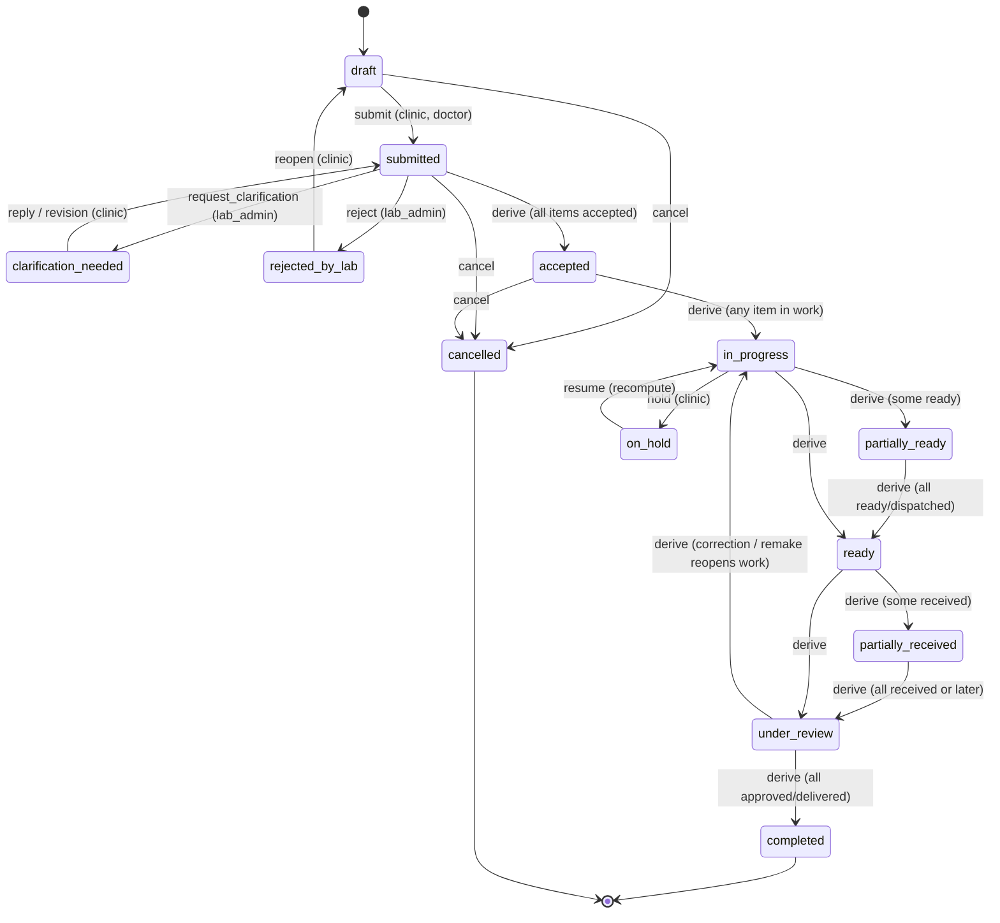

`deriveOrderStatus` order of precedence: all items cancelled → `cancelled`; manual hold →
`on_hold`; all finished → `completed`; all received+ → `under_review`; any received+ →
`partially_received`; all ready/dispatched → `ready`; any ready → `partially_ready`; any in work →
`in_progress`; all accepted → `accepted`; else `submitted`. `draft`, `clarification_needed`,
`rejected_by_lab`, `cancelled` are **not** derivable — only manual transitions set them.

### 9.2 Item lifecycle

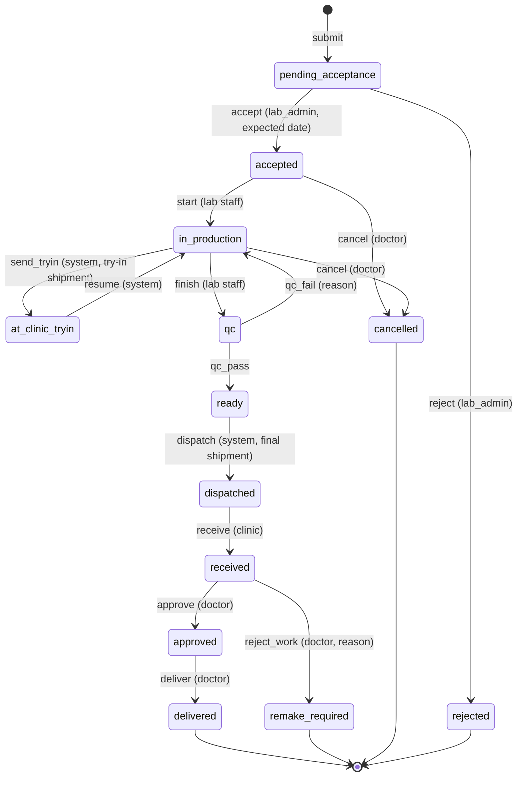

### 9.3 Stage round (one try-in step)

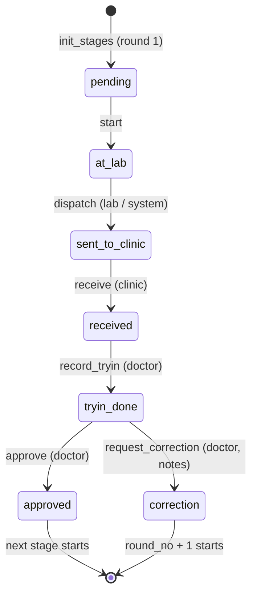

A correction closes the round; the same `seq` reopens as `round_no + 1`. The final stage cannot be
"corrected" — it is approved or the item is rejected into a remake.

### 9.4 Shipment

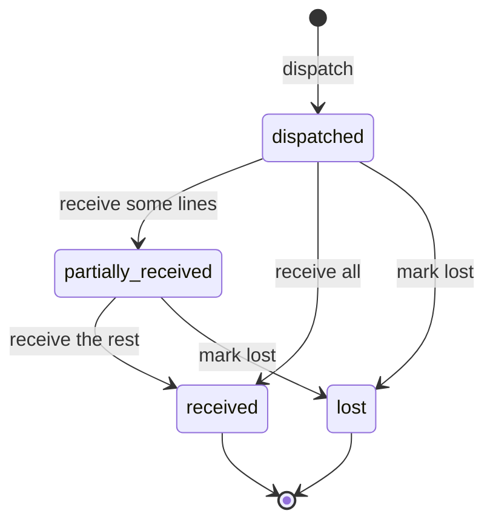

Open lines of a lost shipment become `condition = missing`; the work stays owed and can ship again.

### 9.5 Lab invoice

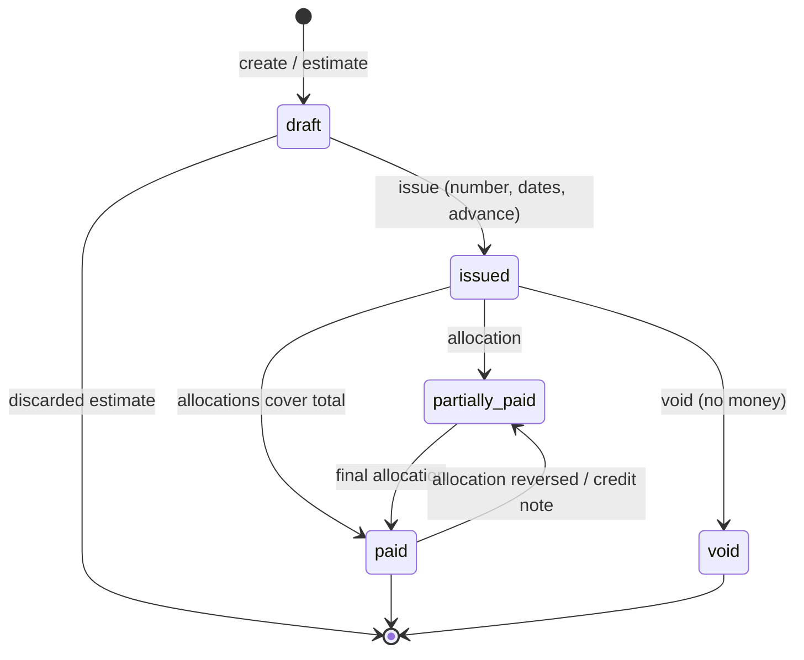

Status is a cached projection written by `LabBillingTotals`; `void` requires no payments and no
credits.

### 9.6 Vendor bill

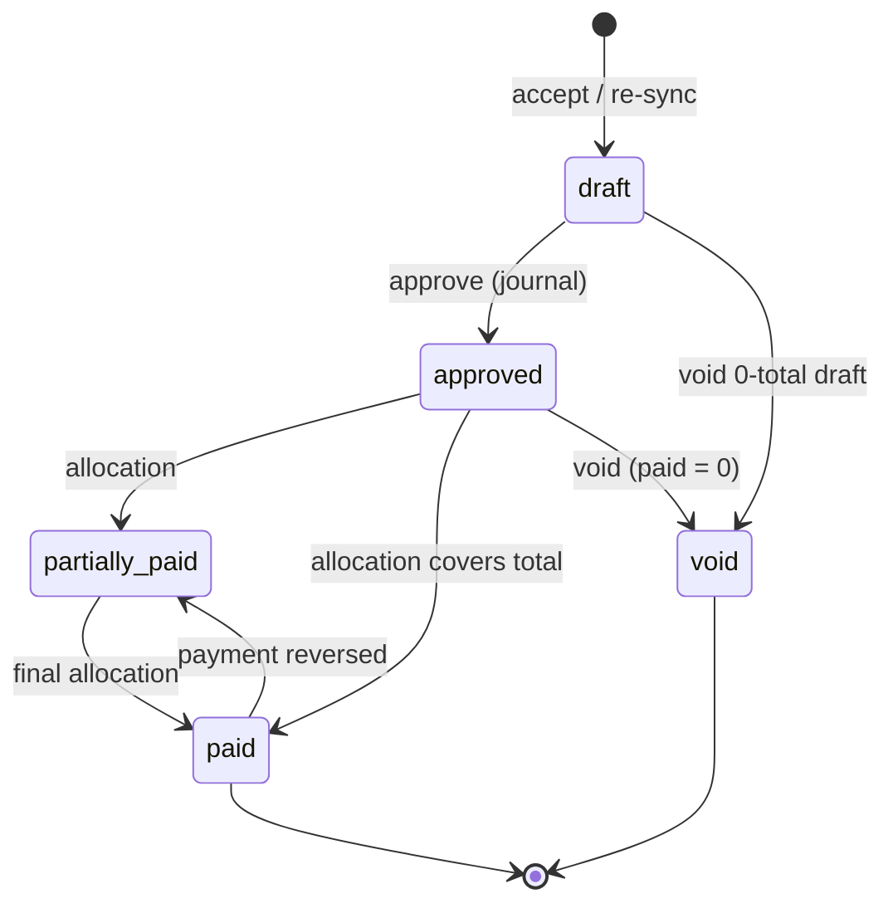

### 9.7 Remake request

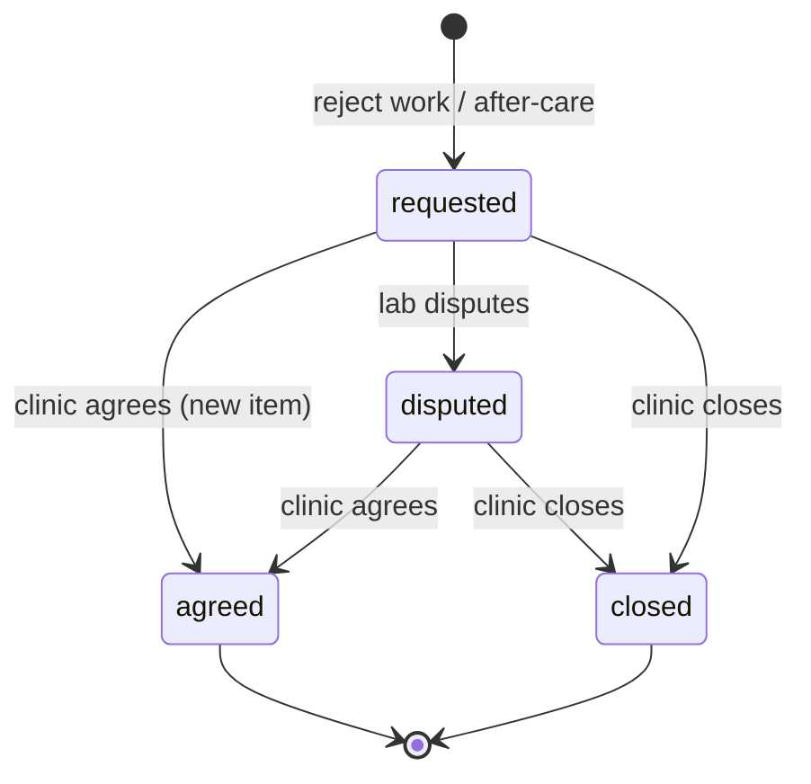

One open request (`requested`/`disputed`) per original item. `agreed` creates the replacement item.

### 9.8 Lab link and magic link

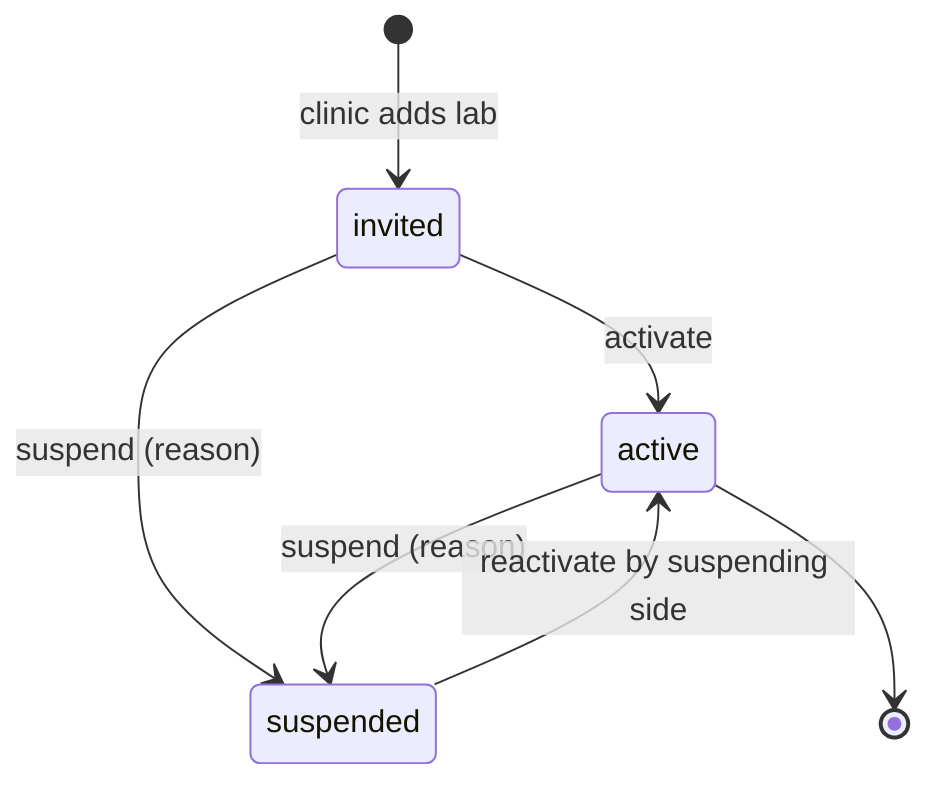

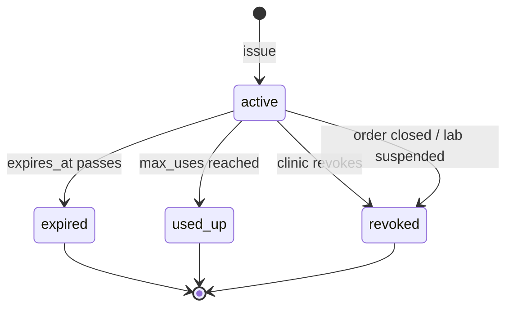

---

## 10. Invariants

| # | Invariant | Enforced by |
| --- | --- | --- |
| 1 | An external lab has no owner; an internal lab has exactly one. | `chk_labs_owner` |
| 2 | One link per clinic + lab. | `uq_lab_clinic_links_lab_org` |
| 3 | A submitted item's snapshot/price columns only change through a revision or an approved charge. | `SnapshotFreezeSubscriber` (app-level; no triggers in this repo) |
| 4 | Revision numbers are unique per order and never overwritten. | `uq_order_revisions_no` |
| 5 | One active stage round per item. | Partial unique `uq_order_item_stages_one_active` |
| 6 | Stage rounds are unique per `(item, seq, round_no)`. | `uq_order_item_stages_round` |
| 7 | One open technician assignment per item. | Partial unique `uq_item_assignments_open` |
| 8 | One open remake request per original item. | Partial unique `uq_remake_requests_open` |
| 9 | One remake item per request. | `uq_remake_requests_new_item` |
| 10 | One warranty per item. | `uq_item_warranties_item` |
| 11 | An item/charge is on at most one non-void invoice line. | Partial uniques `uq_lab_invoice_lines_item` / `_charge` |
| 12 | The same payment key never creates a second payment. | `uq_lab_payments_org_idempotency` |
| 13 | Allocations ≤ payment; each ≤ invoice balance. | CHECK + locked allocation service |
| 14 | A payment has at most one reversal. | `uq_lab_payments_reversal_of` |
| 15 | One open draft vendor bill per order. | Partial unique `uq_vendor_bills_order_draft` |
| 16 | A bill total is `subtotal + tax`; balances never negative. | `chk_vendor_bills_minor` |
| 17 | Payment allocations ≤ payment and ≤ bill. | CHECK + `lockBills` |
| 18 | One active mapping per lab service, one default per treatment. | Partial uniques on `service_mappings` |
| 19 | Price windows never overlap for the same service + clinic. | `excl_lab_service_prices_overlap` |
| 20 | `status_history` is append-only. | DB trigger |
| 21 | Lab money is integer paisa; tax is basis points. | `MinorColumn`, CHECK constraints |
| 22 | Every status change goes through the workflow engine. | Services call `transitionIn`; state columns are not written directly |

---

## 11. Known gaps

- **No statement file upload.** `lab_statements.attachment_id` exists but nothing writes it;
  statements are entered line by line (`attachment_id` is unused).
- **`receive_shipment` magic-link purpose is unused.** The enum value and `magic_links.shipment_id`
  exist for a future shipment link; receiving today uses the QR token on the shipment slip.
- **Payables are partly API-only.** Manual bill edits and explicit `allocate` of an existing vendor
  payment have no admin UI yet (the services exist).
- **Overdue notifications are seeded but not emitted.** The notification catalogue has overdue-order
  entries; no scheduler reads `lab_expected_on` to send them.
- **Lab journals are not in reports.** `lab-finance` posts standard journals, but no report screen
  aggregates lab revenue/payables by lab yet.
- **Snapshot freeze is app-level.** There are no migration files/triggers for frozen item columns, so
  a direct SQL update can bypass it (unlike `status_history`, which has a trigger).
- **`vendor_bills.lab_order_id` and `statement_id` are plain uuids** (no FK), and `shipments` has no
  FK to `labs`/`organizations`; integrity is maintained by the services, not the database.
- **Lab commission depends on the `billing.commissions` feature flag**; with it off, lines are
  snapshotted as "no commission" and a later enable does not backfill them.

---

## 12. Source index

| Concern | Files |
| --- | --- |
| Lab directory, links, members, portal guard | `backend/src/labs/**` (`entities/lab.entity.ts`, `entities/lab-clinic-link.entity.ts`, `entities/lab-member.entity.ts`, `links/*`, `portal/*`, `members/*`) |
| Catalog & pricing | `backend/src/lab-catalog/**` (`entities/*`, `pricing/lab-price-resolver.service.ts`) |
| Orders, drafts, submit, revisions | `backend/src/lab-orders/**` (`entities/*`, `services/order-drafts.service.ts`, `services/order-submit.service.ts`, `services/lab-orders.service.ts`, `snapshot/snapshot-freeze.ts`, `submit/order-lines.ts`) |
| Order status derivation | `backend/src/engine/workflows/order-status.ts` |
| Workflow seeds (states/transitions/roles) | `backend/src/engine/seeds/dental-workflows.seed.ts` |
| Production, stages, assignments | `backend/src/lab-production/workflow/production-workflow.service.ts`, `services/lab-work.service.ts` |
| Try-in, approve, deliver, remake | `backend/src/lab-production/services/clinic-production.service.ts` |
| Shipments | `backend/src/lab-production/services/shipments.service.ts` |
| Access actions & magic links | `backend/src/lab-access/**` (`actions/lab-order-actions.service.ts`, `magic-links/*`, `controllers/*`) |
| Patient receivables | `backend/src/lab-billing/**` (`entities/*`, `services/*`, `events/lab-billing-events.ts`) |
| Lab payables & statements | `backend/src/lab-payables/**` (`entities/*`, `services/*`, `common/payables-math.ts`) |
| Commission & ledger | `backend/src/lab-finance/**` (`lab-commission.service.ts`, `lab-receivables-ledger.service.ts`, `lab-commission-math.ts`) |
| Handbooks | `docs/handbook/src/part4-data-model/ch25-labs.md`, `part5-modules/ch42-lab-finance.md`, `part6-workflows/ch49-dental-lab-case.md` |
| Field-level reference | `backend/docs/data-model/ENTITY_CATALOG.md` |
